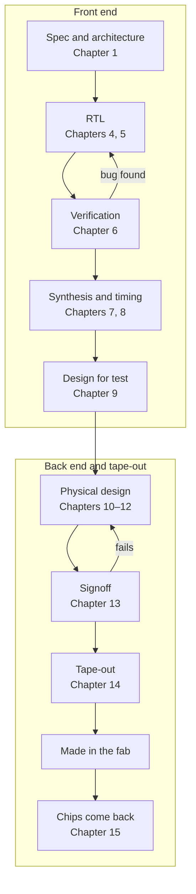

<!-- source: zh-TW/0-before-you-start/00-overview/README.md | sha: 7d0712dfe5e7 -->

# Chapter 0: The Big Picture — The Journey of a Chip Design

> 📍 **Where the design is**
>
> - Previous stop: not started yet
> - **This chapter: a bird's-eye view of a chip's journey from idea to tape-out, and the book's two main characters**
> - Next stop: specification and architecture, deciding what kind of chip to build

🪜 Abstraction level: **Spec ▸ RTL ▸ Netlist ▸ Layout ▸ GDS ▸ Chip**

---

## A chip is designed first

A fab uses dozens of masks to build transistors and wires on a wafer, one layer at a time. But where do the patterns on those masks come from? The answer is IC design. **Integrated circuit** (IC) design turns an idea, such as "let the camera recognize a cat in the photo in real time," step by step into geometric shapes that a fab can manufacture. It is a lot like building a house: first make the requirements clear, then draw the design and the construction drawings, and finally hand the drawings to the builder.

*Introduction to Semiconductor Manufacturing* follows one wafer through the fab. This book is its prequel: it follows a piece of code up to the moment the masks are handed to the factory.

---

## The book's two main characters

- **A chip**: `tiny_npu`, a small AI inference chip. It has 64 multiply-accumulate units, two 64 KB memories and an interface through which a CPU gives it commands. Its target is 32 billion multiply-accumulates per second. The specification is made up for teaching, but every decision in it is one a real chip faces.
- **A unit**: `mac`, one of those multiply-accumulate units. It does only one thing: it multiplies two 8-bit numbers and adds the product into an accumulator.

Most of the work in a neural network is "multiply a list of numbers by a list of weights and add everything up." So the heart of an AI chip is a large array of multiply-accumulate units. `mac` is small; a dozen or so lines of Verilog are enough to write it. Yet it passes through every stop in the book: it is written as code, found to have a bug, turned into nearly a thousand logic gates, copied 64 times into the chip, and finally, on real silicon, reveals a problem that had been hiding for a long time.

> [!NOTE]
> **📖 Term | Multiply-accumulate unit (MAC) (乘加單元)**
>
> - **Definition**: A circuit that multiplies two numbers and adds the product into an accumulator.
> - **On the job**: AI chips are often compared by their number of MACs and how many multiply-accumulates they do per second, as in "This generation doubled the MAC count."
> - **Related terms**: accumulator, dot product, neural processing unit (NPU)
> - **Common confusion**: The MAC address of network equipment (Media Access Control) is something else; the abbreviation just happens to be the same.

---

## Map of the journey

**Spec → RTL → Verification → Synthesis → Timing analysis → Design for test → Physical design → Signoff → Tape-out**

| Stage | What happens | Chapters |
|---|---|---|
| Spec and architecture | Decide what the chip does, how fast, and how much area and power it may use | 1 |
| Register transfer level (RTL) | Write down the behavior of the circuit in a hardware description language | 4, 5 |
| Verification | Prove that the RTL works as the spec says | 6 |
| Synthesis and timing analysis | Turn the RTL into logic gates, and confirm every path keeps up with the clock | 7, 8 |
| Design for test | Add circuits that let the factory find bad chips | 9 |
| Physical design | Place the logic gates on the chip and connect the wires | 10–12 |
| Signoff and tape-out | Finish every check, and hand the layout to the fab | 13, 14 |
| After the chips come back | Bring them up, debug them, and fix the design if needed | 15 |

Chapters 2 and 3 are not on the map. They fill in the digital logic you need for the trip.

---

## Front end and back end

The most common way to divide IC design is into the **front end** and the **back end**:

- **Front end**: from the spec to the netlist. It deals with whether the logic of the circuit is right, and includes RTL, verification and synthesis.
- **Back end**: from the netlist to the layout. It deals with whether the circuit fits, whether it can be wired up, and whether it runs fast enough. It is also called physical design.

> [!NOTE]
> **📖 Term | Front end and back end (前段與後段)**
>
> - **Definition**: In IC design, the front end means logic design and verification, and the back end means physical design.
> - **On the job**: "She's a front-end designer," "The netlist has gone to the back-end team."
> - **Related terms**: RTL, netlist, physical design, signoff
> - **Common confusion**: *Introduction to Semiconductor Manufacturing* also has a front end and a back end, meaning wafer fabrication and packaging and test, and inside a fab there are also FEOL and BEOL. When you hear these words, check whether the speaker works at a design house or a fab.

---

## Who does what

A chip is usually made by several kinds of companies working together:

| Role | What it does |
|---|---|
| Fabless IC design company | Defines the product, designs the chip and sells it, but has no factory of its own |
| Silicon IP vendor | Provides ready-made circuit blocks, such as CPU cores, memories and interface circuits |
| Electronic design automation (EDA) vendor | Provides the software used at every step, such as synthesis, simulation and physical design |
| Design service company | Does the back-end design or the tape-out flow on the customer's behalf |
| Foundry | Manufactures the chip and provides the design rules and cell libraries |
| OSAT | Packages the chip and tests it before shipment |

The design team divides the work too. Architects write the spec; front-end designers write the RTL; verification engineers prove that the RTL is right, and there are often more of them than designers; design for test (DFT) engineers make sure the factory can find bad chips; physical design engineers turn the circuit into a layout; CAD engineers maintain the tools and flows. After the chips come back, test, product and firmware engineers take over.

> [!NOTE]
> **📖 Term | Silicon intellectual property (IP) (矽智財)**
>
> - **Definition**: A ready-made circuit block that you can license and put into your own chip.
> - **On the job**: "We're buying the PLL as IP," "Has this IP been proven in this process?"
> - **Related terms**: memory compiler, standard cell library, PDK
> - **Common confusion**: It has nothing to do with network IP addresses. When chip designers say IP, they usually mean a circuit block, not intellectual property in the legal sense.

---

## Digital, analog, and the scope of this book

The circuits on a chip fall into two broad kinds. **Digital circuits** deal only with 0s and 1s; they can be described in RTL and synthesized automatically by tools. **Analog circuits** deal with voltages that change continuously, such as the phase-locked loop (PLL) that makes the clock, analog-to-digital converters and power circuits, and are mostly designed by hand. This book follows only the digital flow. The PLL in `tiny_npu` is an analog circuit, so it is simply bought as IP.

A digital circuit does not have to become a dedicated chip. A **field-programmable gate array** (FPGA) is a chip whose internal logic can be reconfigured: changing the design only means downloading it again, with no new masks. FPGAs are often used to try out a design before tape-out (Chapter 6), or in products that sell in small volumes. A chip made for one specific purpose is an **application-specific integrated circuit** (ASIC). Its up-front cost is high, but in large volumes each chip is cheaper, faster and uses less power.

> [!IMPORTANT]
> **💻 Software analogy | Tape-out is like shipping a release that can never be updated**
>
> - **Like**: A software release: freeze the code, tag a version number, ship it.
> - **Unlike**: After tape-out, it takes months to get real chips back. As of the mid-2020s, a mask set for a mature process such as 28 nm costs on the order of a million dollars; older processes cost much less, and the most advanced ones many times more. When you find a bug, you cannot push an update; you can only make a new version of the chip, or ask the firmware to work around it.
> - **Watch out**: The software habit of "ship first, fix later" is very expensive in silicon. That is why hardware teams often spend more effort on verification than on writing RTL.

> [!TIP]
> **🔧 Know-how | The earlier you find a problem, the cheaper it is to fix**
>
> - **Situation**: The same bug might be found while writing the RTL, during verification, just before tape-out, or after the chips come back.
> - **Practice**: Move the checks as early as possible: run static checks as soon as the RTL is written, verify in parallel with the RTL, and look at timing right after synthesis.
> - **Why**: At the RTL stage, changing a line takes minutes. Found after the chips come back, the same bug means new masks, months of delay and a lot of money.
> - **If you skip it**: The bug slips all the way into silicon, and the whole product's launch slips with it. That is exactly what happens to `mac` in Chapter 15.
> - **Related chapters**: [Chapter 6: Verification](../../2-front-end/06-verification/README.md), [Chapter 15: After Silicon Returns](../../4-to-the-fab/15-after-silicon/README.md)

> [!TIP]
> **🔧 Know-how | The schedule is planned backward from the tape-out date**
>
> - **Situation**: The first version of the chip will be taped out on a foundry's shared shuttle, and the shuttle dates are fixed.
> - **Practice**: Work backward from the tape-out date to set a finish date for every stage, and leave some buffer.
> - **Why**: Miss a shuttle and you may wait another month or two, and the product launch slips too.
> - **If you skip it**: Every stage runs a little late, the delays pile up on signoff, and people skip checks to make the tape-out date. That is how bugs get out.
> - **Related chapters**: [Chapter 14: Tape-out](../../4-to-the-fab/14-tape-out/README.md)

---

## Key takeaways

1. IC design turns an idea into geometric shapes that a fab can build. This book is the prequel to *Introduction to Semiconductor Manufacturing*.
2. There are two main characters: the AI inference chip `tiny_npu`, and the multiply-accumulate unit `mac` inside it.
3. The flow is roughly spec, RTL, verification, synthesis, timing, design for test, physical design, signoff and tape-out. The front end deals with logic, the back end with the physical chip.
4. A chip is made by design companies, IP and EDA vendors, foundries and packaging and test companies working together.
5. A chip is very hard to change after tape-out, so the earlier a problem is found, the cheaper it is.

---

## Further reading

- Neil H. E. Weste and David Money Harris, *CMOS VLSI Design: A Circuits and Systems Perspective*, 4th edition, Chapter 1
- *Introduction to Semiconductor Manufacturing*, [Chapter 0: The Big Picture](https://github.com/chenwei810/Semiconductor_Manufacturing_Introduction/blob/main/en/0-before-you-start/00-overview/README.md)

---

[Contents](../../README.md) | [Chapter 1: Specification and Architecture →](../01-spec-and-architecture/README.md)
