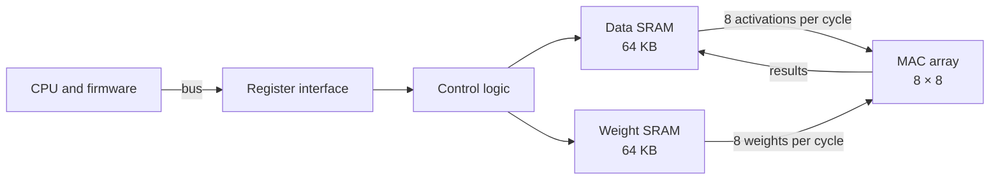

<!-- source: zh-TW/0-before-you-start/01-spec-and-architecture/README.md | sha: 0001bf06d141 -->

# Chapter 1: Specification and Architecture — Deciding What Chip to Build

> 📍 **Where the design is**
>
> - Previous stop: the big picture, the design flow and the two main characters
> - **This chapter: writing the specification and architecture of `tiny_npu`, and deciding how many bits `mac` uses**
> - Next stop: from transistors to logic gates, seeing what circuits the operations in the spec are built from

🪜 Abstraction level: **Spec** ▸ RTL ▸ Netlist ▸ Layout ▸ GDS ▸ Chip

---

## The specification: what everyone works from

Before building a house, you need to say how many rooms it has, what the budget is and when you will move in. A chip is no different. Before anyone writes RTL, there must be a **specification** that says what the chip does, how fast it runs, how much area and power it may use, what its interfaces look like and when it tapes out.

Every later stage follows the spec: designers build to it, verification engineers check against it, and firmware engineers write drivers from it. Wherever the spec is vague, each person fills the gap with their own assumptions.

> [!NOTE]
> **📖 Term | Specification (規格書)**
>
> - **Definition**: A document that describes a chip's functions, performance, interfaces and limits; the common reference for design and verification.
> - **On the job**: Usually just called the spec, as in "The spec doesn't cover this case. Ask the architect."
> - **Related terms**: architecture document, register map, verification plan
> - **Common confusion**: A spec is not a datasheet. A datasheet describes the product for customers; a spec is the team's design reference and contains many internal details.

---

## What tiny_npu computes

A neural network that recognizes images has dozens of layers. Each layer does much the same thing: it takes a small piece of input data, multiplies it item by item with a set of weights, and adds everything up. This operation is called a **dot product**.

Take a common convolution layer. Each output point looks at a 3 × 3 patch of the input image, and the input has 128 channels. So one output point is the sum of 3 × 3 × 128 = 1,152 products. An image has tens of thousands of output points, and each one needs such a dot product.

So `tiny_npu` needs three things: a large array of multiply-accumulate units, **static random-access memories** (SRAMs) to feed them, and a way for the CPU to give commands.

To save area and power, `tiny_npu` does not use floating point. It converts both the data and the weights to 8-bit integers, called **INT8**. An 8-bit signed integer can represent -128 to 127.

> [!NOTE]
> **📖 Term | Quantization (量化)**
>
> - **Definition**: Converting the weights and data of a neural network from floating point to integers with fewer bits.
> - **On the job**: "After quantizing the model to INT8, the accuracy dropped only a little."
> - **Related terms**: INT8, floating point, accumulator, saturation
> - **Common confusion**: 8-bit inputs do not mean 8-bit results. Multiplying two 8-bit numbers gives 16 bits, and adding up more than a thousand of them gives an even bigger number.

---

## Architecture: drawing the block diagram

The spec says what to do; the **architecture** says which blocks to use and how to connect them. The architecture of `tiny_npu` looks like this:

Every clock cycle, the data SRAM sends out 8 activations and the weight SRAM sends out 8 weights. The MAC in row `r`, column `c` multiplies activation `r` by weight `c` and adds the product into its own accumulator. All 64 MACs do this at the same time; after 1,152 cycles, they hold 64 output points.

| Item | Specification |
|---|---|
| Multiply-accumulate units | 8 × 8 = 64, INT8 inputs, 24-bit accumulator that saturates on overflow |
| Memories | Data SRAM and weight SRAM, 64 KB each |
| Clocks | 500 MHz on the compute side, 100 MHz on the bus side |
| Peak performance | 64 × 500 MHz = 32 billion multiply-accumulates per second |
| Process | A 28 nm-class mature process; the die is about 2 mm on a side |

Firmware controls `tiny_npu` through a few registers. This **register map** is part of the spec too, and firmware engineers write the driver from it:

| Address | Name | Purpose |
|---|---|---|
| `0x00` | `CTRL` | Write 1 to the `START` bit to start a computation |
| `0x04` | `STATUS` | Two status bits, `BUSY` and `DONE` |
| `0x08` | `LEN` | How many terms each dot product accumulates |
| `0x0C` | `ADDR` | Where the data and weights start in the SRAMs |

> [!TIP]
> **🔧 Know-how | Run the architecture as a software model before writing RTL**
>
> - **Situation**: You need to decide how many MACs to use, how big the SRAMs are, and how much data to send each cycle.
> - **Practice**: Write an **architecture model** in Python or C++ and run real neural networks through it. Measure how much time the MACs spend waiting for data, and whether INT8 and a 24-bit accumulator hurt accuracy.
> - **Why**: Changing the architecture in software takes days; changing it after the RTL is written takes months. The same model later becomes the reference model for verification.
> - **If you skip it**: The chip has an impressive peak performance on paper, but the memories cannot keep the MACs busy, and it delivers only a fraction of it.
> - **Related chapters**: [Chapter 6: Verification](../../2-front-end/06-verification/README.md)

---

## PPA: you cannot have all three

The three most basic measures of a design are **performance, power and area** (PPA). They often pull against each other. More MACs compute faster but take more area and power; a higher clock means cutting the circuit into finer stages, and the power goes up.

How many bits the `mac` accumulator should have is a PPA trade-off. A 32-bit accumulator almost never overflows. A 24-bit one saves 8 flip-flops and a slice of adder in every MAC, which adds up to a real saving in area and power across 64 MACs.

The architect chose 24 bits and wrote one sentence into the spec: **when the accumulated result goes out of range, it must stop at the maximum or the minimum value**. This is called **saturation**. It must not behave like a car's odometer, which goes back to the start after its maximum; that behavior is called **wrap-around**.

> [!IMPORTANT]
> **💻 Software analogy | In hardware, every bit costs money**
>
> - **Like**: Choosing a data type in code, such as `int32_t` or `int64_t`.
> - **Unlike**: In software, a few extra bits cost almost nothing. In hardware, every extra bit means more flip-flops and adders in all 64 MACs, and every chip ever made pays for that area and power.
> - **Watch out**: Work out bit widths from the worst case, and make the spec say clearly what happens when a value goes out of range. Do not leave it for the RTL designer to guess.

🔍 Going deeper: Is a 24-bit accumulator big enough?

The product of two INT8 values with the largest magnitude is (-128) × (-128) = 16,384. The largest 24-bit signed number is 8,388,607.

- If every term is that largest product, the sum crosses the limit at term 512: 512 × 16,384 = 8,388,608.
- So whatever the data, **a dot product of 511 terms or fewer can never overflow**.
- A 1,152-term convolution goes out of range only when many products have the same sign and are all large. Real data mostly mixes positive and negative values, so the architecture model rarely shows an overflow.

"Rarely" is not "never." That is why the spec requires saturation, and it sets up the story of Chapter 15.

---

## Buy it, or build it

Not every block has to be designed in-house. For `tiny_npu`:

- **Designed in-house**: the MAC array, the control logic and the register interface. This is where the product is different.
- **Ready-made IP**: the SRAMs come from a memory compiler, and the PLL and I/O circuits come from the foundry or an IP vendor.
- **Choice of process**: a 28 nm-class mature process. Its masks are much cheaper than an advanced process's, the technology has been proven for years, and it is good enough for 500 MHz.

> [!TIP]
> **🔧 Know-how | After the spec is frozen, changes go through a change process**
>
> - **Situation**: Halfway through writing the RTL, someone wants to add a new feature.
> - **Practice**: The spec is frozen at a set point. After that, every change needs a change request that weighs its impact on the RTL, verification, timing and schedule, and it goes in only when everyone agrees.
> - **Why**: A change to one line of the spec ripples through the work of every stage.
> - **If you skip it**: The features added at the last minute get the least testing, and they are the most likely to tape out with bugs.
> - **Related chapters**: [Chapter 14: Tape-out](../../4-to-the-fab/14-tape-out/README.md)

---

## Key takeaways

1. The spec says what the chip does, how fast and at what cost. Every later stage works from it.
2. The core operation of a neural network is the dot product, so an AI chip is a large array of MACs plus the memories that feed them.
3. The architecture is checked first with a software model, which later becomes the reference model for verification.
4. PPA is the trade-off among performance, power and area. `mac` uses a 24-bit accumulator, and the spec requires it to saturate on overflow.
5. Not every block is built in-house; SRAMs, PLLs and I/O usually come as ready-made IP.

---

## Further reading

- John L. Hennessy and David A. Patterson, *Computer Architecture: A Quantitative Approach*, 6th edition, Chapter 7 (domain-specific architectures)
- Vivienne Sze, Yu-Hsin Chen, Tien-Ju Yang and Joel S. Emer, *Efficient Processing of Deep Neural Networks*
- *Introduction to Semiconductor Manufacturing*, [Chapter 14: What Does "3 nm" Really Mean?](https://github.com/chenwei810/Semiconductor_Manufacturing_Introduction/blob/main/en/3-integration/14-process-nodes/README.md)

---

[← Chapter 0: The Big Picture](../00-overview/README.md) | [Contents](../../README.md) | [Chapter 2: From Transistors to Logic Gates →](../../1-digital-logic/02-transistors-to-gates/README.md)
