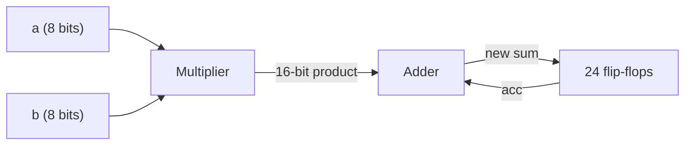
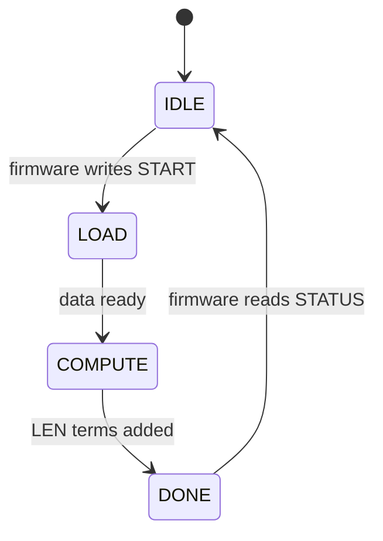

<!-- source: zh-TW/1-digital-logic/03-combinational-and-sequential/README.md | sha: 64db215d1d9c -->

# Chapter 3: Combinational and Sequential Logic — Circuits That Compute and Remember

> 📍 **Where the design is**
>
> - Previous stop: from transistors to logic gates, switches, logic gates and standard cells
> - **This chapter: building the adder, multiplier and accumulator that `mac` needs out of logic gates**
> - Next stop: RTL and Verilog, describing these circuits in code

🪜 Abstraction level: Spec ▸ **RTL ▸ Netlist** ▸ Layout ▸ GDS ▸ Chip

---

## Two kinds of circuits

Digital circuits come in two kinds:

- **Combinational logic**: the output depends only on the current inputs. It is like addition on a calculator: press 3 and 4 and the answer is 7, no matter what you calculated before.
- **Sequential logic**: the output also depends on the past, because it has memory. It is like a counter that adds one each time you press it; the number now depends on how many times you pressed before.

`mac` has both. Its multiplier and adder are **combinational logic**, and the register that holds the accumulated result is **sequential logic**. Combinational logic has no clock, but that does not mean timing does not matter: its delay is exactly what decides how fast the clock can run.

---

## Binary and negative numbers

8 bits have 256 possible combinations. Read as an **unsigned** number, they mean 0 to 255. So how are negative numbers represented? Digital circuits most often use **two's complement**: the weight of the top bit is negative. In 8 bits, the top bit stands for -128, and the other seven bits are 64, 32 and so on down to 1 as usual. So an 8-bit **signed** number can represent -128 to 127.

| Bits | Read as unsigned | Read as signed |
|---|---|---|
| `0000_0011` | 3 | 3 |
| `1111_1101` | 253 | -3 |
| `1000_0001` | 129 | -127 |

The same bits can be 129 or -127. The circuit itself does not know which; the designer decides how to read them.

To widen a signed number, copy its top bit into the new bits. This is called **sign extension**. For example, -3 widened to 16 bits is `1111_1111_1111_1101`. Fill the front with 0s instead, and it becomes 253.

> [!NOTE]
> **📖 Term | Two's complement (二補數)**
>
> - **Definition**: The most common way to represent negative numbers in digital circuits; the weight of the top bit is negative.
> - **On the job**: "This signal is two's complement. Remember to declare it signed."
> - **Related terms**: signed number, unsigned number, sign extension, overflow
> - **Common confusion**: Bits have no sign of their own. The same `1000_0001` is 129 as unsigned and -127 as signed, and the design must state which.

> [!IMPORTANT]
> **💻 Software analogy | Like int8_t and uint8_t in C**
>
> - **Like**: `int8_t` and `uint8_t` in C: the same 8 bits, read in different ways.
> - **Unlike**: A C compiler knows the type of every variable. A wire in a circuit is just a bundle of 0s and 1s, and the type exists only in the RTL declaration. Declare it wrong and the hardware will not complain; it will quietly compute the wrong answer.
> - **Watch out**: In C, mixing `int` and `unsigned int` in one expression quietly turns it into an unsigned operation. Verilog has a similar trap that is even easier to fall into, and `mac` falls into it in Chapter 6.

---

## Adders

Binary addition works like decimal addition: start from the lowest digit and carry when you reach 2.

- **Half adder**: adds two bits and outputs a "sum" and a "carry." The sum is an XOR and the carry is an AND.
- **Full adder**: also takes a carry from the bit below, so full adders can be chained one bit after another.
- **Ripple carry adder**: a chain of 24 full adders adds 24-bit numbers.

A ripple carry adder saves area, but the carry has to pass up one bit at a time, so the more bits, the slower it gets. Faster adders work out the carries in advance, at the cost of more logic gates. That is another PPA trade-off.

---

## Multipliers

Binary multiplication is long multiplication. Each bit of the multiplier is either 0 or 1, so each row has only two possible results: 0, or the multiplicand shifted left by a few places. Each row is called a **partial product**, and a row of AND gates is enough to make one. An 8-bit by 8-bit multiply has 8 rows of partial products, and a large array of adders sums them into a 16-bit product. So a multiplier is much bigger and much slower than an adder, and it is the largest part of `mac`.

🔍 Going deeper: Signed multiplication

The top bit of a two's complement number has a negative weight, so signed multiplication cannot simply reuse the unsigned method. There are two common approaches:

- Sign-extend both operands first, multiply them as wider unsigned numbers, and keep only the low bits you need. It is simple, but it wastes logic gates.
- Adjust the sign bits of the partial products so that the sum comes out right automatically. The widely used Baugh-Wooley method works this way; Booth encoding can also cut the number of partial product rows nearly in half.

Either way, the designer has to tell the tool "this is a signed number." When the synthesis tool sees a signed multiplication, it picks the right structure automatically.

---

## Flip-flops and the clock

A **flip-flop** is a 1-bit memory element. It reads its input only at the instant the **clock** goes from 0 to 1 (the rising edge), then holds that value until the next rising edge. It is like taking a photo: the scene at the moment you press the shutter goes into the picture, and whatever happens afterward, the photo stays the same. Several flip-flops side by side make a **register**.

The clock is like the conductor of an orchestra; every flip-flop moves on the same beat. The data must stay steady for a short time before and after the shutter is pressed, or the flip-flop cannot take a clear picture. Chapter 8 explains this time in detail.

> [!NOTE]
> **📖 Term | Flip-flop (正反器)**
>
> - **Definition**: A 1-bit memory element that reads its input at a clock edge and holds it.
> - **On the job**: Often called a flop or a DFF, as in "This block has a little over two thousand flops."
> - **Related terms**: register, clock, latch, setup, hold
> - **Common confusion**: A **latch** lets data through for the whole time the clock is high, instead of reading it once at the edge. The two behave differently and are analyzed differently for timing.

---

## The accumulator: combinational and sequential together

Connect a multiplier, an adder and 24 flip-flops in a loop, and you have the accumulator of `mac`:

Each cycle, the flip-flops output the current sum, the new product is added to it, and the result is stored back into the flip-flops at the next rising edge. So one clock period must be longer than the delay of "the multiplier plus the adder." In the simplest form: **clock period ≥ the sum of the delays along the path**. Chapter 8 finds that at 500 MHz, this path is too long.

> [!TIP]
> **🔧 Know-how | Work out how many bits the result needs first**
>
> - **Situation**: When designing an adder, a multiplier or an accumulator, you have to decide the bit width of the result.
> - **Practice**: Adding two N-bit numbers needs N + 1 bits; multiplying N bits by M bits needs N + M bits; accumulating K terms needs enough extra bits to hold K times the largest term.
> - **Why**: When the width is too small, the top bits are simply cut off, and the circuit gives no warning.
> - **If you skip it**: Once a value goes out of range, it suddenly jumps from the maximum to the minimum. This kind of bug rarely shows up, and when it does, it is hard to track down.
> - **Related chapters**: [Chapter 1: Specification and Architecture](../../0-before-you-start/01-spec-and-architecture/README.md)

---

## Finite state machines

The control logic of `tiny_npu` has to remember what it is doing right now: idle, moving data, computing, or done. Such a circuit is called a **finite state machine** (FSM). A few flip-flops remember the current state, and combinational logic decides from the current state and the inputs which state to enter on the next cycle. In the `COMPUTE` state, the MAC array does one multiply-accumulate every cycle until it has added `LEN` terms.

> [!TIP]
> **🔧 Know-how | Use one clock for all flip-flops, and never make a clock out of logic gates**
>
> - **Situation**: You want one block to run more slowly, so you use a logic gate to "block out some of the clock pulses."
> - **Practice**: Make clocks only with the PLL and dedicated clock circuits. To pause a circuit, use an enable signal, or the dedicated clock gating cell from the library (Chapter 5).
> - **Why**: A clock made with ordinary logic gates can produce very short glitches, and it is hard to control when it reaches each flip-flop.
> - **If you skip it**: Flip-flops occasionally read the wrong value, only on some chips and at some temperatures, and the timing analysis tools cannot check it properly.
> - **Related chapters**: [Chapter 5: Clocks and Resets](../../2-front-end/05-clocks-and-resets/README.md)

---

## Key takeaways

1. The output of combinational logic depends only on its current inputs; sequential logic has memory, so its output also depends on the past.
2. Two's complement uses the top bit for the sign; the same bits mean completely different things as signed and as unsigned numbers.
3. An adder is a chain of full adders. A multiplier sums rows of partial products and is much bigger and slower than an adder.
4. A flip-flop reads data at a clock edge; an accumulator is a multiplier, an adder and flip-flops connected in a loop.
5. The clock period must be longer than the sum of the delays along the path.

---

## Further reading

- David Money Harris and Sarah L. Harris, *Digital Design and Computer Architecture*, 2nd edition, Chapters 1–5
- M. Morris Mano and Michael D. Ciletti, *Digital Design*, 6th edition

---

[← Chapter 2: From Transistors to Logic Gates](../02-transistors-to-gates/README.md) | [Contents](../../README.md) | [Chapter 4: RTL and Verilog →](../../2-front-end/04-rtl-and-verilog/README.md)
