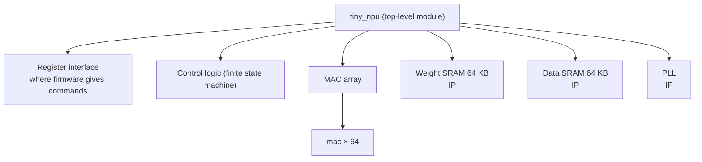

<!-- source: zh-TW/2-front-end/04-rtl-and-verilog/README.md | sha: 7966a18ce809 -->

# Chapter 4: RTL and Verilog — Describing Hardware in Code

> 📍 **Where the design is**
>
> - Previous stop: digital logic basics, adders, multipliers and flip-flops
> - **This chapter: writing `mac` as RTL and running it in a simulator for the first time**
> - Next stop: clocks and resets, keeping all the flip-flops in `tiny_npu` moving together

🪜 Abstraction level: Spec ▸ **RTL** ▸ Netlist ▸ Layout ▸ GDS ▸ Chip

---

## Why draw circuits with code

Early chips had only a few thousand transistors, and engineers could draw the schematic one logic gate at a time. A chip today has billions of transistors, and drawing them by hand is impossible. So engineers write down what the circuit should do in a **hardware description language** (HDL) and let tools turn it into logic gates, a step called synthesis (Chapter 7). The most widely used hardware description language is Verilog, together with its extension, SystemVerilog.

It is a lot like building a house: an architect draws the design, not the position of every brick. RTL is the design drawing of a chip. It describes which data moves into which register on each clock cycle and what is computed on the way, but not which logic gates those computations end up using.

> [!NOTE]
> **📖 Term | Register transfer level (RTL) (暫存器傳輸層級)**
>
> - **Definition**: A level of abstraction that describes a circuit by how data moves between registers and what is computed on the way.
> - **On the job**: The Verilog code itself is also called RTL, as in "The RTL is frozen; from now on, it's ECOs only."
> - **Related terms**: hardware description language, Verilog, netlist, synthesis
> - **Common confusion**: RTL is a level of abstraction, not a language. Verilog and VHDL are languages; the code you write in them is the RTL.

---

## A MAC in Verilog

The basic unit for describing a circuit in Verilog is the **module**. A module is like a box, and the pins on the outside of the box are its **ports**. The spec from Chapter 1 first becomes the ports of `mac`:

```verilog
module mac (
    input  wire        clk,
    input  wire        rst_n,   // active-low reset
    input  wire        clr,     // start a new dot product
    input  wire        en,      // accumulate a * b this cycle
    input  wire [7:0]  a,       // activation, INT8
    input  wire [7:0]  b,       // weight, INT8
    output reg  [23:0] acc      // 24-bit accumulator
);
```

- `clk` is the clock and `rst_n` is the reset. The `_n` at the end of a name means "active low": the reset happens when the signal is 0.
- `clr` tells the MAC "a new dot product is starting; clear the accumulator to 0."
- Only in a cycle where `en` is 1 is `a × b` added into the accumulator. `[7:0]` means 8 bits and `[23:0]` means 24 bits.

The circuit inside the box looks like this:

```verilog
    always @(posedge clk or negedge rst_n) begin
        if (!rst_n)
            acc <= 24'd0;          // reset: clear the accumulator
        else if (clr)
            acc <= 24'd0;          // a new dot product starts
        else if (en)
            acc <= acc + a * b;    // multiply, then add
    end
endmodule
```

`always @(posedge clk ...)` means: every time the clock goes from 0 to 1 (a rising edge), do what is inside. So this code describes exactly the accumulator from Chapter 3: a multiplier plus an adder, fed back into 24 flip-flops.

This code hides two problems. Neither one crashes the simulation or makes the tools complain. Chapter 6 finds one of them, and Chapter 15 finds the other.

> [!NOTE]
> **📖 Term | Module and instance (模組與實例)**
>
> - **Definition**: A module is the design of a kind of circuit; an instance is one real copy of it placed in the chip.
> - **On the job**: Placing an instance is called instantiating it, as in "`tiny_npu` instantiates 64 `mac`s" or "This instance is called `u_mac`."
> - **Related terms**: port, hierarchy, top-level module
> - **Common confusion**: Put 64 instances of one module in a chip and the chip really has 64 copies of the circuit, each taking area and using power. That is completely different from calling the same function 64 times in software.

---

## Hardware happens all at once

A program runs one line after another. A circuit does not: every logic gate on the chip is working at every moment. The 64 MACs do not take turns either; they all compute in the same clock cycle.

That is why `<=` has a special meaning in Verilog. It is called a **non-blocking assignment**: at a clock edge, every register assigned with `<=` updates "at the same time." It is like a group that agrees to swap places at one blow of a whistle; nobody sees anyone else's new place first.

> [!IMPORTANT]
> **💻 Software analogy | Verilog looks like C, but it describes a circuit**
>
> - **Like**: The syntax looks a lot like C, with `if`, `else`, `+` and `*`, and a module is like a reusable function.
> - **Unlike**: `acc <= acc + a * b` is not one instruction that "computes and then stores." It is a multiplier, an adder and 24 flip-flops, all working every clock cycle. Write one more `*`, and the chip gets hundreds more logic gates.
> - **Watch out**: When you write RTL, always picture the circuit it becomes. A `for` loop does not "run many times"; it copies the circuit many times. Delays such as `#10` and calls such as `$display` work only in test code and cannot become circuits.

<details>
<summary>🔍 Going deeper: Blocking and non-blocking assignments</summary>

Verilog has two kinds of assignment: `<=` is non-blocking, and `=` is a **blocking assignment**. The difference shows most clearly when you swap two registers:

```verilog
    always @(posedge clk) begin
        x <= y;     // non-blocking: both read the old values
        y <= x;
    end
    always @(posedge clk) begin
        p = q;      // blocking: the next line sees the new p
        q = p;
    end
```

Run it once in a simulator: `x` and `y` go from 1 and 2 to 2 and 1, a real swap, but `p` and `q` both become 2. The common rule in the industry is to use `<=` in an `always @(posedge clk)` block that describes flip-flops, and `=` in an `always @(*)` block that describes combinational logic. Mix the two in one block, and the simulation may not match the synthesized circuit.

</details>

---

## Writable is not the same as buildable

Verilog has two uses: describing circuits and describing tests. In a test, you can write anything, such as reading a file, printing a message or waiting 10 ns. In a circuit, you can write only what the synthesis tool understands and can turn into logic gates. This is called **synthesizable** code.

The most common trap is an incomplete `if` in combinational logic. The circuit does not know what to output in "the other cases," so it has to remember the previous value, and a latch appears out of nowhere.

> [!TIP]
> **🔧 Know-how | Always write complete if and case statements in combinational logic**
>
> - **Situation**: You write a multiplexer with `always @(*)`, covering only `if (sel == 0)` and `if (sel == 1)`, and say nothing about `sel` being 2 or 3.
> - **Practice**: Assign the output in every branch, or give it a default value at the top of the block; give every `case` a `default`.
> - **Why**: For the cases you left out, the synthesis tool can only make the output "keep its old value," and that needs a memory element.
> - **If you skip it**: An unexpected latch appears in the circuit. The timing analysis in Chapter 8 has trouble with it, and the real chip may behave differently from the simulation.
> - **Related chapters**: [Chapter 3: Combinational and Sequential Logic](../../1-digital-logic/03-combinational-and-sequential/README.md)

---

## From one MAC to a whole chip

The top-level module of `tiny_npu` contains the register interface, the control logic, the MAC array, two SRAMs and the PLL. The MAC array in turn contains 64 instances of `mac`. This structure of modules inside modules is called the **hierarchy**. The SRAMs and the PLL are not RTL written by the team; they are ready-made blocks from the foundry or a silicon IP vendor.



You do not have to write 64 instances by hand. A `generate` loop gives the MAC in row `r` activation `r`, and the MAC in column `c` weight `c`:

```verilog
    genvar r, c;
    generate
        for (r = 0; r < 8; r = r + 1) begin : row
            for (c = 0; c < 8; c = c + 1) begin : col
                mac u_mac (.clk(clk), .rst_n(rst_n), .clr(clr), .en(en),
                           .a(act[8*r +: 8]), .b(wgt[8*c +: 8]),
                           .acc(acc[24*(8*r+c) +: 24]));
            end
        end
    endgenerate
```

> [!TIP]
> **🔧 Know-how | Put the RTL under version control, and record which version you taped out**
>
> - **Situation**: Someone changes the RTL every day, and synthesis, verification and physical design each take their own copy.
> - **Practice**: Keep the RTL in a version control system such as Git. Every hand-off to the next stage records which commit it used, and the taped-out version gets a tag.
> - **Why**: When a problem turns up after the chips come back, you have to find exactly which code was taped out before you can reproduce the problem and fix it.
> - **If you skip it**: Everyone has a different version of the RTL, and the one that passed verification is not the one that was taped out. When something goes wrong, you cannot even find the cause.
> - **Related chapters**: [Chapter 15: After Silicon Returns](../../4-to-the-fab/15-after-silicon/README.md), *Introduction to Git*, [Chapter 8: Branching Strategies and Releases](https://github.com/chenwei810/Git_Introduction/blob/main/en/2-beyond-your-computer/08-branching-and-releases/README.md)

---

## 🧪 Try it: Run the MAC for the first time

First install Icarus Verilog as described in [practice/README.md](../../../practice/README.md). This section uses the simplest possible test to confirm that `mac` can compute 3 × 4 + 5 × 6.

The test inputs are in `vectors/directed.txt`, one clock cycle per line: `clr en a b`, followed by the expected accumulator value. Then run the commands below from the root of this repository:

```text
1 0 0 0 0
0 1 3 4 12
0 1 5 6 42
```

```bash
cd practice
iverilog -o sim rtl/mac_ch04.v tb/tb_mac.v
vvp sim +vec=vectors/directed.txt +verbose
```

`iverilog` compiles the RTL and the testbench into a simulation file, `sim`, and `vvp` runs it. `+verbose` makes the testbench print every check:

```text
clr                ->  acc = 0   (expected 0)
a =    3, b =    4  ->  acc = 12   (expected 12)
a =    5, b =    6  ->  acc = 42   (expected 42)
PASS: 3 of 3 checks passed
```

3 × 4 + 5 × 6 = 42. The MAC got its first answer right. But this proves only one example. In Chapter 6, two hundred random inputs bring out the first problem.

---

## Key takeaways

1. Modern chips are written as RTL in a hardware description language and turned into logic gates by tools; RTL is the design drawing of the chip.
2. A Verilog module has ports and a circuit inside; every instance placed in the chip is a real copy of the circuit.
3. Circuits work all at once. Flip-flops use the non-blocking assignment `<=`, so every register updates at the same clock edge.
4. RTL may use only synthesizable code; an incomplete `if` or `case` in combinational logic creates a latch.
5. RTL needs version control, so that every stage knows which version it is using.

---

## Further reading

- Samir Palnitkar, *Verilog HDL: A Guide to Digital Design and Synthesis*, 2nd edition
- Clifford E. Cummings, "Nonblocking Assignments in Verilog Synthesis, Coding Styles That Kill!", 2000
- The IEEE 1800 (SystemVerilog) standard, which includes the full Verilog syntax

---

[← Chapter 3: Combinational and Sequential Logic](../../1-digital-logic/03-combinational-and-sequential/README.md) | [Contents](../../README.md) | [Chapter 5: Clocks and Resets →](../05-clocks-and-resets/README.md)
