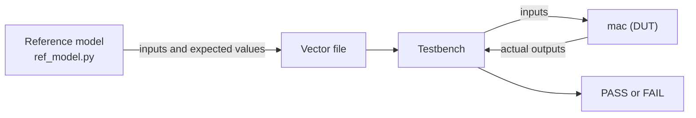

<!-- source: zh-TW/2-front-end/06-verification/README.md | sha: e6d963784a06 -->

# Chapter 6: Verification — Proving the Design Is Right

> 📍 **Where the design is**
>
> - Previous stop: clocks and resets, the clock domains and resets of `tiny_npu` are planned
> - **This chapter: checking `mac` with a reference model and random tests, and finding the first hidden problem**
> - Next stop: logic synthesis, turning the verified RTL into logic gates

🪜 Abstraction level: Spec ▸ **RTL** ▸ Netlist ▸ Layout ▸ GDS ▸ Chip

---

## Why verification matters so much

As Chapter 0 said, a chip is very hard to change after tape-out. So before tape-out, the team does everything it can to prove that the RTL works as the spec says. This work is called **verification**. On many teams there are more verification engineers than designers, and verification often takes more than half of the project's time.

The basic tool of verification is the **testbench**: a program that runs only in a simulator. It sends inputs into the design being tested and checks whether the outputs are right. The design being tested is called the **design under test** (DUT); in this chapter, it is `mac`.

> [!NOTE]
> **📖 Term | Testbench (測試平台)**
>
> - **Definition**: Verification code that creates inputs, drives the design under test and checks its outputs in a simulator.
> - **On the job**: Often shortened to TB, as in "Hook up the TB first and run a smoke test."
> - **Related terms**: DUT, reference model, simulator, waveform
> - **Common confusion**: A testbench never becomes a circuit, so it can use code that cannot be synthesized, such as reading files, printing messages and waiting for a time (Chapter 4).

---

## Directed tests and random tests

The 3 × 4 + 5 × 6 of Chapter 4 is a **directed test**: an engineer picks the inputs. It tests the cases you can think of, but not the ones you cannot.

So verification relies more on **random tests**. A program generates the inputs at random, with limits and preferences: it produces only legal values, and it makes edge values such as -128, -1, 0, 1 and 127 come up especially often. This is called a **constrained random test**.

Who works out the answers for random inputs? A **reference model** written in software. This is where the architecture model from Chapter 1 pays off:



Random is not really random. The same **random seed** always produces the same inputs. When a test fails, you only need to note the seed to reproduce it exactly.

> [!NOTE]
> **📖 Term | Reference model (參考模型)**
>
> - **Definition**: A model written in software that computes the correct answers from the spec, used to check the RTL's outputs.
> - **On the job**: Often called the golden model, as in "The RTL doesn't match the golden model."
> - **Related terms**: architecture model, random seed, scoreboard
> - **Common confusion**: A reference model can be wrong too. It is best written from the spec by someone other than the RTL designer, so that the two do not make the same mistake.

---

## Catching the first problem

Seed 1 produces 8 dot products of 25 terms each. With a clear at the start of each one, that makes 208 checks. The `mac` from Chapter 4 fails 195 of them.

The first failure is -127 × -49. The right answer is 6,223, but `mac` computes 26,703. 26,703 is exactly 129 × 207, and 129 and 207 are what -127 and -49 become when they are read as unsigned numbers (Chapter 3).

The cause is that the ports in Chapter 4 were not declared `signed`, so Verilog treats them as unsigned by default. The fix is to declare all three ports as signed, which gives `rtl/mac_ch06.v`:

```verilog
    input  wire signed [7:0]  a,
    input  wire signed [7:0]  b,
    output reg  signed [23:0] acc
```

3 × 4 + 5 × 6 uses only positive numbers, so the result is the same with or without `signed`, and the directed test cannot catch the problem. That is exactly why random tests are worth having.

> [!TIP]
> **🔧 Know-how | One unsigned operand makes the whole expression unsigned**
>
> - **Situation**: You declare `a` and `b` as `signed` but forget `acc`.
> - **Practice**: Declare every operand in the same expression as signed, and when in doubt, convert explicitly with `$signed()`. Lint tools can also find places where signed and unsigned values are mixed.
> - **Why**: This is a Verilog rule: if any operand is unsigned, the whole expression is computed as unsigned, so negative numbers are not sign-extended. Mixing `int` and `unsigned int` in C follows a similar rule.
> - **If you skip it**: We tried it: changing only `a` and `b` and not `acc` still fails 195 of the 208 checks. All the tests with positive numbers pass, and the problem stays hidden until very late.
> - **Related chapters**: [Chapter 3: Combinational and Sequential Logic](../../1-digital-logic/03-combinational-and-sequential/README.md)

---

## Are we done testing? Coverage

How do you know whether you have tested enough? You measure **coverage**.

- **Code coverage**: whether every line and every branch of the RTL has been executed. The `mac` code is only a few lines long; after the random test, every branch (reset, clear and accumulate) has run, and the code coverage is 100%.
- **Functional coverage**: whether every situation in the spec has actually happened, such as "the accumulator goes out of range in the positive direction," "in the negative direction" or "`LEN` is 1."

Code coverage has a blind spot: it can measure only the code that was written. The saturation the spec asks for was never written in Chapter 4, so there is no line of code that went unexecuted. The dot products in this random test have only 25 terms, so the accumulator never goes much above fifty thousand, far from the 24-bit limit of more than eight million.

> [!NOTE]
> **📖 Term | Coverage (覆蓋率)**
>
> - **Definition**: Measures of whether testing is sufficient. Code coverage checks whether the RTL has been executed; functional coverage checks whether the situations in the spec have been tested.
> - **On the job**: "We can't sign off until coverage reaches 100%," "That corner isn't covered yet."
> - **Related terms**: verification plan, assertion, regression test
> - **Common confusion**: 100% code coverage does not mean there are no bugs. A feature that was never written has no code to measure.

> [!TIP]
> **🔧 Know-how | Write the verification plan from the spec, item by item**
>
> - **Situation**: Before verification starts, you have to decide what to test.
> - **Practice**: Read the spec line by line, turn each line into an item in the verification plan, and map each item to tests and functional coverage. When the plan is written, review it with the designer and the architect.
> - **Why**: Tests written from the RTL only check what the RTL does, not what it should do.
> - **If you skip it**: A feature that is in the spec but that nobody implemented is also a feature that nobody tests. That is exactly how `mac` gets into trouble in Chapter 15.
> - **Related chapters**: [Chapter 15: After Silicon Returns](../../4-to-the-fab/15-after-silicon/README.md)

---

## Other verification methods

- **Assertion**: a rule written in the design or the testbench that must always hold, such as "`BUSY` and `DONE` are never both 1." If it is ever broken during simulation, an error is reported at once.
- **Formal verification**: instead of relying on inputs, it uses mathematics to prove that a property holds for every possible input. It suits small, critical circuits.
- **Regression test**: every night, all the tests run again with different seeds, to confirm that new changes have not broken anything that used to work.
- **FPGA prototype**: the RTL runs on an FPGA, thousands of times faster than simulation, so real neural networks and firmware can run before tape-out.

Large projects usually build reusable testbenches in SystemVerilog with **UVM** (Universal Verification Methodology, IEEE 1800.2), the industry-standard methodology.

> [!IMPORTANT]
> **💻 Software analogy | Verification is like writing unit tests, with a much higher bar**
>
> - **Like**: Unit tests, continuous integration, and fuzzing, which looks for bugs with random inputs.
> - **Unlike**: Software bugs can be patched after release; chips cannot. And simulating a large chip is more than a million times slower than the real chip. One second of work on real silicon may take days to simulate, so you cannot test everything.
> - **Watch out**: Test smart. Write the verification plan from the spec, and use constrained random tests and functional coverage to find what has not been tested, instead of just running more and more tests.

---

## 🧪 Try it: Catch the signed bug with a reference model

Run these in the `practice/` folder. First, use the reference model to generate a random test with seed 1:

```bash
python3 ref_model.py random --seed 1 > vectors/random.txt
head -n 3 vectors/random.txt
```

```text
1 0 0 0 0
0 1 -127 -49 6223
0 1 80 50 10223
```

The first line is a clear. Each line after that is a pair of `a` and `b`, and the last column is the accumulator value that the reference model computed. Run it against the `mac` from Chapter 4:

```bash
iverilog -o sim rtl/mac_ch04.v tb/tb_mac.v
vvp sim +vec=vectors/random.txt
```

```text
MISMATCH at line 2: a = -127, b = -49, expected 6223, got 26703
MISMATCH at line 3: a = 80, b = 50, expected 10223, got 30703
MISMATCH at line 4: a = -12, b = -73, expected 11099, got 75355
FAIL: 195 of 208 checks failed
```

Switch to the version with `signed`, run the random test again, and rerun the directed test from Chapter 4 as well:

```bash
iverilog -o sim rtl/mac_ch06.v tb/tb_mac.v
vvp sim +vec=vectors/random.txt
vvp sim +vec=vectors/directed.txt
```

```text
PASS: 208 of 208 checks passed
PASS: 3 of 3 checks passed
```

After fixing a new problem, rerun the old tests to make sure nothing that used to work is broken: that is the smallest possible regression test. To see the waveforms, add `+vcd` to the `vvp` line and open the resulting `mac.vcd` in GTKWave.

---

## Key takeaways

1. Verification proves, before tape-out, that the RTL works as the spec says, and it often takes more than half of a project's time.
2. Directed tests cover only the cases you think of; constrained random tests with a reference model find the bugs you did not think of.
3. The first problem in `mac` is a missing `signed`: negative numbers are read as unsigned, yet every test with positive numbers passes.
4. Code coverage cannot measure features that were never written; the verification plan must be written from the spec, item by item.
5. Assertions, formal verification, regression tests and FPGA prototypes each make up for something simulation cannot do.

---

## Further reading

- Janick Bergeron, *Writing Testbenches: Functional Verification of HDL Models*, 2nd edition
- Chris Spear and Greg Tumbush, *SystemVerilog for Verification*, 3rd edition
- Accellera, *Universal Verification Methodology (UVM) User's Guide*

---

[← Chapter 5: Clocks and Resets](../05-clocks-and-resets/README.md) | [Contents](../../README.md) | [Chapter 7: Logic Synthesis →](../07-logic-synthesis/README.md)
