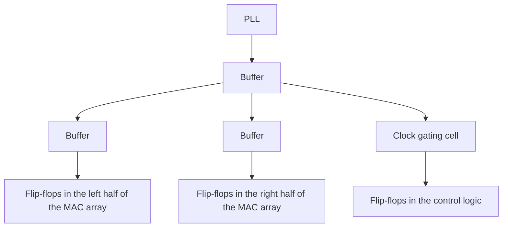

<!-- source: zh-TW/3-physical-design/11-placement-and-cts/README.md | sha: a4fbe88924f3 -->

# Chapter 11: Placement and the Clock Tree — Putting Cells Down, Sending the Clock Out

> 📍 **Where the design is**
>
> - Previous stop: floorplanning and the power network, where the SRAMs, the MAC array and the power all got their places
> - **This chapter: placing a hundred thousand standard cells on the chip, then sending the clock to every flip-flop**
> - Next stop: routing and parasitics, connecting every cell with metal wires

🪜 Abstraction level: Spec ▸ RTL ▸ Netlist ▸ **Layout** ▸ GDS ▸ Chip

---

## Placement: finding a spot for a hundred thousand cells

All standard cells have the same height, so they can be lined up in rows between the power rails, like books on shelves. **Placement** finds a spot on the shelves for every standard cell in the netlist.

A good placement keeps connected cells close together, so the wires are short, the delays are small and the cells do not crowd into a jam. Tools usually do it in three steps:

**Global placement → Legalization → Post-placement optimization**

1. **Global placement**: work out a rough position for every cell; at this point cells may overlap.
2. **Legalization**: push each cell to the nearest legal spot, lined up with a cell row and with no overlaps.
3. **Post-placement optimization**: based on the timing results, resize cells, insert buffers and move the cells on critical paths closer together.

The 64 `mac`s in `tiny_npu` all have exactly the same structure. The tool gathers the few hundred cells of each `mac` together, forming a neat grid of tiles.

> [!NOTE]
> **📖 Term | Utilization (使用率)**
>
> - **Definition**: The share of the core's placeable area that standard cells occupy.
> - **On the job**: "This run starts at 70% utilization, and the MAC array is already at 85%."
> - **Related terms**: congestion, filler cell, die area
> - **Common confusion**: Higher utilization is not always better. Too high and the design cannot be routed; also, the buffers inserted later and the spare cells for ECOs both need room.

When cells are packed too tightly, more wires need to pass through an area than it has tracks for. This is called **congestion**. The multipliers in the MAC array have many tangled connections, which makes them the most congestion-prone part of `tiny_npu`.

> [!TIP]
> **🔧 Know-how | Scatter spare cells near important logic in advance**
>
> - **Situation**: If a small bug is found after tape-out, it is much better not to redo the whole mask set.
> - **Practice**: During placement, scatter some unused **spare cells** around the chip, especially near important logic such as the MAC array, or **ECO cells** that can become logic gates by changing only the metal layers.
> - **Why**: With these cells in place, a small fix only needs new masks for a few upper metal layers to wire them into the circuit; the dozens of masks below stay unchanged.
> - **If you skip it**: Even the smallest fix has to be redone from the transistor layers up, costing months more and a large mask bill.
> - **Related chapters**: [Chapter 15: After Silicon Returns](../../4-to-the-fab/15-after-silicon/README.md), *Introduction to Semiconductor Manufacturing*, [Chapter 24: How the Process Shapes Firmware](https://github.com/chenwei810/Semiconductor_Manufacturing_Introduction/blob/main/en/6-beyond-the-fab/24-process-and-firmware/README.md)

After placement, the scan chains are also reordered by the actual positions of the cells, so that flip-flops next to each other in a chain are also next to each other on the chip, which shortens the wires (Chapter 9).

---

## The clock tree: getting the clock to every flip-flop at the same time

`tiny_npu` has thousands of flip-flops; the 64 `mac`s alone have 2,688. The clock has to reach every one of them at almost the same moment. But a single wire cannot drive thousands of loads, and flip-flops at different distances from the PLL would get the clock at different times.

**Clock tree synthesis** (CTS) uses layer after layer of buffers to branch the clock out like a tree, and adjusts the length and buffers of each branch so that every flip-flop gets the clock as close to the same time as possible.

The time the clock takes to travel from its source to a flip-flop is the **insertion delay**; the difference between the times the same clock reaches different flip-flops is the **clock skew**. The clock tree switches every cycle and has many buffers, so it is often the most power-hungry network on the chip. That is why the clock gating cells from Chapter 5 sit on the branches of the tree.

> [!NOTE]
> **📖 Term | Clock skew (時脈偏移)**
>
> - **Definition**: The difference between the times the same clock reaches different flip-flops.
> - **On the job**: Usually just "skew," as in "Even after CTS, the skew in this area is still too big."
> - **Related terms**: clock tree, insertion delay, clock jitter, useful skew
> - **Common confusion**: Skew is a time difference between *different places*; **jitter** is the cycle-to-cycle variation of the clock at *the same place*, which comes mostly from the PLL and power supply noise.

🔍 Going deeper: Using skew as a tool

Clock skew is not always bad. Suppose path A→B is too long but path B→C is short. If the clock is made to reach B a little later on purpose, the A→B stage gains a little time; the B→C stage loses the same amount, but it had plenty to spare.

Skew arranged on purpose like this is called **useful skew**: it lets a long path borrow time from the next stage. It is a common technique in timing closure. The cost is that hold analysis gets harder: making the clock arrive later makes it easier for data from the previous stage to arrive too early.

> [!TIP]
> **🔧 Know-how | Fix hold only after the clock tree is built**
>
> - **Situation**: Before the clock tree is built, STA assumes that the clock reaches every flip-flop at the same time.
> - **Practice**: Look only at setup at first. After the clock tree is built and the analysis is rerun with the real clock arrival times, insert delay buffers to fix hold.
> - **Why**: Before the clock tree exists, nobody knows the real skew. Fixing hold at that point often fixes the wrong places, or fixes too much.
> - **If you skip it**: You insert a pile of unneeded buffers that waste area and power and hurt setup, while the paths that really violate are still there.
> - **Related chapters**: [Chapter 8: Static Timing Analysis](../../2-front-end/08-static-timing-analysis/README.md)

> [!IMPORTANT]
> **💻 Software analogy | A clock tree is like synchronizing the time on every server**
>
> - **Like**: Using network time synchronization so that every server has the same time and the logs line up.
> - **Unlike**: A few milliseconds of difference between servers usually does not matter; a few tens of picoseconds on a chip can make a flip-flop capture the wrong data. And the difference is a physical quantity set by wire lengths and buffers, fixed once the chip is made; no software can correct it afterward.
> - **Watch out**: The clock is the signal on the chip with the most loads, the most switching and the most sensitivity to noise. In physical design, it always comes first.

---

## Key takeaways

1. Placement puts standard cells into the core row by row, in three steps: global placement, legalization and post-placement optimization.
2. Too high a utilization causes congestion; leave room for buffers and for spare cells for ECOs.
3. With spare cells scattered in advance, a small fix after tape-out may need changes only to the metal layers.
4. The clock tree uses layers of buffers to get the clock to every flip-flop at almost the same time; both skew and jitter eat into the timing margin.
5. Fix hold only after the clock tree is built, using the real clock arrival times.

---

## Further reading

- Andrew B. Kahng, Jens Lienig, Igor L. Markov and Jin Hu, *VLSI Physical Design: From Graph Partitioning to Timing Closure*, Chapters 4 and 7
- *Introduction to Semiconductor Manufacturing*, [Chapter 24: How the Process Shapes Firmware](https://github.com/chenwei810/Semiconductor_Manufacturing_Introduction/blob/main/en/6-beyond-the-fab/24-process-and-firmware/README.md)

---

[← Chapter 10: Floorplanning and the Power Network](../10-floorplan-and-power/README.md) | [Contents](../../README.md) | [Chapter 12: Routing and Parasitics →](../12-routing-and-parasitics/README.md)
