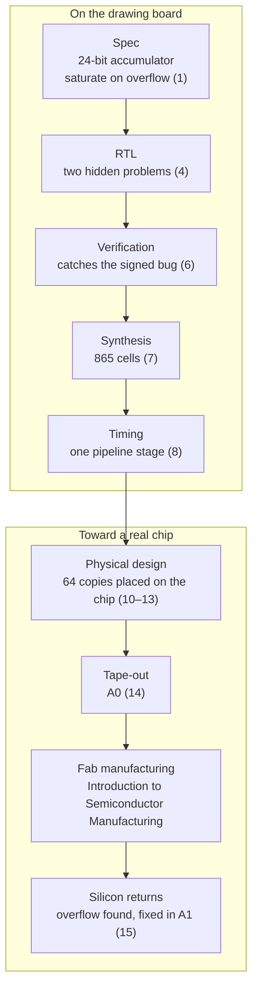

<!-- source: zh-TW/README.md | sha: ec0bdb1f7edf -->

<div align="center">


# Introduction to IC Design

**Follow one multiply-accumulate unit on its journey from code to chip**

🌐 [繁體中文](../zh-TW/README.md) ｜ **English** ｜ [日本語](../ja/README.md) ｜ [한국어](../ko/README.md) ｜ [Home](../README.md)

</div>

---

## What this book is about

A fab uses dozens of masks to build billions of transistors on a wafer, layer by layer. But who drew the patterns on those masks, and how?

This book is the prequel to *[Introduction to Semiconductor Manufacturing](https://github.com/chenwei810/Semiconductor_Manufacturing_Introduction)*. It follows two main characters:

- **One chip**: `tiny_npu`, a small AI inference chip. It has 64 multiply-accumulate units, two memory blocks, and an interface through which a CPU gives it commands.
- **One unit**: `mac`, one of those multiply-accumulate units. It starts as one sentence in the specification. It is written as a dozen or so lines of Verilog, found to have a bug, synthesized into nearly a thousand logic gates and copied 64 times into the chip. On real silicon, it finally reveals a problem that had been hiding for a long time.

The book skips heavy equations and focuses on three things:

- **Process flow**: what each step does, why it is done that way, and what goes wrong if it is done badly.
- **Terminology**: the English and Chinese names, and how people on IC design teams actually use these words.
- **Know-how**: the things textbooks rarely mention but every project runs into.

## Who it is for

| Reader | What to read | What you will be able to do |
|---|---|---|
| 🌱 Science or engineering background, but new to IC design | The main text; skip the deep dives | Describe every step of a chip from specification to tape-out, and the words designers use every day |
| 🎓 Electrical engineering and computer science students | Everything, including the deep dives and the Try-it sections | Understand the principles behind each step, and run it yourself with open-source tools |
| 💻 Software and firmware engineers | The main text, with extra attention to the software analogies | Know where hardware really differs from software, and stop talking past the hardware team |

No background in circuits or semiconductor physics is needed. Some programming experience helps, but it is not required.

## Helpers in every chapter

| Marker | What it shows |
|---|---|
| 📍 Where the design is | Which stop of the journey the two main characters have reached, and what comes before and after |
| 🪜 Abstraction level | Where the chapter sits in "Spec ▸ RTL ▸ Netlist ▸ Layout ▸ GDS ▸ Chip" |
| 📖 Term box | Definition, how designers use the term, related terms, and what it is often confused with |
| 🔧 Know-how box | What design teams actually do, why, and what goes wrong if you skip it |
| 💻 Software analogy | How it resembles software development, and, more importantly, how it differs |
| 🔍 Going deeper | Explanations of the principles for engineering students; collapsed by default, and safe to skip |
| 🧪 Try it | Chapters 4, 6, 7, 8 and 15: run it yourself with open-source tools; every output in the book comes from a real run |

Here is a know-how box from Chapter 6, Verification:

> [!TIP]
> **🔧 Know-how | Write the verification plan from the spec, item by item**
>
> - **Situation**: Before verification starts, you have to decide what to test.
> - **Practice**: Read the spec line by line, turn each line into an item in the verification plan, and map each item to tests and functional coverage.
> - **Why**: Tests written from the RTL only check what the RTL does, not what it should do.
> - **If you skip it**: A feature that is in the spec but that nobody implemented is also a feature that nobody tests. That is exactly how `mac` gets into trouble in Chapter 15.

## Practice files

The book comes with a set of practice files in the [`practice/`](../practice/README.md) folder: every version of `mac` in the story, the testbench, and a reference model written in Python. Install two open-source tools, Icarus Verilog and Yosys, and you can reproduce every output in the book on your own computer.

```bash
cd practice
iverilog -o sim rtl/mac_ch04.v tb/tb_mac.v
vvp sim +vec=vectors/directed.txt +verbose
```

---

## Map of the book

This is the journey of `mac`. The numbers in parentheses are chapter numbers.



Chapter 0 gives a bird's-eye view of the whole flow, Chapters 2 and 3 fill in the basics of digital logic, Chapter 5 deals with clocks and resets, and Chapter 9 adds the circuits that let the factory test the chip.

---

## Contents

### Part 0: Before You Start

| Chapter | What you will read |
|---|---|
| [Chapter 0: The Big Picture](0-before-you-start/00-overview/README.md) | The journey of a chip from idea to tape-out, how the industry divides the work, and the two main characters |
| [Chapter 1: Specification and Architecture](0-before-you-start/01-spec-and-architecture/README.md) | The specification, the block diagram, PPA trade-offs, and how many bits the accumulator needs |

### Part 1: Digital Logic Basics

| Chapter | What you will read |
|---|---|
| [Chapter 2: From Transistors to Logic Gates](1-digital-logic/02-transistors-to-gates/README.md) | CMOS, logic gates, delay, power and standard cells |
| [Chapter 3: Combinational and Sequential Logic](1-digital-logic/03-combinational-and-sequential/README.md) | Two's complement, adders, multipliers, flip-flops and finite state machines |

### Part 2: Front-End Design

| Chapter | What you will read |
|---|---|
| [Chapter 4: RTL and Verilog](2-front-end/04-rtl-and-verilog/README.md) | Writing `mac` in Verilog, and how hardware differs from a program |
| [Chapter 5: Clocks and Resets](2-front-end/05-clocks-and-resets/README.md) | PLLs, clock domain crossings, metastability, reset synchronization and clock gating |
| [Chapter 6: Verification](2-front-end/06-verification/README.md) | Testbenches, reference models, random tests, coverage and the verification plan |
| [Chapter 7: Logic Synthesis](2-front-end/07-logic-synthesis/README.md) | Standard cell libraries, timing constraints, netlists and equivalence checking |
| [Chapter 8: Static Timing Analysis](2-front-end/08-static-timing-analysis/README.md) | Setup, hold, slack, process corners and pipelining |
| [Chapter 9: Design for Test](2-front-end/09-design-for-test/README.md) | Scan chains, ATPG, MBIST and JTAG |

### Part 3: Physical Design

| Chapter | What you will read |
|---|---|
| [Chapter 10: Floorplanning and the Power Network](3-physical-design/10-floorplan-and-power/README.md) | Chip size, macro placement, IR drop and power domains |
| [Chapter 11: Placement and the Clock Tree](3-physical-design/11-placement-and-cts/README.md) | Placement, utilization, spare cells, the clock tree and clock skew |
| [Chapter 12: Routing and Parasitics](3-physical-design/12-routing-and-parasitics/README.md) | Metal layers, routing, parasitic extraction, crosstalk and the antenna effect |
| [Chapter 13: Signoff](3-physical-design/13-signoff/README.md) | Multi-corner multi-mode analysis, DRC, LVS, power signoff and waivers |

### Part 4: Handing Off to the Fab

| Chapter | What you will read |
|---|---|
| [Chapter 14: Tape-out](4-to-the-fab/14-tape-out/README.md) | GDS, mask data preparation, OPC and multi-project wafers |
| [Chapter 15: After Silicon Returns](4-to-the-fab/15-after-silicon/README.md) | Bring-up, post-silicon validation, errata and a metal-only fix |

### Appendices

| Appendix | What you will read |
|---|---|
| [Appendix A: Glossary](appendix/glossary.md) | Every term in the book with its Chinese equivalent and abbreviation; also the reference for the book's wording |
| [Appendix B: Designer Jargon](appendix/jargon.md) | What you hear on IC design teams, with example sentences |
| [Appendix C: Further Reading](appendix/further-reading.md) | Textbooks, standards and open-source tools |
| [Appendix D: Verilog Quick Reference](appendix/verilog-quick-reference.md) | The Verilog syntax used in the book |

---

## Reading paths

Reading in order gives you the full picture, but you can also start with the path that fits you:

| Path | Suggested chapters |
|---|---|
| 🚀 Quick overview | Chapters 0, 1, 7, 10 and 14 |
| 💻 Software and firmware engineers | Chapters 0, 1, 3, 4, 6, 8 and 15, and the software analogy in every chapter |
| 🏭 Joining the IC design industry | The whole book in order, with extra attention to Chapters 6, 8 and 13 and Appendix B |
| 🔬 Read *Introduction to Semiconductor Manufacturing* first | Chapters 0, 2, 10, 12, 13 and 14, to see how design connects to the process |
| 🧪 Just want to try it | The Try-it sections of Chapters 4, 6, 7, 8 and 15 |

---

## Contributing

This is an open project, and help is always welcome:

- **Found a mistake?** Open an [issue](../../../issues) with the "Erratum" template.
- **Want to add content or figures?** Read the [contributing guide](../CONTRIBUTING.md) and the [style guide](../STYLE_GUIDE.md).
- **Want to translate the book into another language?** Read the [translation guide](../TRANSLATIONS.md).

If this book helps you, please give it a ⭐ star so that more people can find it.

---

## Disclaimer

- This book is based on public information and general industry knowledge. It contains no confidential information, internal flows or design data of any company, and no real values from any foundry's PDK.
- It is not affiliated with any semiconductor company or EDA vendor. The only tools named are the open-source tools used in the Try-it sections; commercial tools are never named.
- `tiny_npu` is a made-up chip for teaching, and its specification and story are illustrative. Most numbers are orders of magnitude or approximate values. Actual values vary by process, product and company.
- If you find anything wrong or out of date, please let us know by opening an issue.

## License

The text, images and practice files of this book are licensed under the [Creative Commons Attribution-NonCommercial-ShareAlike 4.0 International License](../LICENSE) (CC BY-NC-SA 4.0). You may share, adapt and translate them for non-commercial purposes, as long as you give credit and share your work under the same license.

The original text is written in Traditional Chinese. If the English and Chinese versions differ, the Chinese version is the reference.
