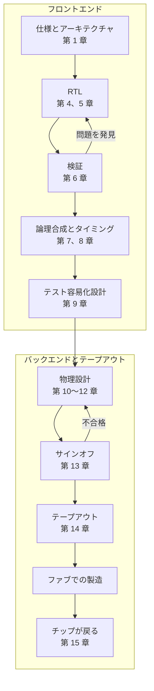

<!-- source: zh-TW/0-before-you-start/00-overview/README.md | sha: 7d0712dfe5e7 -->

# 第 0 章　IC 設計の全体像：チップ一つの設計の旅

> 📍 **設計の現在地**
>
> - 前の工程：まだ出発していない
> - **この章：チップ一つがアイデアからテープアウトに至るまでの旅を見渡し、本書の二つの主役に会う**
> - 次の工程：仕様とアーキテクチャ。どんなチップを作るかを決める

🪜 抽象度：**仕様 ▸ RTL ▸ ネットリスト ▸ レイアウト ▸ GDS ▸ チップ**

---

## チップはまず設計される

ファブは数十枚のフォトマスクを使い、ウェーハの上にトランジスタと配線を 1 層ずつ作っていきます。では、マスクのパターンはどこから来るのでしょうか。答えは IC 設計です。**集積回路**（Integrated Circuit、IC）の設計とは、「カメラが写真の中の猫をその場で見分けられるようにする」といったアイデアを、一歩ずつファブが製造できる幾何学的な図形に変えていく仕事です。家を建てるのに似ています。まず要望をはっきりさせ、設計図と施工図を描き、最後に施工図を建設会社に渡します。

『半導体製造入門』は、1 枚のウェーハを追いかけて工場の中を旅しました。本書はその前日譚です。一つのコードを追いかけて、マスクが工場に渡される瞬間までを旅します。

---

## 本書の二つの主役

- **一つのチップ**：`tiny_npu`。小さな AI 推論チップで、64 個の積和ユニット、64 KB のメモリ 2 個、そして CPU が命令を出すためのインターフェースを持つ。目標は毎秒 320 億回の積和演算。教材として架空に決めた仕様だが、一つひとつの判断は実際のチップでも出会うものである。
- **一つのユニット**：`mac`。その中の積和ユニットの一つ。仕事は一つだけで、8 ビットの数を二つ掛け合わせ、累算器に足し込む。

ニューラルネットワークの計算のほとんどは、「数の列に重みの列を掛け、全部を足し合わせる」ことです。だから AI チップの中心は、ずらりと並んだ積和ユニットです。`mac` は小さく、十数行の Verilog で書けます。それでも本書のすべての工程を通ります。コードとして書かれ、テストで問題が見つかり、千個近い論理ゲートになり、64 個に複製されてチップに並び、最後に本物のチップの上で、長いあいだ隠れていた問題を見せます。

> [!NOTE]
> **📖 用語｜積和ユニット（Multiply-Accumulate Unit、MAC、乘加單元）**
>
> - **定義**：二つの数を掛け、その積を累算器に足し込む回路。
> - **現場での使い方**：AI チップは MAC の数や毎秒の積和演算の回数で演算能力を比べることが多い。「今世代は MAC の数が倍になった」。
> - **関連用語**：累算器、内積、ニューラルプロセッシングユニット（NPU）
> - **よくある混同**：ネットワーク機器の MAC アドレス（Media Access Control）は別物で、略語がたまたま同じだけである。

---

## 旅の地図

**仕様 → RTL → 検証 → 論理合成 → タイミング解析 → テスト容易化設計 → 物理設計 → サインオフ → テープアウト**

| 段階 | 何が起きるか | 本書の章 |
|---|---|---|
| 仕様とアーキテクチャ | チップが何をするか、どれだけ速く、どれだけの面積と電力を使うかを決める | 第 1 章 |
| レジスタ転送レベル（Register Transfer Level、RTL） | ハードウェア記述言語で回路の振る舞いを書く | 第 4、5 章 |
| 検証 | RTL が仕様どおりに動くことを示す | 第 6 章 |
| 論理合成とタイミング解析 | RTL を論理ゲートにし、どのパスもクロックに間に合うことを確かめる | 第 7、8 章 |
| テスト容易化設計 | 工場で不良チップを見つけられるようにする回路を加える | 第 9 章 |
| 物理設計 | 論理ゲートをチップに置き、配線をつなぐ | 第 10～12 章 |
| サインオフとテープアウト | すべての確認を終え、レイアウトをファブに渡す | 第 13、14 章 |
| チップが戻ってから | 立ち上げ、デバッグ、必要なら改版 | 第 15 章 |

第 2、3 章は地図に載っていません。この旅に必要なデジタル論理の基礎を補う章です。

---

## フロントエンドとバックエンド

IC 設計で最もよく使われる分け方は、**フロントエンド**と**バックエンド**です。

- **フロントエンド**：仕様からネットリストまで。「回路の論理が正しいか」を扱う。RTL、検証、論理合成を含む。
- **バックエンド**：ネットリストからレイアウトまで。「回路が収まるか、つながるか、速く動くか」を扱う。物理設計とも呼ぶ。

> [!NOTE]
> **📖 用語｜フロントエンドとバックエンド（前段與後段）**
>
> - **定義**：IC 設計では、フロントエンドは論理設計と検証、バックエンドは物理設計を指す。
> - **現場での使い方**：「彼はフロントの人だ」「ネットリストはバックエンドに渡した」。台湾では「前段」「後段」と言う。
> - **関連用語**：RTL、ネットリスト、物理設計、サインオフ
> - **よくある混同**：『半導体製造入門』の前工程と後工程は、ウェーハ製造とパッケージング・テストを指す。ファブの中にはさらに FEOL と BEOL がある。台湾ではどれも「前段」「後段」と呼ぶので、話し手が設計会社の人か工場の人かを見て判断する。

---

## 誰が何を受け持つか

一つのチップは、ふつう何種類もの会社が分担して完成させます。

| 役割 | 仕事 |
|---|---|
| IC 設計会社（ファブレス） | 製品を定義し、チップを設計し、販売するが、自社の工場は持たない |
| IP ベンダー | CPU コア、メモリ、インターフェース回路など、設計済みの回路ブロックを提供する |
| 電子設計自動化（Electronic Design Automation、EDA）ツールベンダー | 論理合成、シミュレーション、物理設計など、各工程で使うソフトウェアを提供する |
| デザインサービス会社 | バックエンド設計やテープアウトの作業を代わりに行う |
| ファウンドリ | チップを製造し、設計ルールとライブラリを提供する |
| 後工程受託会社（OSAT） | チップをパッケージングし、出荷前のテストを行う |

設計チームの中にも分担があります。アーキテクトが仕様を決め、フロントエンド設計エンジニアが RTL を書きます。検証エンジニアは RTL が正しいことを示す役で、RTL を書く人より多いこともよくあります。テスト容易化設計（Design for Test、DFT）エンジニアは工場で不良チップを見つけられるようにすることを、物理設計エンジニアは回路をレイアウトにする仕事を、CAD エンジニアはツールとフローの整備を受け持ちます。チップが戻ってからは、テスト、製品、ファームウェアのエンジニアが引き継ぎます。

> [!NOTE]
> **📖 用語｜IP（Silicon Intellectual Property、矽智財）**
>
> - **定義**：すでに設計されていて、ライセンスを受けて自分のチップに組み込める回路ブロック。
> - **現場での使い方**：「PLL は買ってきた IP を使う」「この IP はこのプロセスで実績がある？」。
> - **関連用語**：メモリコンパイラ、標準セルライブラリ、PDK
> - **よくある混同**：ネットワークの IP アドレスとは関係がない。IC 設計の現場で IP と言えば、ふつうは回路ブロックのことで、法律上の知的財産権の話ではない。

---

## デジタル、アナログ、そして本書の範囲

チップの中の回路は、大きく二つに分かれます。**デジタル回路**は 0 と 1 だけを扱い、RTL で記述してツールで自動的に合成できます。**アナログ回路**は連続的に変わる電圧を扱います。クロックを作る位相同期回路（Phase-Locked Loop、PLL）、アナログ・デジタル変換器、電源回路などで、多くはエンジニアが手作業で設計します。本書が扱うのはデジタル回路のフローだけです。`tiny_npu` の PLL はアナログ回路なので、買ってきた IP をそのまま使います。

デジタル回路は、必ずしも専用のチップにする必要はありません。**フィールドプログラマブルゲートアレイ**（Field-Programmable Gate Array、FPGA）は中の論理を設定し直せるチップで、設計を変えても再ダウンロードするだけで済み、マスクを作り直す必要はありません。テープアウト前の試し動作（第 6 章）や、数の少ない製品によく使われます。特定の用途のために専用に作るチップは**特定用途向け集積回路**（Application-Specific Integrated Circuit、ASIC）と呼ばれます。初期費用は高いものの、数が多ければ 1 個あたりは安く、速く、消費電力も少なくなります。

> [!IMPORTANT]
> **💻 ソフトウェアとの対比｜テープアウトは、二度と更新できない版のリリースに似ている**
>
> - **似ている点**：ソフトウェアの正式リリース。コードを凍結し、バージョン番号を付けて出す。
> - **違う点**：チップはテープアウトしてから実物を手にするまで何か月もかかる。2020 年代半ばの時点で、28 nm のような成熟プロセスのマスク一式はおよそ百万ドルの桁である。もっと古いプロセスならずっと安く、最先端のプロセスではその何倍にもなる。問題が見つかってもアップデートは配信できず、改版して作り直すか、ファームウェアで回避するしかない。
> - **だから注意**：ソフトウェアの「まず出してから直す」という習慣は、チップでは非常に高くつく。だからハードウェアチームは、RTL を書くより多くの力を検証に注ぐことが多い。

> [!TIP]
> **🔧 ノウハウ｜問題は早く見つけるほど安く直せる**
>
> - **状況**：同じ問題が、RTL を書いているとき、検証のとき、テープアウトの直前、あるいはチップが戻ってから見つかることがある。
> - **やり方**：確認をできるだけ前倒しにする。RTL を書いたらまず静的チェックを流し、検証は RTL と並行して進め、論理合成のあとすぐにタイミングを見る。
> - **理由**：RTL の段階なら 1 行の修正は数分で済む。チップが戻ってから見つかれば、マスクを作り直すことになり、何か月もの時間と大きな費用がかかる。
> - **やらないとどうなる**：問題がチップまで漏れ出し、製品の発売が丸ごと遅れる。第 15 章の `mac` はまさにこうなる。
> - **関連する章**：[第 6 章　検証](../../2-front-end/06-verification/README.md)、[第 15 章　チップが戻ってきたら](../../4-to-the-fab/15-after-silicon/README.md)

> [!TIP]
> **🔧 ノウハウ｜日程はテープアウトの日から逆算する**
>
> - **状況**：最初のチップはファウンドリの相乗りの便でテープアウトする。便の日付は決まっている。
> - **やり方**：テープアウトの日から逆算して、各関門の完了日を決め、余裕の時間も残しておく。
> - **理由**：便を一つ逃すと、さらに 1～2 か月待つことになり、製品の発売も遅れる。
> - **やらないとどうなる**：前の関門が少しずつ遅れ、最後にしわ寄せがサインオフに来る。みんなが確認を飛ばしてテープアウトを急ぎ、問題はこうして外に漏れ出す。
> - **関連する章**：[第 14 章　テープアウト](../../4-to-the-fab/14-tape-out/README.md)

---

## この章のポイント

1. IC 設計はアイデアをファブが製造できる幾何学的な図形に変える仕事であり、本書は『半導体製造入門』の前日譚である。
2. 二つの主役は、AI 推論チップ `tiny_npu` と、その中の積和ユニット `mac` である。
3. フローはおおむね仕様、RTL、検証、論理合成、タイミング、テスト容易化、物理設計、サインオフ、テープアウトの順で、フロントエンドは論理を、バックエンドは物理を受け持つ。
4. チップは設計会社、IP と EDA のベンダー、ファウンドリ、後工程受託会社が分担して完成させる。
5. テープアウトのあとは修正が難しいので、問題は早く見つけるほど安く済む。

---

## 参考文献

- Neil H. E. Weste、David Money Harris『CMOS VLSI Design: A Circuits and Systems Perspective』第 4 版、第 1 章
- 『半導体製造入門』[第 0 章　半導体製造の全体像](https://github.com/chenwei810/Semiconductor_Manufacturing_Introduction/blob/main/ja/0-before-you-start/00-overview/README.md)

---

[目次](../../README.md) ｜ [第 1 章　仕様とアーキテクチャ →](../01-spec-and-architecture/README.md)
