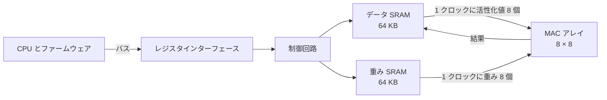

<!-- source: zh-TW/0-before-you-start/01-spec-and-architecture/README.md | sha: 0001bf06d141 -->

# 第 1 章　仕様とアーキテクチャ：どんなチップを作るかを決める

> 📍 **設計の現在地**
>
> - 前の工程：全体像。設計フローと二つの主役を知った
> - **この章：`tiny_npu` の仕様とアーキテクチャを書き、`mac` を何ビットにするかを決める**
> - 次の工程：トランジスタから論理ゲートへ。仕様にある演算をどんな回路で作るかを見る

🪜 抽象度：**仕様** ▸ RTL ▸ ネットリスト ▸ レイアウト ▸ GDS ▸ チップ

---

## 仕様書：全員の共通の拠り所

家を建てる前には、部屋がいくつ必要か、予算はいくらか、いつ住み始めたいかをはっきりさせます。チップも同じです。RTL を書き始める前に、まず**仕様書**が必要です。チップが何をするか、どれだけ速いか、どれだけの面積と電力を使ってよいか、インターフェースはどんな形か、いつテープアウトするかを書きます。

この先のすべての関門は仕様書が基準です。RTL を書く人はそれに従って設計し、検証する人はそれに従って確かめ、ファームウェアエンジニアはそれに従ってドライバを書きます。仕様書があいまいなところは、それぞれが自分の思い込みで埋めてしまいます。

> [!NOTE]
> **📖 用語｜仕様書（Specification、規格書）**
>
> - **定義**：チップの機能、性能、インターフェース、制約を記した文書。設計と検証の共通の拠り所になる。
> - **現場での使い方**：ふつうはそのまま spec と呼ぶ。「このケースは spec に書いてないから、アーキテクトに聞こう」。
> - **関連用語**：アーキテクチャ文書、レジスタマップ、検証計画
> - **よくある混同**：仕様書はデータシートではない。データシートは顧客向けの製品説明で、仕様書はチーム向けの設計の拠り所であり、内部の細かい情報を大量に含む。

---

## tiny_npu は何を計算するか

画像を認識するニューラルネットワークには、数十の層があります。どの層もやることはほぼ同じで、入力データの小さなまとまりと一組の重みを項目ごとに掛け、全部を足し合わせます。この演算を**内積**（Dot Product）と呼びます。

たとえばよくある畳み込み層では、出力の 1 点ごとに入力画像の 3 × 3 の範囲を見ます。しかも入力には 128 のチャネルがあります。だから出力の 1 点は、3 × 3 × 128 ＝ 1,152 個の積の合計です。1 枚の画像には何万もの出力点があり、そのすべてでこの内積を計算します。

そこで `tiny_npu` には三つのものが必要です。ずらりと並んだ積和ユニット、そこにデータを送り込む **SRAM**（Static Random-Access Memory）、そして CPU が命令を出す方法です。

面積と電力を節約するため、`tiny_npu` は浮動小数点数を使わず、データも重みも 8 ビットの整数に置き換えます。これを **INT8** と呼びます。8 ビットの符号付き整数は、-128 から 127 までを表せます。

> [!NOTE]
> **📖 用語｜量子化（Quantization、量化）**
>
> - **定義**：ニューラルネットワークの重みとデータを、浮動小数点数からビット数の少ない整数に変えて計算すること。
> - **現場での使い方**：「モデルを INT8 に量子化しても、精度はほんの少ししか落ちなかった」。
> - **関連用語**：INT8、浮動小数点数、累算器、飽和
> - **よくある混同**：入力が 8 ビットでも、結果が 8 ビットで足りるわけではない。8 ビット同士の積は 16 ビットになり、それを千項以上足し合わせれば、数はさらに大きくなる。

---

## アーキテクチャ：ブロック図を描く

仕様は「何をするか」を、**アーキテクチャ**は「どのブロックを使い、どうつなぐか」を述べます。`tiny_npu` のアーキテクチャは次のとおりです。

クロックごとに、データ SRAM は活性化値を 8 個、重み SRAM は重みを 8 個送り出します。`r` 行 `c` 列の MAC は、`r` 番目の活性化値に `c` 番目の重みを掛けて、自分の累算器に足し込みます。64 個の MAC が同時にこれを行い、1,152 クロック続けると、64 個の出力点が得られます。

| 項目 | 仕様 |
|---|---|
| 積和ユニット | 8 × 8 ＝ 64 個。入力は INT8、累算器は 24 ビット、オーバーフロー時は飽和 |
| メモリ | データ SRAM、重み SRAM それぞれ 64 KB |
| クロック | 演算側 500 MHz、バス側 100 MHz |
| ピーク性能 | 64 × 500 MHz ＝ 毎秒 320 億回の積和演算 |
| プロセス | 28 nm クラスの成熟プロセス、ダイの一辺は約 2 mm |

ファームウェアはいくつかのレジスタを通して `tiny_npu` に指示を出します。この**レジスタマップ**も仕様の一部で、ファームウェアエンジニアはこれをもとにドライバを書きます。

| アドレス | 名前 | 用途 |
|---|---|---|
| `0x00` | `CTRL` | `START` ビットに 1 を書くと、演算を 1 回始める |
| `0x04` | `STATUS` | `BUSY` と `DONE` の二つの状態ビット |
| `0x08` | `LEN` | 一つの内積で何項を足し込むか |
| `0x0C` | `ADDR` | SRAM の中のデータと重みの開始アドレス |

> [!TIP]
> **🔧 ノウハウ｜アーキテクチャはまずソフトウェアのモデルで動かし、それから RTL を書く**
>
> - **状況**：MAC をいくつ置くか、SRAM をどれだけの大きさにするか、1 クロックに何個のデータを送るかを決めたい。
> - **やり方**：Python や C++ で**アーキテクチャモデル**を書き、本物のニューラルネットワークを一通り流す。MAC がデータ待ちで遊んでいる時間はどれだけか、INT8 と 24 ビットの累算器が精度に影響しないかを計算する。
> - **理由**：ソフトウェアならアーキテクチャの変更は数日で済む。RTL を書いたあとで変えれば、何か月もかかる。このモデルはのちに検証用のリファレンスモデルにもなる。
> - **やらないとどうなる**：チップのピーク性能は立派でも、メモリが MAC にデータを送りきれず、実際にはその一部しか発揮できない。
> - **関連する章**：[第 6 章　検証](../../2-front-end/06-verification/README.md)

---

## PPA：三つの指標は同時には満たせない

設計を評価する最も基本的な三つの指標は、**性能、消費電力、面積**（Performance, Power, Area、PPA）です。三つはよく引っ張り合います。MAC を多く置けば速く計算できますが、面積も電力も増えます。クロックを上げれば回路をもっと細かく分ける必要があり、電力も上がります。

`mac` の累算器を何ビットにするかも、PPA のトレードオフです。32 ビットならオーバーフローはほぼ起きません。24 ビットなら MAC 1 個あたりフリップフロップ 8 個と加算器の一部が減り、64 個の MAC を合わせると、かなりの面積と電力を節約できます。

アーキテクトは 24 ビットを選び、仕様に一文を書き込みました。**累算の結果が範囲を超えたときは、最大値か最小値で止めること**。これを**飽和**（Saturation）と呼びます。車の走行距離計のように、最大値を超えたら最初に戻ってはいけません。そちらは**ラップアラウンド**（Wrap-around）と呼びます。

> [!IMPORTANT]
> **💻 ソフトウェアとの対比｜ハードウェアでは 1 ビットごとにお金がかかる**
>
> - **似ている点**：プログラムでデータ型を選ぶこと。`int32_t` にするか `int64_t` にするか。
> - **違う点**：ソフトウェアでは数ビット多く使ってもほとんどコストはかからない。ハードウェアでは 1 ビット増えるごとに、64 個の MAC すべてにフリップフロップと加算器が 1 組ずつ増える。量産すれば、チップ 1 個ごとにその面積と電力を払い続ける。
> - **だから注意**：ビット幅は最悪のケースから計算する。そして「範囲を超えたらどうするか」を仕様にはっきり書き、RTL を書く人の推測に任せない。

🔍 もう一歩深く：24 ビットの累算器で足りるのか

INT8 同士の積で絶対値が最大になるのは (-128) × (-128) ＝ 16,384 です。24 ビットの符号付き数で表せる最大値は 8,388,607 です。

- どの項も最大の積だとすると、512 項目でちょうど上限を超える。512 × 16,384 ＝ 8,388,608。
- だからデータが何であっても、**511 項以内の内積は決してオーバーフローしない**。
- 1,152 項の畳み込みが範囲を超えるのは、同じ符号の大きな積がたくさん並んだときだけである。実際のデータは正負が入り混じることが多いので、アーキテクチャモデルではオーバーフローはめったに見られない。

「めったにない」は「起きない」ではありません。これが仕様で飽和を求める理由であり、第 15 章の物語の伏線でもあります。

---

## 買うか、自分で作るか

すべてのブロックを自分で設計するわけではありません。`tiny_npu` の分担は次のとおりです。

- **自分で設計する**：MAC アレイ、制御回路、レジスタインターフェース。製品の違いはここで生まれる。
- **既製の IP を使う**：SRAM はメモリコンパイラで生成し、PLL と I/O 回路はファウンドリか IP ベンダーから入手する。
- **プロセスを選ぶ**：28 nm クラスの成熟プロセス。マスクは先端プロセスよりずっと安く、技術も長く実績がある。500 MHz で動かすにはこれで十分である。

> [!TIP]
> **🔧 ノウハウ｜仕様を凍結したあとの変更は、変更手続きを通す**
>
> - **状況**：RTL を書いている途中で、誰かが新しい機能をもう一つ足したいと言い出す。
> - **やり方**：仕様はある時点で「凍結」する。それ以降の変更は変更申請を出し、RTL、検証、タイミング、日程への影響を評価して、全員が合意してから変える。
> - **理由**：仕様の 1 項目の変更は、すべての関門の仕事に波及する。
> - **やらないとどうなる**：最後の最後に入った機能はテストの時間がいちばん少なく、問題を抱えたままテープアウトしやすい。
> - **関連する章**：[第 14 章　テープアウト](../../4-to-the-fab/14-tape-out/README.md)

---

## この章のポイント

1. 仕様書はチップが何をするか、どれだけ速いか、どれだけのコストをかけるかを書いたもので、この先のすべての関門の共通の拠り所である。
2. ニューラルネットワークの中心の演算は内積なので、AI チップはずらりと並んだ MAC と、データを送り込むメモリでできている。
3. アーキテクチャはまずソフトウェアのモデルで確かめる。このモデルはのちに検証のリファレンスモデルになる。
4. PPA は性能、消費電力、面積のトレードオフである。`mac` は 24 ビットの累算器を選び、オーバーフロー時は飽和すると決めた。
5. すべてのブロックを自作するわけではなく、SRAM、PLL、I/O にはふつう既製の IP を使う。

---

## 参考文献

- John L. Hennessy、David A. Patterson『Computer Architecture: A Quantitative Approach』第 6 版、第 7 章（ドメイン固有アーキテクチャ）
- Vivienne Sze、Yu-Hsin Chen、Tien-Ju Yang、Joel S. Emer『Efficient Processing of Deep Neural Networks』
- 『半導体製造入門』[第 14 章　「何ナノ」とは何か](https://github.com/chenwei810/Semiconductor_Manufacturing_Introduction/blob/main/ja/3-integration/14-process-nodes/README.md)

---

[← 第 0 章　IC 設計の全体像](../00-overview/README.md) ｜ [目次](../../README.md) ｜ [第 2 章　トランジスタから論理ゲートへ →](../../1-digital-logic/02-transistors-to-gates/README.md)
