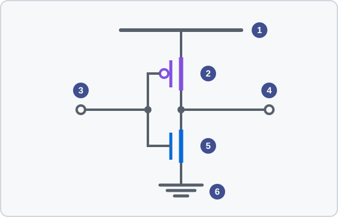

<!-- source: zh-TW/1-digital-logic/02-transistors-to-gates/README.md | sha: 5f1ee105ed9e -->

# 第 2 章　トランジスタから論理ゲートへ：スイッチで 0 と 1 を作る

> 📍 **設計の現在地**
>
> - 前の工程：仕様とアーキテクチャ。`tiny_npu` が何を計算するかを決めた
> - **この章：いちばん下の層まで降りて、どの `mac` も形づくっているスイッチと論理ゲートを知る**
> - 次の工程：組み合わせ回路と順序回路。論理ゲートを組み合わせて、計算し記憶する回路にする

🪜 抽象度：仕様 ▸ RTL ▸ **ネットリスト** ▸ レイアウト ▸ GDS ▸ チップ

---

## トランジスタはスイッチである

チップの中のトランジスタは、デジタル回路ではスイッチとしてだけ使われます。水道管のバルブのようなものです。ゲートが取っ手で、取っ手を一方に回せば水が流れ、反対に回せば水が止まります。

デジタル回路は 2 種類のトランジスタを使います。

- **NMOS**：ゲートが 1（高い電圧）のときにオンになり、0 のときにオフになる。
- **PMOS**：ちょうど逆で、ゲートが 0 のときにオンになり、1 のときにオフになる。

トランジスタがなぜこのようにオン・オフできるのかは、『半導体製造入門』の第 2 章で詳しく説明しています。本書では、電圧で制御するスイッチだということだけ覚えておけば十分です。

> [!NOTE]
> **📖 用語｜CMOS（Complementary Metal-Oxide-Semiconductor、相補型金属酸化物半導体、互補式金屬氧化物半導體）**
>
> - **定義**：NMOS と PMOS をペアで使う回路技術。ほとんどすべてのデジタルチップがこれを使う。
> - **現場での使い方**：回路だけでなくプロセスを指すこともある。「これは 28 nm の CMOS プロセスだ」。
> - **関連用語**：NMOS、PMOS、インバータ、しきい値電圧
> - **よくある混同**：カメラの「CMOS センサー」は、この技術で作ったイメージセンサーのことで、別の回路技術ではない。

---

## インバータ：いちばん簡単な論理ゲート

PMOS を電源と出力の間に、NMOS を出力とグラウンドの間につなぎ、二つのゲートをつないで入力にすると、**インバータ**（Inverter）になります。

- 入力が 1：NMOS がオンになり、出力をグラウンドに引き下げる。出力は 0。
- 入力が 0：PMOS がオンになり、出力を電源に引き上げる。出力は 1。

*図の説明：① 電源。② PMOS。ゲートの前の小さな丸は「ゲートが 0 のときにオン」を表す。③ 入力。④ 出力。⑤ NMOS。⑥ グラウンド。*

入力が何であっても、上下のスイッチのどちらかは必ずオフなので、電源からグラウンドへ電流が直接流れることはありません。これが CMOS が省電力な理由です。回路がはっきり電力を使うのは、切り替わる瞬間だけです。

---

## NAND、NOR と真理値表

トランジスタを何個か増やせば、ほかの**論理ゲート**（Logic Gate）も作れます。たとえば PMOS 2 個を並列に、NMOS 2 個を直列につなぐと、2 入力の NAND になります。二つの入力がどちらも 1 のときだけ下側の道が完全につながり、出力が 0 になります。

論理ゲートを最もはっきり表す方法は、すべての入力の組み合わせを並べた**真理値表**（Truth Table）です。

| A | B | AND | OR | NAND | NOR | XOR |
|:-:|:-:|:-:|:-:|:-:|:-:|:-:|
| 0 | 0 | 0 | 0 | 1 | 1 | 0 |
| 0 | 1 | 0 | 1 | 1 | 0 | 1 |
| 1 | 0 | 0 | 1 | 1 | 0 | 1 |
| 1 | 1 | 1 | 1 | 0 | 0 | 0 |

CMOS で自然に作れるのは「反転した」論理ゲートで、NAND と NOR がいちばん簡単で速くなります。AND は実は NAND のあとにインバータをつないだものです。

NAND だけで、どんな論理でも組み立てられます。そのため業界では、回路の大きさを「2 入力 NAND 何個分か」で表す習慣があります。

> [!NOTE]
> **📖 用語｜ゲート数（Gate Count、邏輯閘數）**
>
> - **定義**：回路の面積を「2 入力 NAND（NAND2）何個分か」に換算した数。回路の大きさを比べるのに使う。
> - **現場での使い方**：K や M を単位にすることが多い。「このブロックはだいたい 50K ゲートだ」。
> - **関連用語**：NAND2 換算ゲート数、標準セル、面積レポート
> - **よくある混同**：1 ゲートはトランジスタ 1 個ではない。NAND2 一つでトランジスタは 4 個ある。ゲート数は本物の論理ゲートの個数でもなく、面積から換算した値である。

---

## 遅延：切り替わるには時間がかかる

論理ゲートの出力が 0 から 1 に変わるには、次の段の入力と配線を充電しなければなりません。1 から 0 に変わるには、その電気を放電します。これは水道管でバケツを満たすのに似ています。バケツが大きいほど（後ろにつながるものが多く、配線が長いほど）、あるいは管が細いほど（トランジスタが小さいほど）、長く待つことになります。

28 nm クラスのプロセスでは、論理ゲート一つの遅延はおよそ数十ピコ秒（ps）です。信号がフリップフロップを出て、一連の論理ゲートを通り、次のフリップフロップに着くまで、遅延は積み重なっていきます。この一連の論理ゲートの遅延が、チップのクロックをどれだけ速くできるかを決めます。第 8 章で詳しく計算します。

---

## 消費電力：切り替わるたびに電気代がかかる

チップの消費電力には、主に 2 種類あります。

- **動的電力**（Dynamic Power）：信号が切り替わるたびに、容量を充電し、放電する。切り替えが多いほど、電圧が高いほど、多くの電力を使う。
- **リーク電力**（Leakage Power）：トランジスタはオフのときも閉じきらず、少しずつ電流が漏れる。温度が高いほど、漏れも多い。

動的電力は簡単な関係で書けます。電力は「容量 × 電圧の 2 乗 × 切り替えの頻度」に比例します。電圧は 2 乗で効くので、電圧を下げることが最も効果的な省電力の方法です。

> [!IMPORTANT]
> **💻 ソフトウェアとの対比｜CPU を眠らせることと、回路を切り替えさせないこと**
>
> - **似ている点**：ソフトウェアで電力を節約するときは、暇になった CPU をスリープさせる。
> - **違う点**：回路の信号線は、0 と 1 の間で切り替わるたびに電力を使う。その結果を誰も使っていなくても同じである。働いていない MAC も、クロックが動いていて入力が変わり続けている限り、電力を使い続ける。
> - **だから注意**：ハードウェアの省電力は「不要な信号を切り替えさせない」ことから始める。使わないブロックはクロックを止め（第 5 章）、電源まで切ることもある（第 10 章）。

🔍 もう一歩深く：なぜ電圧の 2 乗なのか

容量を電圧 V まで充電するとき、電源から取り出すエネルギーは C × V² です。その半分が容量に蓄えられ、残りの半分は充電の途中で熱になります。放電するときには、蓄えた半分も熱になります。だから充放電を 1 回するごとに、C × V² のエネルギーを消費します。

電圧が高くなると、同じ容量にためる電荷が増え、電荷 1 個あたりが「落ちる」電圧差も大きくなります。二つの効果が掛け合わさって、2 乗になります。

1 秒間に実際に充放電する回数は、クロック周波数 f に**トグル率**（α、1 クロックあたり平均してどれだけの割合のノードが 0 から 1 に変わるか）を掛けたものです。だから動的電力はおよそ α × C × V² × f です。電圧を 10% 下げると、動的電力はおよそ 19% 下がります。

---

## 標準セル：設計者が使う積み木

設計者はトランジスタを一つずつ描いたりはしません。ファウンドリや IP ベンダーが**標準セルライブラリ**（Standard Cell Library）を提供します。インバータ、NAND、NOR、XOR、マルチプレクサ、加算器、フリップフロップなどで、どれもレイアウトが描かれ、速度と電力が測られています。

標準セルはどれも高さがそろっているので、積み木のように 1 列ずつ並べられます（第 11 章）。第 7 章の論理合成は、このライブラリから適したセルを選び、RTL が記述する回路を組み立てる作業です。

> [!TIP]
> **🔧 ノウハウ｜同じ論理ゲートにも、駆動力の違うものが何種類もある**
>
> - **状況**：ライブラリの NAND2 には何種類かの大きさがある。現場ではよく X1、X2、X4 のように呼んで駆動力を区別する。
> - **やり方**：長い配線や多くの入力を駆動するときは駆動力の大きいものを、近くのセル一つか二つにしかつながらないときは小さいものを使う。論理合成と物理設計のツールが自動的に選び、調整する。
> - **理由**：大きいセルは速く駆動できるが、面積が大きく、自分の入力容量も大きい。前の段はそれを駆動するのに余計な力が必要になり、電力も増える。
> - **やらないとどうなる**：すべて大きいものにすれば、面積と電力をむだにする。すべて小さいものにすれば、長いパスがクロックに間に合わない。
> - **関連する章**：[第 7 章　論理合成](../../2-front-end/07-logic-synthesis/README.md)、[第 8 章　静的タイミング解析](../../2-front-end/08-static-timing-analysis/README.md)

> [!TIP]
> **🔧 ノウハウ｜速いセルはクリティカルパスに、それ以外は省電力のセルに**
>
> - **状況**：同じプロセスでも、しきい値電圧（Threshold Voltage、Vt）の違うセルが何種類か用意されている。低 Vt は速いがリークが多く、高 Vt は遅いがとても省電力である。
> - **やり方**：時間がいちばん厳しいパスだけに低 Vt のセルを使い、それ以外の大部分の回路には高 Vt を使う。
> - **理由**：チップが待機しているとき、電力の主な行き先はリークである。しかもほとんどのパスは、実はそれほど速くなくてよい。
> - **やらないとどうなる**：すべて低 Vt にすれば、待機中もリークが続き、電池がすぐなくなる。すべて高 Vt にすれば、目標のクロックに間に合わない。
> - **関連する章**：『半導体製造入門』[第 2 章　物理からトランジスタへ](https://github.com/chenwei810/Semiconductor_Manufacturing_Introduction/blob/main/ja/1-fundamentals/02-transistor-basics/README.md)

---

## この章のポイント

1. デジタル回路のトランジスタはスイッチである。NMOS はゲートが 1 のとき、PMOS はゲートが 0 のときにオンになる。
2. NMOS と PMOS をペアで使うのが CMOS である。安定しているときは電源からグラウンドへ電流が直接流れないので、省電力である。
3. 真理値表は論理ゲートのすべての入力の組み合わせを並べる。回路の大きさは NAND2 換算の数で表すことが多い。
4. 論理ゲートの遅延はパスに沿って積み重なり、クロックの上限を決める。動的電力は電圧の 2 乗に比例する。
5. 設計者はファウンドリが提供する標準セルライブラリを使う。同じ論理ゲートにも駆動力としきい値電圧の違うものがある。

---

## 参考文献

- Neil H. E. Weste、David Money Harris『CMOS VLSI Design: A Circuits and Systems Perspective』第 4 版、第 1、2 章
- Jan M. Rabaey、Anantha Chandrakasan、Borivoje Nikolić『Digital Integrated Circuits: A Design Perspective』第 2 版
- 『半導体製造入門』[第 2 章　物理からトランジスタへ](https://github.com/chenwei810/Semiconductor_Manufacturing_Introduction/blob/main/ja/1-fundamentals/02-transistor-basics/README.md)

---

[← 第 1 章　仕様とアーキテクチャ](../../0-before-you-start/01-spec-and-architecture/README.md) ｜ [目次](../../README.md) ｜ [第 3 章　組み合わせ回路と順序回路 →](../03-combinational-and-sequential/README.md)
