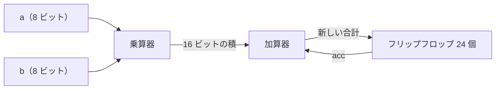
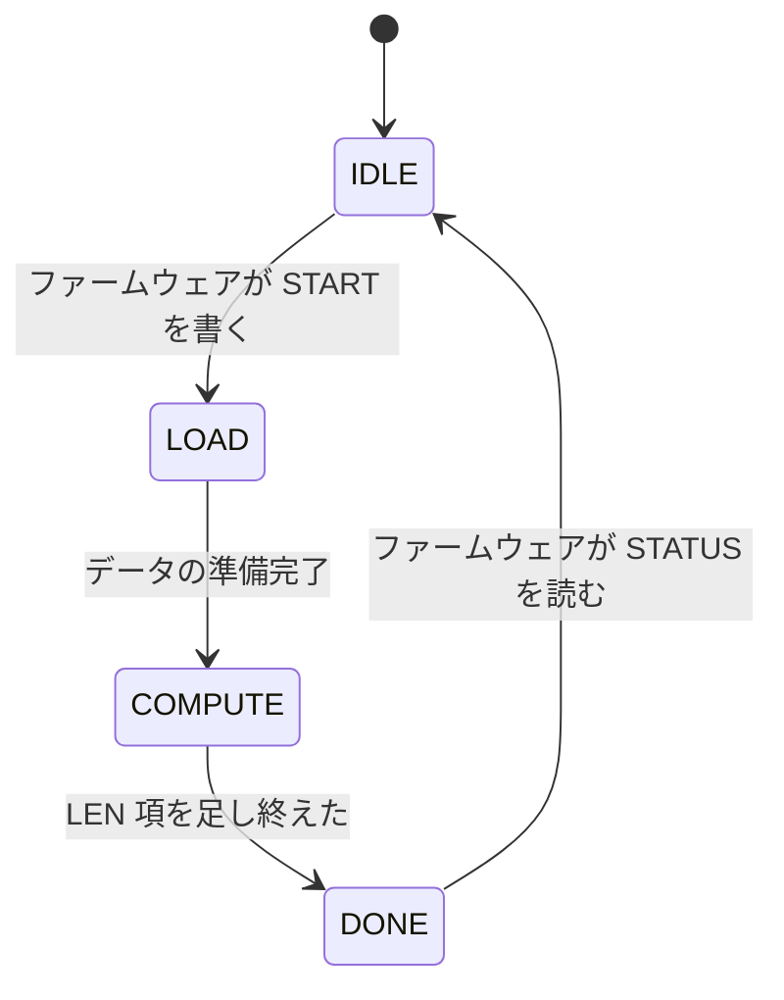

<!-- source: zh-TW/1-digital-logic/03-combinational-and-sequential/README.md | sha: 64db215d1d9c -->

# 第 3 章　組み合わせ回路と順序回路：計算もし、記憶もする

> 📍 **設計の現在地**
>
> - 前の工程：トランジスタから論理ゲートへ。スイッチ、論理ゲート、標準セルを知った
> - **この章：論理ゲートを組み合わせて、`mac` に必要な加算器、乗算器、累算器を作る**
> - 次の工程：RTL と Verilog。これらの回路をコードで記述する

🪜 抽象度：仕様 ▸ **RTL ▸ ネットリスト** ▸ レイアウト ▸ GDS ▸ チップ

---

## 2 種類の回路

デジタル回路は 2 種類に分かれます。

- **組み合わせ回路**：出力はいまの入力だけで決まる。電卓の足し算のように、3 と 4 を押せば答えは 7 で、さっき何を計算したかには関係がない。
- **順序回路**：記憶を持つので、出力が過去にも左右される。カウンタのように、1 回押すごとに 1 増え、いまの数はそれまでに何回押したかで決まる。

`mac` には両方があります。乗算器と加算器は**組み合わせ回路**（Combinational Logic）で、累算の結果を覚えておくレジスタは**順序回路**（Sequential Logic）です。組み合わせ回路にはクロックがありませんが、時間を気にしなくてよいわけではありません。その遅延こそが、クロックをどれだけ速くできるかを決める鍵です。

---

## 2 進数と負の数

8 ビットでは 256 通りの組み合わせを表せます。**符号なし**（Unsigned）の数として読めば、0 から 255 です。では負の数はどう表すのでしょうか。デジタル回路で最もよく使うのは **2 の補数**（Two's Complement）で、最上位ビットの重みを負とみなします。8 ビットの最上位ビットは -128 を表し、残りの 7 ビットはいつもどおり 64、32、……、1 です。だから 8 ビットの**符号付き**（Signed）の数は、-128 から 127 までを表せます。

| ビット | 符号なしとして読む | 符号付きとして読む |
|---|---|---|
| `0000_0011` | 3 | 3 |
| `1111_1101` | 253 | -3 |
| `1000_0001` | 129 | -127 |

同じビットの並びが、129 にも -127 にもなります。回路自身は答えを知りません。どう読むかは設計者が決めます。

符号付きの数のビット幅を広げるときは、最上位ビットを新しいビットにコピーします。これを**符号拡張**（Sign Extension）と呼びます。たとえば -3 を 16 ビットに広げると `1111_1111_1111_1101` です。前に 0 を詰めてしまうと、253 になります。

> [!NOTE]
> **📖 用語｜2 の補数（Two's Complement、二補數）**
>
> - **定義**：デジタル回路で最もよく使う負の数の表し方。最上位ビットの重みが負になる。
> - **現場での使い方**：「この信号は 2 の補数だから、signed の宣告を忘れずに」。
> - **関連用語**：符号付き、符号なし、符号拡張、オーバーフロー
> - **よくある混同**：ビットそのものに正負はない。同じ `1000_0001` が、符号なしなら 129、符号付きなら -127 になる。どう読むかは設計の中に書いておく必要がある。

> [!IMPORTANT]
> **💻 ソフトウェアとの対比｜C 言語の int8_t と uint8_t に似ている**
>
> - **似ている点**：C 言語の `int8_t` と `uint8_t`。同じ 8 ビットで、読み方が違う。
> - **違う点**：C のコンパイラは変数ごとの型を知っている。回路の配線はただの 0 と 1 の束で、型は RTL の宣言の中にしか存在しない。宣言を間違えても、ハードウェアはエラーを出さず、黙って間違った答えを計算する。
> - **だから注意**：C 言語では、`int` と `unsigned int` を混ぜて計算すると、こっそり符号なしの演算になる。Verilog にも似た落とし穴があり、しかももっと踏みやすい。第 6 章の `mac` がまさにそこに落ちる。

---

## 加算器

2 進数の足し算は 10 進数と同じで、最下位の桁から足し、2 になったら桁上げします。

- **半加算器**：2 ビットを足し、「和」と「桁上げ」を出力する。和は XOR、桁上げは AND である。
- **全加算器**：下の桁から来た桁上げをもう一つ受け取るので、1 桁ずつつないでいける。
- **リップルキャリー加算器**（Ripple Carry Adder）：全加算器を 24 個一列につなげば、24 ビットの数を足せる。

リップルキャリー加算器は面積が小さくて済みますが、桁上げが 1 桁ずつ上へ伝わっていくので、桁数が多いほど遅くなります。速い加算器は桁上げを先回りして計算しますが、その代わりに論理ゲートが増えます。これも PPA のトレードオフです。

---

## 乗算器

2 進数の掛け算は、筆算の掛け算と同じです。乗数の各ビットは 0 か 1 しかないので、各行の結果も 2 通りしかありません。0 か、被乗数を何桁か左にずらしたものです。この行を**部分積**（Partial Product）と呼び、AND ゲートを一列並べれば作れます。8 ビット × 8 ビットでは部分積が 8 行でき、それをたくさんの加算器で足し合わせて、16 ビットの積を得ます。だから乗算器は加算器よりずっと大きく、ずっと遅く、`mac` の中でいちばん面積を取る部分です。

🔍 もう一歩深く：符号付きの数の掛け算

2 の補数では最上位ビットの重みが負なので、符号付きの掛け算に符号なしのやり方をそのまま使うことはできません。よく使われる方法は二つあります。

- 二つのオペランドをまず符号拡張し、より幅の広い符号なしの数として掛け、必要な下位ビットだけを取り出す。簡単だが、論理ゲートをむだにする。
- 部分積の符号ビットを調整して、合計した結果が自動的に正しくなるようにする。業界でよく使う Baugh-Wooley 法はこの種のやり方である。Booth 符号化を使えば、部分積の行数をほぼ半分に減らせる。

どちらの方法でも、設計者は「これは符号付きの数だ」とツールに伝える必要があります。論理合成ツールは符号付きの掛け算を見ると、正しい構造を自動的に選びます。

---

## フリップフロップとクロック

**フリップフロップ**（Flip-Flop）は 1 ビットの記憶素子です。**クロック**が 0 から 1 に変わる瞬間（立ち上がりエッジ）にだけ入力を取り込み、次の立ち上がりエッジまでその値を保ち続けます。写真を撮るのに似ています。シャッターを押した瞬間の景色が写り、そのあと外がどう変わっても写真は変わりません。フリップフロップを何個か並べたものが**レジスタ**（Register）です。

クロックはオーケストラの指揮者のようなもので、すべてのフリップフロップが同じ拍子で進みます。フリップフロップがきれいに「撮影」できるよう、データはシャッターの前後のわずかな時間、安定していなければなりません。この時間は第 8 章で詳しく説明します。

> [!NOTE]
> **📖 用語｜フリップフロップ（Flip-Flop、正反器）**
>
> - **定義**：クロックのエッジで入力を取り込み、保持する 1 ビットの記憶素子。
> - **現場での使い方**：よく flop や DFF と呼ぶ。「このブロックには flop が二千個以上ある」。
> - **関連用語**：レジスタ、クロック、ラッチ、setup、hold
> - **よくある混同**：**ラッチ**（Latch）は、クロックが高レベルの間ずっとデータを通す。エッジで 1 回だけ取り込むのではない。両者は振る舞いが違い、タイミング解析のしかたも違う。

---

## 累算器：組み合わせ回路と順序回路の合体

乗算器、加算器、24 個のフリップフロップを輪の形につなぐと、`mac` の累算器になります。

クロックごとに、フリップフロップはいまの合計を出力し、そこに新しい積を足して、次の立ち上がりエッジでフリップフロップに書き戻します。だからクロックの 1 周期は、「乗算器と加算器」の遅延より長くなければなりません。最も簡単な式で書けば、**クロック周期 ≥ パス上の遅延の合計** です。第 8 章では、500 MHz ではこのパスが長すぎることがわかります。

> [!TIP]
> **🔧 ノウハウ｜結果に何ビット必要かを先に計算しておく**
>
> - **状況**：加算器、乗算器、累算器を設計するとき、結果のビット幅を決める必要がある。
> - **やり方**：N ビット同士を足せば、結果は N＋1 ビットになる。N ビット × M ビットなら、結果は N＋M ビットになる。K 項を累算するなら、さらに K 倍を収められるだけのビットを足す。
> - **理由**：ビット幅が足りないと、最上位ビットはそのまま切り捨てられ、回路はエラーを出さない。
> - **やらないとどうなる**：値が範囲を超えると、最大値から最小値へ突然跳ぶ。この種の誤りはふだんめったに出ず、出たときには原因を調べるのがとても難しい。
> - **関連する章**：[第 1 章　仕様とアーキテクチャ](../../0-before-you-start/01-spec-and-architecture/README.md)

---

## 有限状態機械

`tiny_npu` の制御回路は、自分がいま何をしているかを覚えておく必要があります。暇なのか、データを運んでいるのか、計算しているのか、計算が終わったのか。このような回路を**有限状態機械**（Finite State Machine、FSM）と呼びます。いくつかのフリップフロップでいまの状態を覚え、組み合わせ回路で、いまの状態と入力から次のクロックでどの状態に進むかを決めます。`COMPUTE` 状態の間、MAC アレイは 1 クロックに 1 回積和演算を行い、`LEN` 項を足し終えるまで続けます。

> [!TIP]
> **🔧 ノウハウ｜すべてのフリップフロップに同じクロックを使い、論理ゲートで勝手にクロックを作らない**
>
> - **状況**：ある回路を少しゆっくり動かしたくて、論理ゲートでクロックの「何拍かを間引く」。
> - **やり方**：クロックは PLL と専用のクロック回路だけで作る。回路を止めたいときは、イネーブル信号を使うか、ライブラリにある専用のクロックゲーティングセルを使う（第 5 章）。
> - **理由**：ふつうの論理ゲートで作ったクロックは、ごく短いノイズのパルスを出すことがあり、各フリップフロップに届く時刻も制御しにくい。
> - **やらないとどうなる**：フリップフロップがときどき間違った値を取り込む。それも一部のチップ、一部の温度でだけ起き、タイミング解析ツールも正しく確認できない。
> - **関連する章**：[第 5 章　クロックとリセット](../../2-front-end/05-clocks-and-resets/README.md)

---

## この章のポイント

1. 組み合わせ回路の出力はいまの入力だけで決まる。順序回路は記憶を持ち、出力が過去にも左右される。
2. 2 の補数は最上位ビットで負の符号を表す。同じビットの並びでも、符号付きか符号なしかで意味がまったく違う。
3. 加算器は全加算器をつないで作る。乗算器は部分積を何行も足し合わせたもので、加算器よりずっと大きく、ずっと遅い。
4. フリップフロップはクロックのエッジでデータを取り込む。累算器は乗算器、加算器、フリップフロップを輪の形につないだものである。
5. クロック周期は、パス上の遅延の合計より長くなければならない。

---

## 参考文献

- David Money Harris、Sarah L. Harris『Digital Design and Computer Architecture』第 2 版、第 1～5 章
- M. Morris Mano、Michael D. Ciletti『Digital Design』第 6 版

---

[← 第 2 章　トランジスタから論理ゲートへ](../02-transistors-to-gates/README.md) ｜ [目次](../../README.md) ｜ [第 4 章　RTL と Verilog →](../../2-front-end/04-rtl-and-verilog/README.md)
