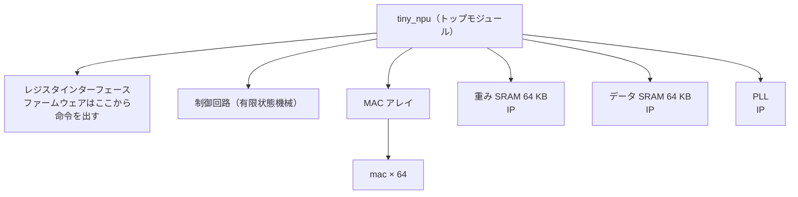

<!-- source: zh-TW/2-front-end/04-rtl-and-verilog/README.md | sha: 7966a18ce809 -->

# 第 4 章　RTL と Verilog：コードでハードウェアを記述する

> 📍 **設計の現在地**
>
> - 前の工程：デジタル論理の基礎。加算器、乗算器、フリップフロップを知った
> - **この章：`mac` を RTL で書き、初めてシミュレータで動かす**
> - 次の工程：クロックとリセット。`tiny_npu` 全体のフリップフロップを足並みそろえて進める

🪜 抽象度：仕様 ▸ **RTL** ▸ ネットリスト ▸ レイアウト ▸ GDS ▸ チップ

---

## なぜコードで回路を描くのか

初期のチップにはトランジスタが数千個しかなく、エンジニアは論理ゲートを一つずつ描いて回路図を作れました。いまのチップには数十億個のトランジスタがあり、手で描くことはもうできません。そこでエンジニアは、**ハードウェア記述言語**（Hardware Description Language、HDL）で回路が「何をするか」を書き、それをツールに渡して論理ゲートに変換させます。この工程が論理合成です（第 7 章）。最もよく使われるハードウェア記述言語は Verilog と、その拡張である SystemVerilog です。

家を建てるのに似ています。建築家が描くのは設計図で、レンガ一つひとつの置き場所までは決めません。RTL はチップの設計図です。クロックごとにどのデータをどのレジスタへ運び、途中でどんな演算をするかを記述しますが、その演算に最終的にどの論理ゲートを使うかは問いません。

> [!NOTE]
> **📖 用語｜レジスタ転送レベル（Register Transfer Level、RTL、暫存器傳輸層級）**
>
> - **定義**：「データがレジスタの間をどう運ばれ、途中でどんな演算をするか」で回路を記述する抽象度。
> - **現場での使い方**：書き上げた Verilog のコードもそのまま RTL と呼ぶ。「RTL はフリーズしたから、この先は ECO でしか変えられない」。
> - **関連用語**：ハードウェア記述言語、Verilog、ネットリスト、論理合成
> - **よくある混同**：RTL は抽象度の一つで、言語ではない。Verilog や VHDL が言語で、それで書いたコードを RTL と呼ぶ。

---

## MAC 一つ分の Verilog

Verilog で回路を記述する基本単位は**モジュール**（Module）です。モジュールは箱のようなもので、箱の外にはピンがあり、これを**ポート**（Port）と呼びます。第 1 章で決めた仕様は、まず `mac` のポートになります。

```verilog
module mac (
    input  wire        clk,
    input  wire        rst_n,   // active-low reset
    input  wire        clr,     // start a new dot product
    input  wire        en,      // accumulate a * b this cycle
    input  wire [7:0]  a,       // activation, INT8
    input  wire [7:0]  b,       // weight, INT8
    output reg  [23:0] acc      // 24-bit accumulator
);
```

- `clk` はクロック、`rst_n` はリセットである。名前の後ろの `_n` は「ローアクティブ」、つまり 0 のときにリセットすることを表す。
- `clr` は MAC に「新しい内積を始めるから、累算器を 0 にせよ」と伝える。
- `en` が 1 のクロックでだけ、`a × b` を累算器に足し込む。`[7:0]` は 8 ビット、`[23:0]` は 24 ビットを表す。

箱の中の回路は次のとおりです。

```verilog
    always @(posedge clk or negedge rst_n) begin
        if (!rst_n)
            acc <= 24'd0;          // reset: clear the accumulator
        else if (clr)
            acc <= 24'd0;          // a new dot product starts
        else if (en)
            acc <= acc + a * b;    // multiply, then add
    end
endmodule
```

`always @(posedge clk ...)` は、クロックが 0 から 1 に変わるたび（立ち上がりエッジ）に中の処理を 1 回行う、という意味です。だからこのコードが記述しているのは、まさに第 3 章の「乗算器と加算器を、24 個のフリップフロップにつなぎ戻した」累算器です。

このコードには二つの問題が隠れています。シミュレーションが止まることも、ツールがエラーを出すこともありません。第 6 章と第 15 章で、それぞれ見つけ出します。

> [!NOTE]
> **📖 用語｜モジュールとインスタンス（Module／Instance、模組與實例）**
>
> - **定義**：モジュールはある回路の設計図で、インスタンスはその設計図どおりにチップに置いた実体の一つ。
> - **現場での使い方**：インスタンスを置くことを instantiate（インスタンス化）と言い、置いたものは instance と呼ぶ。「`tiny_npu` は `mac` を 64 個インスタンス化している」「このインスタンスは `u_mac` という名前だ」。
> - **関連用語**：ポート、階層、トップモジュール
> - **よくある混同**：同じモジュールのインスタンスを 64 個置けば、チップの上には本当に 64 組の回路ができ、どれも面積を取り、電力を使う。ソフトウェアで同じ関数を 64 回呼ぶのとはまったく違う。

---

## ハードウェアは同時に動く

プログラムは 1 行ずつ順番に実行されます。回路は違います。チップの上のすべての論理ゲートが、どの瞬間も同時に働いています。64 個の MAC も順番に計算するのではなく、同じクロックで一斉に計算します。

だから Verilog の `<=` には特別な意味があります。これは**ノンブロッキング代入**（Non-blocking Assignment）と呼ばれ、同じクロックエッジでは、`<=` を使ったすべてのレジスタが「同時に」更新されます。全員が同じ笛の合図で一斉に場所を入れ替えるようなもので、誰も他人の新しい場所を先に見ることはありません。

> [!IMPORTANT]
> **💻 ソフトウェアとの対比｜Verilog は C に似ているが、記述しているのは回路である**
>
> - **似ている点**：文法は C によく似ていて、`if`、`else`、`+`、`*` がある。モジュールも再利用できる関数のように見える。
> - **違う点**：`acc <= acc + a * b` は「計算してから保存する」1 個の命令ではない。乗算器 1 個、加算器 1 個、フリップフロップ 24 個であり、クロックごとに働き続ける。`*` を一つ多く書けば、チップの上に論理ゲートが数百個増える。
> - **だから注意**：RTL を書くときは、それがどんな回路になるかをいつも思い浮かべる。`for` ループは「何回も実行する」のではなく、回路を何組も複製する。`#10` のような遅延や `$display` はテスト用のコードでしか使えず、回路にはならない。

<details>
<summary>🔍 もう一歩深く：ブロッキング代入とノンブロッキング代入</summary>

Verilog には 2 種類の代入があります。`<=` はノンブロッキングで、`=` は**ブロッキング代入**（Blocking Assignment）です。違いは二つのレジスタを入れ替えるときに最もはっきりします。

```verilog
    always @(posedge clk) begin
        x <= y;     // non-blocking: both read the old values
        y <= x;
    end
    always @(posedge clk) begin
        p = q;      // blocking: the next line sees the new p
        q = p;
    end
```

シミュレータで 1 回動かすと、`x` と `y` は 1、2 から 2、1 になり、本当に入れ替わります。ところが `p` と `q` はどちらも 2 になります。業界で共通の規則は、フリップフロップを記述する `always @(posedge clk)` には `<=` を、組み合わせ回路を記述する `always @(*)` には `=` を使うことです。同じブロックに両方を混ぜると、シミュレーションの結果と、合成された回路の動きが食い違うことがあります。

</details>

---

## 書けるだけでなく、作れなければならない

Verilog には二つの用途があります。回路を記述することと、テストを記述することです。テストを記述するときは何でも書けます。ファイルを読む、メッセージを表示する、10 ns 待つ、などです。回路を記述するときは、論理合成ツールが理解でき、論理ゲートに変換できる書き方しか使えません。これを**合成可能**な書き方と呼びます。

最もよくある落とし穴は、組み合わせ回路の `if` を書ききっていないことです。回路は「それ以外の場合」に何を出せばよいかわからないので、前の値を覚えておくしかなく、ありもしないはずのラッチが一つ増えてしまいます。

> [!TIP]
> **🔧 ノウハウ｜組み合わせ回路の if と case は必ずすべての場合を書く**
>
> - **状況**：`always @(*)` でマルチプレクサを書き、`if (sel == 0)` と `if (sel == 1)` だけを書いて、`sel` が 2 や 3 のときのことを書いていない。
> - **やり方**：どの分岐でも出力を代入するか、ブロックの最初で出力にデフォルト値を与えておく。`case` には `default` を加える。
> - **理由**：書かれていない場合、論理合成ツールは出力を「元の値のまま保つ」しかなく、そのためには記憶素子が必要になる。
> - **やらないとどうなる**：回路に思いがけないラッチが入る。第 8 章のタイミング解析ではこれを扱いにくく、シミュレーションと実際のチップの振る舞いが食い違うこともある。
> - **関連する章**：[第 3 章　組み合わせ回路と順序回路](../../1-digital-logic/03-combinational-and-sequential/README.md)

---

## MAC 一つからチップ全体へ

`tiny_npu` のトップモジュールには、レジスタインターフェース、制御回路、MAC アレイ、二つの SRAM、PLL が入っています。MAC アレイの中には、さらに `mac` のインスタンスが 64 個入っています。このように 1 層ずつ包み込む構造を**階層**（Hierarchy）と呼びます。このうち SRAM と PLL は自分で書いた RTL ではなく、ファウンドリや IP ベンダーから入手した既製のブロックです。



64 個のインスタンスを 64 回書く必要はありません。`generate` ループを使い、`r` 行目の MAC に `r` 番目の活性化値を、`c` 列目の MAC に `c` 番目の重みを渡します。

```verilog
    genvar r, c;
    generate
        for (r = 0; r < 8; r = r + 1) begin : row
            for (c = 0; c < 8; c = c + 1) begin : col
                mac u_mac (.clk(clk), .rst_n(rst_n), .clr(clr), .en(en),
                           .a(act[8*r +: 8]), .b(wgt[8*c +: 8]),
                           .acc(acc[24*(8*r+c) +: 24]));
            end
        end
    endgenerate
```

> [!TIP]
> **🔧 ノウハウ｜RTL もバージョン管理し、テープアウトのときにどの版を使ったかを記録する**
>
> - **状況**：同じ RTL を毎日誰かが変えていて、論理合成、検証、物理設計がそれぞれ持っていって使う。
> - **やり方**：RTL は Git のようなバージョン管理システムに入れる。次の関門に渡すたびに、どの commit を使ったかを記録し、テープアウトした版には tag を付ける。
> - **理由**：チップが戻ってから問題が見つかったとき、「あのときテープアウトしたのはいったいどのコードか」を突き止められなければ、問題を再現することも、修正することもできない。
> - **やらないとどうなる**：人によって手元の RTL の版が違い、検証に通った版と実際にテープアウトした版が別物になる。問題が起きても原因すら見つけられない。
> - **関連する章**：[第 15 章　チップが戻ってきたら](../../4-to-the-fab/15-after-silicon/README.md)、『Git 入門』[第 8 章　ブランチ戦略とリリース](https://github.com/chenwei810/Git_Introduction/blob/main/ja/2-beyond-your-computer/08-branching-and-releases/README.md)

---

## 🧪 やってみよう：MAC を初めて動かす

まず [practice/README.md](../../../practice/README.md) に従って Icarus Verilog をインストールします。この節では、いちばん簡単なテストで `mac` が 3 × 4 ＋ 5 × 6 を計算できることを確かめます。

テストの入力は `vectors/directed.txt` に書いてあります。1 行が 1 クロックで、`clr en a b` と、期待する累算器の値が順に並んでいます。このリポジトリのルートで、そのあとのコマンドを実行します。

```text
1 0 0 0 0
0 1 3 4 12
0 1 5 6 42
```

```bash
cd practice
iverilog -o sim rtl/mac_ch04.v tb/tb_mac.v
vvp sim +vec=vectors/directed.txt +verbose
```

`iverilog` は RTL とテスト用のコードをコンパイルして、シミュレーション用のファイル `sim` を作り、`vvp` がそれを実行します。`+verbose` を付けると、テスト用のコードがチェックを 1 件ずつ表示します。

```text
clr                ->  acc = 0   (expected 0)
a =    3, b =    4  ->  acc = 12   (expected 12)
a =    5, b =    6  ->  acc = 42   (expected 42)
PASS: 3 of 3 checks passed
```

3 × 4 ＋ 5 × 6 ＝ 42 で、MAC は初めて正しく計算しました。ただし、これは一つの例を示しただけです。第 6 章で 200 件の乱数を使ってテストすると、一つ目の問題が姿を現します。

---

## この章のポイント

1. 現代のチップはハードウェア記述言語で RTL を書き、ツールが論理ゲートに変換する。RTL はチップの設計図である。
2. Verilog のモジュールにはポートと内部の回路がある。チップに置くインスタンスの一つひとつが、本物の回路である。
3. 回路は同時に動く。フリップフロップにはノンブロッキング代入 `<=` を使い、すべてのレジスタが同じクロックエッジで一斉に更新される。
4. RTL では合成可能な書き方しか使えない。組み合わせ回路の `if` と `case` を書ききらないと、ラッチが増える。
5. RTL はバージョン管理し、どの関門も自分がどの版を使っているかを知っておく。

---

## 参考文献

- Samir Palnitkar『Verilog HDL: A Guide to Digital Design and Synthesis』第 2 版
- Clifford E. Cummings「Nonblocking Assignments in Verilog Synthesis, Coding Styles That Kill!」2000 年
- IEEE 1800（SystemVerilog）規格。Verilog の完全な文法を含む

---

[← 第 3 章　組み合わせ回路と順序回路](../../1-digital-logic/03-combinational-and-sequential/README.md) ｜ [目次](../../README.md) ｜ [第 5 章　クロックとリセット →](../05-clocks-and-resets/README.md)
