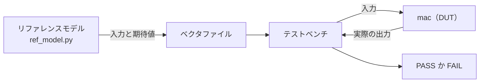

<!-- source: zh-TW/2-front-end/06-verification/README.md | sha: e6d963784a06 -->

# 第 6 章　検証：設計が正しいことを示す

> 📍 **設計の現在地**
>
> - 前の工程：クロックとリセット。`tiny_npu` のクロックドメインとリセットを計画した
> - **この章：リファレンスモデルとランダムテストで `mac` を調べ、中に隠れていた一つ目の問題を見つける**
> - 次の工程：論理合成。検証を終えた RTL を論理ゲートにする

🪜 抽象度：仕様 ▸ **RTL** ▸ ネットリスト ▸ レイアウト ▸ GDS ▸ チップ

---

## なぜ検証がそれほど重要なのか

第 0 章で述べたとおり、チップはテープアウトしてしまうと修正が難しくなります。だからテープアウトの前に、RTL が仕様どおりに動くことを全力で示さなければなりません。この仕事を**検証**（Verification）と呼びます。多くのチームでは検証エンジニアのほうが RTL を書く人より多く、検証がプロジェクトの時間の半分以上を占めることもよくあります。

検証の基本の道具は**テストベンチ**（Testbench）です。シミュレータの中でだけ動くプログラムで、テストする設計に入力を送り、出力が正しいかを確かめます。テストされる設計は**検証対象**（Design Under Test、DUT）と呼ばれ、この章では `mac` です。

> [!NOTE]
> **📖 用語｜テストベンチ（Testbench、測試平台）**
>
> - **定義**：シミュレータの中で入力を作り、テストする設計を駆動し、出力を確かめる検証用のプログラム。
> - **現場での使い方**：よく TB と略す。「まず TB をつないで、smoke test を流してみよう」。
> - **関連用語**：DUT、リファレンスモデル、シミュレータ、波形
> - **よくある混同**：テストベンチは回路にならないので、ファイルの読み込み、メッセージの表示、時間待ちといった合成できない書き方を使える（第 4 章）。

---

## 指向性テストとランダムテスト

第 4 章の 3 × 4 ＋ 5 × 6 は**指向性テスト**（Directed Test）で、エンジニアが自分で入力を選びます。思いつく状況はテストできますが、思いつかない状況はテストできません。

そこで検証はもっと**ランダムテスト**に頼ります。プログラムに入力をランダムに作らせ、そこに制約と偏りを加えます。正当な値だけを作り、しかも -128、-1、0、1、127 といった境界値が特によく出るようにします。これを**制約付きランダムテスト**（Constrained Random Test）と呼びます。

ランダムに作った入力の答えは、誰が計算するのでしょうか。ソフトウェアで書いた**リファレンスモデル**です。第 1 章のアーキテクチャモデルが、ここで役に立ちます。



乱数は本当にでたらめなわけではありません。同じ**乱数シード**（Random Seed）からは、いつも同じ入力ができます。テストが失敗したら、シードを記録しておけば、まったく同じように再現できます。

> [!NOTE]
> **📖 用語｜リファレンスモデル（Reference Model、參考模型）**
>
> - **定義**：ソフトウェアで書かれ、仕様に従って正しい答えを計算できるモデル。RTL の出力と比べるのに使う。
> - **現場での使い方**：よく golden model と呼ぶ。「RTL が golden model と合わない」。
> - **関連用語**：アーキテクチャモデル、乱数シード、比較器
> - **よくある混同**：リファレンスモデルも間違えることがある。RTL とは別の人が、それぞれ仕様をもとに書くのが望ましい。そうすれば同じ誤りを犯さずに済む。

---

## 一つ目の問題を捕まえる

シード 1 で内積を 8 組作ります。1 組は 25 項で、各組の最初のクリアを加えると、チェックは全部で 208 件です。第 4 章の `mac` は 195 件を間違えました。

最初の誤りは -127 × -49 です。正しい答えは 6,223 なのに、`mac` は 26,703 と計算しました。26,703 はちょうど 129 × 207 で、129 と 207 は、-127 と -49 を符号なしとして読んだときの値です（第 3 章）。

原因は、第 4 章のポートに `signed` を宣言していなかったことです。Verilog はデフォルトでそれらを符号なしとして扱います。直すには三つのポートをすべて符号付きとして宣言します。これが `rtl/mac_ch06.v` です。

```verilog
    input  wire signed [7:0]  a,
    input  wire signed [7:0]  b,
    output reg  signed [23:0] acc
```

3 × 4 ＋ 5 × 6 はすべて正の数なので、`signed` を宣言してもしなくても結果は同じです。だから指向性テストでは捕まえられません。これこそがランダムテストの価値です。

> [!TIP]
> **🔧 ノウハウ｜式の中に符号なしの数が一つでもあれば、式全体が符号なしの演算になる**
>
> - **状況**：`a` と `b` を `signed` にしたが、`acc` を忘れた。
> - **やり方**：同じ式の中のオペランドは、すべて符号付きとして宣言する。自信がなければ `$signed()` ではっきり変換する。Lint ツールでも、符号付きと符号なしを混ぜて使っている場所を見つけられる。
> - **理由**：これは Verilog の規則である。オペランドが一つでも符号なしなら、式全体が符号なしとして計算され、負の数は符号拡張されない。C 言語で `int` と `unsigned int` を混ぜたときにも、似た規則がある。
> - **やらないとどうなる**：実際に試すと、`a` と `b` だけを直して `acc` を直さない場合、208 件のうち 195 件がやはり間違える。正の数のテストはすべて通るので、問題はずっと後まで隠れたままになる。
> - **関連する章**：[第 3 章　組み合わせ回路と順序回路](../../1-digital-logic/03-combinational-and-sequential/README.md)

---

## テストは終わったか：カバレッジ

テストが十分かどうかは、どうすればわかるでしょうか。**カバレッジ**で測ります。

- **コードカバレッジ**：RTL のすべての行と分岐が実行されたか。`mac` のコードは数行しかなく、ランダムテストを流せば、リセット、クリア、累算のどの分岐も通る。コードカバレッジは 100% である。
- **機能カバレッジ**：仕様にあるそれぞれの状況が、本当に起きたか。たとえば「累算器が正の方向に範囲を超えた」「負の方向に範囲を超えた」「`LEN` が 1 だった」。

コードカバレッジには盲点があります。測れるのは「書かれたコード」だけです。仕様が求める飽和は、第 4 章ではまったく書かれていないので、実行されていない行は 1 行もありません。このランダムテストの内積は 25 項しかなく、累算器の値は最大でも 5 万あまりで、24 ビットの上限である 800 万あまりには遠く及びません。

> [!NOTE]
> **📖 用語｜カバレッジ（Coverage、覆蓋率）**
>
> - **定義**：テストが十分かを測る指標。コードカバレッジは RTL が実行されたかを、機能カバレッジは仕様の状況がテストされたかを見る。
> - **現場での使い方**：「coverage が 100% に届かないと signoff できない」「この corner はまだ cover できていない」。
> - **関連用語**：検証計画、アサーション、リグレッションテスト
> - **よくある混同**：コードカバレッジが 100% でも、誤りがないとは限らない。書かれていない機能には、測るべきコードがそもそもない。

> [!TIP]
> **🔧 ノウハウ｜検証計画は仕様から 1 項目ずつ書き出す**
>
> - **状況**：検証を始める前に、何をテストするかを決める必要がある。
> - **やり方**：仕様書を 1 項目ずつ読み、どの項目も検証計画の一つの項目として書き、テストと機能カバレッジに対応させる。書き終えたら、設計者とアーキテクトに一緒に確認してもらう。
> - **理由**：RTL を見ながらテストを書くと、RTL が「何をしているか」しか確かめず、「何をすべきか」は確かめない。
> - **やらないとどうなる**：仕様にはあるが誰も実装していない機能は、誰もテストもしない。第 15 章の `mac` は、まさにこうして問題を起こす。
> - **関連する章**：[第 15 章　チップが戻ってきたら](../../4-to-the-fab/15-after-silicon/README.md)

---

## そのほかの検証の方法

- **アサーション**（Assertion）：設計やテストベンチに書く、つねに成り立たなければならない規則。たとえば「`BUSY` と `DONE` が同時に 1 になることはない」。シミュレーション中に破られれば、すぐにエラーを出す。
- **形式検証**（Formal Verification）：入力に頼らず、ある性質が「ありうるすべての入力」で成り立つことを数学的に証明する。小さくて重要な回路に向いている。
- **リグレッションテスト**（Regression Test）：毎晩、違うシードですべてのテストを流し直し、新しい変更が古い機能を壊していないことを確かめる。
- **FPGA プロトタイプ**：RTL を FPGA に入れて動かす。シミュレーションより何千倍、何万倍も速く、テープアウトの前に本物のニューラルネットワークとファームウェアを動かせる。

大きなプロジェクトでは、ふつう SystemVerilog と業界標準の **UVM**（Universal Verification Methodology、IEEE 1800.2）を使って、再利用できるテストベンチを組み立てます。

> [!IMPORTANT]
> **💻 ソフトウェアとの対比｜検証はユニットテストに似ているが、基準がずっと高い**
>
> - **似ている点**：ユニットテスト、継続的インテグレーション、そしてランダムな入力で誤りを探すファジング（Fuzzing）。
> - **違う点**：ソフトウェアは誤りがあっても修正を配布できるが、チップはできない。しかも大きなチップのシミュレーションは本物のチップより百万倍以上遅い。本物のチップなら 1 秒で終わる仕事に、シミュレーションでは何日もかかることがあり、何でもテストすることはできない。
> - **だから注意**：テストは賢く行う。仕様から検証計画を書き、制約付きランダムテストと機能カバレッジでテストできていない場所を見つける。テストの回数をひたすら増やすのではない。

---

## 🧪 やってみよう：リファレンスモデルで signed の誤りを捕まえる

`practice/` フォルダで実行します。まずリファレンスモデルで、シード 1 のランダムテストを作ります。

```bash
python3 ref_model.py random --seed 1 > vectors/random.txt
head -n 3 vectors/random.txt
```

```text
1 0 0 0 0
0 1 -127 -49 6223
0 1 80 50 10223
```

1 行目はクリアで、そのあとの各行が `a` と `b` の 1 組です。最後の列はリファレンスモデルが計算した累算器の値です。第 4 章の `mac` で流してみます。

```bash
iverilog -o sim rtl/mac_ch04.v tb/tb_mac.v
vvp sim +vec=vectors/random.txt
```

```text
MISMATCH at line 2: a = -127, b = -49, expected 6223, got 26703
MISMATCH at line 3: a = 80, b = 50, expected 10223, got 30703
MISMATCH at line 4: a = -12, b = -73, expected 11099, got 75355
FAIL: 195 of 208 checks failed
```

`signed` を宣言した版に替えて、もう一度ランダムテストを流し、第 4 章の指向性テストも流し直します。

```bash
iverilog -o sim rtl/mac_ch06.v tb/tb_mac.v
vvp sim +vec=vectors/random.txt
vvp sim +vec=vectors/directed.txt
```

```text
PASS: 208 of 208 checks passed
PASS: 3 of 3 checks passed
```

新しい問題を直したら、古いテストも流し直して、もとの機能を壊していないことを確かめます。これが最小のリグレッションテストです。波形を見たいときは、`vvp` の行に `+vcd` を付け、できあがった `mac.vcd` を GTKWave で開きます。

---

## この章のポイント

1. 検証はテープアウトの前に RTL が仕様どおりに動くことを示す仕事で、プロジェクトの時間の半分以上を占めることも多い。
2. 指向性テストは思いつく状況しかテストできない。制約付きランダムテストとリファレンスモデルを組み合わせれば、思いもよらない誤りを見つけられる。
3. `mac` の一つ目の問題は `signed` を宣言していなかったことである。負の数が符号なしとして読まれたが、正の数のテストはすべて通っていた。
4. コードカバレッジは書かれていない機能を測れない。検証計画は仕様から 1 項目ずつ書き出す。
5. アサーション、形式検証、リグレッションテスト、FPGA プロトタイプが、それぞれシミュレーションの足りないところを補う。

---

## 参考文献

- Janick Bergeron『Writing Testbenches: Functional Verification of HDL Models』第 2 版
- Chris Spear、Greg Tumbush『SystemVerilog for Verification』第 3 版
- Accellera『Universal Verification Methodology (UVM) User's Guide』

---

[← 第 5 章　クロックとリセット](../05-clocks-and-resets/README.md) ｜ [目次](../../README.md) ｜ [第 7 章　論理合成 →](../07-logic-synthesis/README.md)
