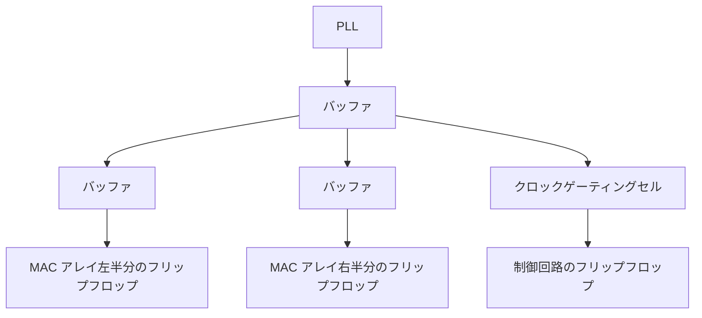

<!-- source: zh-TW/3-physical-design/11-placement-and-cts/README.md | sha: a4fbe88924f3 -->

# 第 11 章　配置とクロックツリー：セルを置き、クロックを届ける

> 📍 **設計の現在地**
>
> - 前の工程：フロアプランと電源網。SRAM、MAC アレイ、電源の位置が決まった
> - **この章：10 万個の標準セルをチップに置き、クロックをすべてのフリップフロップに届ける**
> - 次の工程：配線と寄生成分。すべてのセルを金属配線でつなぐ

🪜 抽象度：仕様 ▸ RTL ▸ ネットリスト ▸ **レイアウト** ▸ GDS ▸ チップ

---

## 配置：10 万個のセルの居場所を探す

標準セルはどれも高さがそろっているので、電源レールの間に 1 列ずつ並べられます。本棚に本を並べるようなものです。**配置**（Placement）とは、ネットリストのすべての標準セルに、本棚の上の居場所を一つずつ見つけることです。

よい配置では、つながり合うセルどうしが近くに集まり、配線は短く、遅延は小さく、混み合うことも少なくなります。ツールはふつう三つの段階で仕上げます。

**グローバル配置 → リーガライズ → 配置後の最適化**

1. **グローバル配置**：まず各セルのおおよその位置を計算する。この段階ではセルどうしが重なってもよい。
2. **リーガライズ**：各セルを最も近い正しい位置に押し出し、セル列にそろえる。重なってはいけない。
3. **配置後の最適化**：タイミングの結果に合わせてセルの大きさを調整し、バッファを挿入し、クリティカルパス上のセルを少し近づける。

`tiny_npu` の 64 個の `mac` は、構造がまったく同じです。ツールは `mac` ごとに数百個のセルを一か所に集め、1 マスずつ整然と並んだアレイを作ります。

> [!NOTE]
> **📖 用語｜使用率（Utilization、使用率）**
>
> - **定義**：標準セルが占める面積の、コアの配置可能な面積に対する割合。
> - **現場での使い方**：「今回は utilization 70% で始めたけど、MAC アレイのあたりはもう 85% になっている」。
> - **関連用語**：混雑、フィラーセル、ダイ面積
> - **よくある混同**：使用率は高いほどよいわけではない。高すぎると配線が通らなくなるうえ、あとでバッファを挿入したり、ECO 用の予備セルを置いたりするにも空間が必要になる。

セルを詰め込みすぎると、ある領域を通るべき配線が、そこで使えるトラックより多くなります。これを**混雑**（Congestion）と呼びます。MAC アレイの乗算器は配線が多く入り組んでいるので、`tiny_npu` で最も混雑しやすい場所です。

> [!TIP]
> **🔧 ノウハウ｜重要な論理の近くに、予備のセルをあらかじめまいておく**
>
> - **状況**：テープアウトのあとで小さな誤りが見つかったとき、できればマスクを全部作り直したくない。
> - **やり方**：配置のときにチップのあちこち、特に MAC アレイのような重要な論理の近くに、使わない**予備セル**や、メタル層を変えるだけで論理ゲートになる **ECO セル**をあらかじめまいておく。
> - **理由**：これらのセルがあれば、小さな修正は上の数層のメタルのマスクを作り直し、それらを回路につなぐだけで済む。その下の数十層のマスクには手を付けなくてよい。
> - **やらないとどうなる**：どんなに小さな修正でも、トランジスタの層から作り直すことになり、何か月もの時間と大きなマスク費用が余計にかかる。
> - **関連する章**：[第 15 章　チップが戻ってきたら](../../4-to-the-fab/15-after-silicon/README.md)、『半導体製造入門』[第 24 章　プロセスとファームウェア](https://github.com/chenwei810/Semiconductor_Manufacturing_Introduction/blob/main/ja/6-beyond-the-fab/24-process-and-firmware/README.md)

配置が終わると、スキャンチェーンもセルの実際の位置に合わせて並べ替えます。チェーンの上で隣り合うフリップフロップがチップの上でも隣り合うようにして、配線を短くします（第 9 章）。

---

## クロックツリー：クロックをすべてのフリップフロップに同時に届ける

`tiny_npu` には数千個のフリップフロップがあり、64 個の `mac` だけでも 2,688 個あります。クロックは、すべてのフリップフロップにほぼ同時に着かなければなりません。しかし 1 本の配線で数千個の負荷を駆動することはできず、PLL からの距離が違うフリップフロップには、クロックの着く時刻も違ってきます。

**クロックツリー合成**（Clock Tree Synthesis、CTS）は、何段ものバッファを使ってクロックを木の枝のように分けていき、枝ごとの長さとバッファを調整して、どのフリップフロップにもクロックができるだけ同じ時刻に着くようにします。

クロックが発生源からフリップフロップまで進む時間を**挿入遅延**（Insertion Delay）と呼び、同じクロックが別々のフリップフロップに着く時刻の差を**クロックスキュー**と呼びます。クロックツリーは毎クロック切り替わり、バッファも多いので、チップの中で最も電力を使う網になることがよくあります。だから第 5 章のクロックゲーティングセルも、ツリーの枝の上に置かれます。

> [!NOTE]
> **📖 用語｜クロックスキュー（Clock Skew、時脈偏移）**
>
> - **定義**：同じクロックが別々のフリップフロップに着く時刻の差。
> - **現場での使い方**：そのまま skew と言うことが多い。「CTS のあとも、この領域の skew はまだ大きすぎる」。
> - **関連用語**：クロックツリー、挿入遅延、クロックジッタ、有用スキュー
> - **よくある混同**：スキューは「別々の場所」の間の時刻の差である。**クロックジッタ**（Jitter）は「同じ場所」でのクロックごとの時刻の揺れで、主に PLL と電源のノイズから来る。

🔍 もう一歩深く：スキューを道具として使う

クロックスキューは必ずしも悪者ではありません。パス A→B が長すぎて、B→C は短いとしましょう。わざと B へのクロックを少し遅く着かせれば、A→B の区間には時間が少し増えます。B→C の区間は同じだけ時間が減りますが、もともと十分に余裕があります。

このように意図的に作るスキューを**有用スキュー**（Useful Skew）と呼びます。長いパスが次の区間から時間を借りるようなものです。タイミングクロージャでよく使う手段の一つですが、その代わりに hold の解析が複雑になります。クロックを遅く着かせることは、前の段のデータが早く着きすぎやすくなることでもあるからです。

> [!TIP]
> **🔧 ノウハウ｜hold はクロックツリーができてから直す**
>
> - **状況**：クロックツリーができる前の STA は、クロックがすべてのフリップフロップに同時に着くと仮定している。
> - **やり方**：最初は setup だけを見る。クロックツリーを作り、本当のクロックの到着時刻で解析し直してから、遅延用のバッファを挿入して hold を直す。
> - **理由**：クロックツリーができる前は、本当のスキューがどれだけかわからない。この段階で hold を直すと、違う場所を直したり、直しすぎたりすることが多い。
> - **やらないとどうなる**：不要なバッファを大量に挿入して面積と電力をむだにし、setup も遅くしてしまう。本当に違反しているパスは、かえって残ったままになる。
> - **関連する章**：[第 8 章　静的タイミング解析](../../2-front-end/08-static-timing-analysis/README.md)

> [!IMPORTANT]
> **💻 ソフトウェアとの対比｜クロックツリーは、すべてのサーバーの時刻を合わせるのに似ている**
>
> - **似ている点**：ネットワークで時刻を合わせ、どのサーバーの時刻もそろえて、ログを突き合わせられるようにする。
> - **違う点**：サーバーの間で時刻が数ミリ秒ずれても、ふつうは問題にならない。チップの中では数十ピコ秒ずれるだけで、データを誤って取り込むことがある。しかもこの時刻のずれは配線の長さとバッファで決まる物理量で、チップができれば固定され、あとからソフトウェアで補正することはできない。
> - **だから注意**：クロックはチップの中で最も負荷が多く、最も頻繁に切り替わり、最もノイズに敏感な信号である。物理設計では、いつも最優先で扱われる。

---

## この章のポイント

1. 配置は標準セルをコアに 1 列ずつ並べる作業で、グローバル配置、リーガライズ、配置後の最適化の三つの段階に分かれる。
2. 使用率が高すぎると混雑が起きる。バッファや ECO 用の予備セルのための空間を残しておく。
3. 予備セルをあらかじめまいておけば、テープアウト後の小さな修正をメタル層だけで済ませられる可能性がある。
4. クロックツリーは何段ものバッファで、クロックをすべてのフリップフロップにほぼ同時に届ける。スキューもジッタもタイミングの余裕を食う。
5. hold はクロックツリーができてから、本当のクロックの到着時刻を使って直す。

---

## 参考文献

- Andrew B. Kahng、Jens Lienig、Igor L. Markov、Jin Hu『VLSI Physical Design: From Graph Partitioning to Timing Closure』第 4、7 章
- 『半導体製造入門』[第 24 章　プロセスとファームウェア](https://github.com/chenwei810/Semiconductor_Manufacturing_Introduction/blob/main/ja/6-beyond-the-fab/24-process-and-firmware/README.md)

---

[← 第 10 章　フロアプランと電源網](../10-floorplan-and-power/README.md) ｜ [目次](../../README.md) ｜ [第 12 章　配線と寄生成分 →](../12-routing-and-parasitics/README.md)
