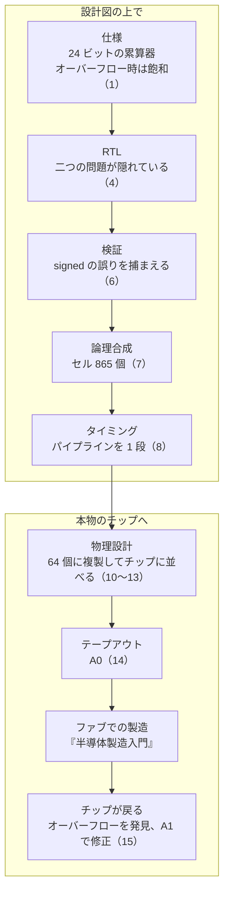

<!-- source: zh-TW/README.md | sha: ec0bdb1f7edf -->

<div align="center">


# IC 設計入門

**一つの積和ユニットを追いかけて、コードからチップまでの旅をたどる**

🌐 [繁體中文](../zh-TW/README.md) ｜ [English](../en/README.md) ｜ **日本語** ｜ [한국어](../ko/README.md) ｜ [ホーム](../README.md)

</div>

---

## この本について

ファブは数十枚のフォトマスクを使い、ウェーハの上に数十億個のトランジスタを 1 層ずつ作り上げます。では、そのマスクのパターンは誰が、どうやって描いたのでしょうか。

この本は『[半導体製造入門](https://github.com/chenwei810/Semiconductor_Manufacturing_Introduction)』の前日譚です。二つの主役を追いかけます。

- **一つのチップ**：`tiny_npu`。小さな AI 推論チップで、64 個の積和ユニット、二つのメモリ、そして CPU が命令を出すためのインターフェースを持つ。
- **一つのユニット**：`mac`。その中の積和ユニットの一つ。仕様書の一文から始まり、十数行の Verilog として書かれ、テストで問題が見つかり、千個近い論理ゲートに合成され、64 個に複製されてチップに並ぶ。最後に本物のチップの上で、長いあいだ隠れていた問題を見せる。

難しい数式は扱わず、次の三つに集中します。

- **流れ**：各工程が何をしているのか、なぜそうするのか、うまくいかないとどうなるのか。
- **用語**：英語と中国語の名称、そして IC 設計の現場で実際にどう使われているか。
- **ノウハウ**：教科書にはあまり書かれていないが、プロジェクトでは必ず出会うこと。

## こんな人におすすめ

| 読者 | 読むところ | 読み終えるとできること |
|---|---|---|
| 🌱 理工系だが、IC 設計には触れたことがない | 本文。「もう一歩深く」は飛ばしてよい | チップが仕様からテープアウトに至るまでの各工程と、現場でよく使う用語を説明できる |
| 🎓 電気系・情報系の学生 | すべて。「もう一歩深く」と「やってみよう」も含む | 各工程の背後にある原理を理解し、オープンソースのツールで自分で一通り動かせる |
| 💻 ソフトウェア・ファームウェアエンジニア | 本文。特に「ソフトウェアとの対比」 | ハードウェアがソフトウェアと本当に違うところを知り、ハードウェアチームとの話がかみ合うようになる |

電子回路や半導体物理の予備知識は必要ありません。少しプログラムが書けると役立ちますが、書けなくても大丈夫です。

## 各章にある道しるべ

| マーク | 内容 |
|---|---|
| 📍 設計の現在地 | 二つの主役が旅のどの地点にいるか、前後の工程は何か |
| 🪜 抽象度 | その章が「仕様 ▸ RTL ▸ ネットリスト ▸ レイアウト ▸ GDS ▸ チップ」のどの層にいるか |
| 📖 用語ボックス | 定義、現場での使い方、関連用語、よくある混同 |
| 🔧 ノウハウボックス | 現場でのやり方と、なぜそうするのか、やらないとどうなるか |
| 💻 ソフトウェアとの対比 | ソフトウェア開発とどこが似ているか、そしてもっと大事な、どこが違うか |
| 🔍 もう一歩深く | 電気系・情報系の学生向けの原理の説明。最初は折りたたまれていて、飛ばしてもよい |
| 🧪 やってみよう | 第 4、6、7、8、15 章。オープンソースのツールで自分で一通り動かす。本に載っている出力は、すべて実際に実行した結果である |

たとえば第 6 章「検証」のノウハウボックスはこうなっています。

> [!TIP]
> **🔧 ノウハウ｜検証計画は仕様から 1 項目ずつ書き出す**
>
> - **状況**：検証を始める前に、何をテストするかを決める必要がある。
> - **やり方**：仕様書を 1 項目ずつ読み、どの項目も検証計画の一つの項目として書き、テストと機能カバレッジに対応させる。
> - **理由**：RTL を見ながらテストを書くと、RTL が「何をしているか」しか確かめず、「何をすべきか」は確かめない。
> - **やらないとどうなる**：仕様にはあるが誰も実装していない機能は、誰もテストもしない。第 15 章の `mac` は、まさにこうして問題を起こす。

## 練習ファイル

この本には練習ファイルが付いていて、[`practice/`](../practice/README.md) フォルダにあります。物語に出てくるすべての版の `mac`、テストベンチ、そして Python で書いたリファレンスモデルです。Icarus Verilog と Yosys という二つのオープンソースのツールをインストールすれば、本に載っているすべての出力を自分のコンピュータで再現できます。

```bash
cd practice
iverilog -o sim rtl/mac_ch04.v tb/tb_mac.v
vvp sim +vec=vectors/directed.txt +verbose
```

---

## 全体マップ

この図は `mac` がたどる旅です。かっこの中は章の番号です。



第 0 章でフロー全体を見渡し、第 2、3 章でデジタル論理の基礎を補い、第 5 章でクロックとリセットを扱い、第 9 章で工場がチップをテストできるようにする回路を加えます。

---

## 目次

### 第 0 部　はじめる前に

| 章 | 読める内容 |
|---|---|
| [第 0 章　IC 設計の全体像](0-before-you-start/00-overview/README.md) | チップがアイデアからテープアウトに至るまでの旅、業界の分業、そして二つの主役 |
| [第 1 章　仕様とアーキテクチャ](0-before-you-start/01-spec-and-architecture/README.md) | 仕様書、ブロック図、PPA のトレードオフ、そして累算器を何ビットにするか |

### 第 1 部　デジタル論理の基礎

| 章 | 読める内容 |
|---|---|
| [第 2 章　トランジスタから論理ゲートへ](1-digital-logic/02-transistors-to-gates/README.md) | CMOS、論理ゲート、遅延、消費電力、標準セル |
| [第 3 章　組み合わせ回路と順序回路](1-digital-logic/03-combinational-and-sequential/README.md) | 2 の補数、加算器、乗算器、フリップフロップ、有限状態機械 |

### 第 2 部　フロントエンド設計

| 章 | 読める内容 |
|---|---|
| [第 4 章　RTL と Verilog](2-front-end/04-rtl-and-verilog/README.md) | Verilog で `mac` を書く。ハードウェアとプログラムの違い |
| [第 5 章　クロックとリセット](2-front-end/05-clocks-and-resets/README.md) | PLL、クロックドメインクロッシング、メタステーブル、リセットの同期、クロックゲーティング |
| [第 6 章　検証](2-front-end/06-verification/README.md) | テストベンチ、リファレンスモデル、ランダムテスト、カバレッジ、検証計画 |
| [第 7 章　論理合成](2-front-end/07-logic-synthesis/README.md) | 標準セルライブラリ、タイミング制約、ネットリスト、等価性検証 |
| [第 8 章　静的タイミング解析](2-front-end/08-static-timing-analysis/README.md) | セットアップ、ホールド、スラック、プロセスコーナー、パイプライン |
| [第 9 章　テスト容易化設計](2-front-end/09-design-for-test/README.md) | スキャンチェーン、ATPG、MBIST、JTAG |

### 第 3 部　物理設計

| 章 | 読める内容 |
|---|---|
| [第 10 章　フロアプランと電源網](3-physical-design/10-floorplan-and-power/README.md) | チップの大きさ、マクロの配置、IR ドロップ、電源ドメイン |
| [第 11 章　配置とクロックツリー](3-physical-design/11-placement-and-cts/README.md) | 配置、使用率、予備セル、クロックツリー、クロックスキュー |
| [第 12 章　配線と寄生成分](3-physical-design/12-routing-and-parasitics/README.md) | メタル層、配線、寄生抽出、クロストーク、アンテナ効果 |
| [第 13 章　サインオフ](3-physical-design/13-signoff/README.md) | マルチコーナー・マルチモード解析、DRC、LVS、電源のサインオフ、ウェイバー |

### 第 4 部　ファブへ渡す

| 章 | 読める内容 |
|---|---|
| [第 14 章　テープアウト](4-to-the-fab/14-tape-out/README.md) | GDS、マスクデータ準備、OPC、マルチプロジェクトウェーハ |
| [第 15 章　チップが戻ってきたら](4-to-the-fab/15-after-silicon/README.md) | 立ち上げ、ポストシリコン検証、エラッタ、メタル層だけの修正 |

### 付録

| 付録 | 読める内容 |
|---|---|
| [付録 A　用語集](appendix/glossary.md) | 本書の用語と中国語・略語の対応表。本書の用語の基準でもある |
| [付録 B　設計現場の言い回し](appendix/jargon.md) | IC 設計チームでよく聞く言い回しと例文 |
| [付録 C　参考文献](appendix/further-reading.md) | 教科書、規格、オープンソースのツール |
| [付録 D　Verilog クイックリファレンス](appendix/verilog-quick-reference.md) | 本書で使う Verilog の文法一覧 |

---

## 読み方のおすすめ

最初から順に読むのがいちばん全体をつかめますが、目的に合わせて次のルートから始めることもできます。

| ルート | おすすめの章 |
|---|---|
| 🚀 全体をざっと知りたい | 第 0、1、7、10、14 章 |
| 💻 ソフトウェア・ファームウェアエンジニア | 第 0、1、3、4、6、8、15 章と、各章の「ソフトウェアとの対比」 |
| 🏭 IC 設計の業界に入る準備 | 全章を順に。特に第 6、8、13 章と付録 B |
| 🔬 『半導体製造入門』を読んだ人 | 第 0、2、10、12、13、14 章。設計がプロセスとどうつながるかを見る |
| 🧪 手を動かしてみたい | 第 4、6、7、8、15 章の「やってみよう」 |

---

## 参加するには

これはオープンなプロジェクトです。いつでも協力を歓迎します。

- **間違いを見つけたら**：[Issues](../../../issues) から「Erratum」テンプレートで報告してください。
- **内容や図を追加したいとき**：[コントリビューションガイド](../CONTRIBUTING.md) と [スタイルガイド](../STYLE_GUIDE.md) を読んでください。
- **ほかの言語に翻訳したいとき**：[翻訳ガイド](../TRANSLATIONS.md) を読んでください。

この本が役に立ったら、⭐ Star を付けてもらえると、より多くの人に届きます。

---

## 免責事項

- この本は公開情報と業界の一般的な知識をもとにしています。特定企業の機密情報、社内の手順や設計データは含まず、どのファウンドリの PDK の実際の値も含みません。
- 特定の半導体企業や EDA ツールベンダーとは関係がありません。名前を挙げているのは「やってみよう」で使うオープンソースのツールだけで、商用ツールの名前は書きません。
- `tiny_npu` は教材として架空に作ったチップで、仕様も物語も説明のためのものです。数値の多くは桁や概算値です。実際の値はプロセス、製品、企業によって異なります。
- 間違いや古くなった内容を見つけたら、Issue で知らせてください。

## ライセンス

この本の文章、図、練習ファイルは [クリエイティブ・コモンズ 表示 - 非営利 - 継承 4.0 国際ライセンス](../LICENSE)（CC BY-NC-SA 4.0）で提供しています。出典を明記し、非営利目的で、同じライセンスで共有する限り、自由に転載、改変、翻訳できます。

原文は繁体字中国語で書かれており、日本語版はその翻訳です。内容に違いがある場合は、中国語版を正とします。
