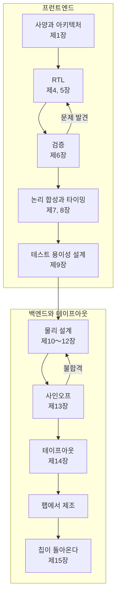

<!-- source: zh-TW/0-before-you-start/00-overview/README.md | sha: 7d0712dfe5e7 -->

# 제0장 IC 설계의 전체 그림: 칩 하나가 설계되기까지의 여정

> 📍 **설계의 현재 위치**
>
> - 이전 단계: 아직 출발하지 않았다
> - **이 장: 칩 하나가 아이디어에서 테이프아웃까지 가는 여정을 내려다보고, 이 책의 두 주인공을 만난다**
> - 다음 단계: 사양과 아키텍처. 어떤 칩을 만들지 정한다

🪜 추상화 수준: **사양 ▸ RTL ▸ 네트리스트 ▸ 레이아웃 ▸ GDS ▸ 칩**

---

## 칩은 먼저 설계된다

팹은 수십 장의 마스크를 사용해 웨이퍼 위에 트랜지스터와 배선을 한 층씩 만들어 갑니다. 그렇다면 마스크의 패턴은 어디에서 올까요? 답은 IC 설계입니다. **집적 회로**(Integrated Circuit, IC) 설계란 '카메라가 사진 속 고양이를 즉시 알아보게 하자' 같은 아이디어를, 한 걸음씩 팹이 만들 수 있는 기하학적 도형으로 바꾸어 가는 일입니다. 집을 짓는 것과 비슷합니다. 먼저 요구 사항을 분명히 하고, 설계도와 시공도를 그린 다음, 마지막으로 시공도를 건설사에 넘깁니다.

『반도체 제조 입문』은 웨이퍼 한 장을 따라 공장 안을 여행했습니다. 이 책은 그 프리퀄입니다. 코드 한 조각을 따라, 마스크가 공장에 넘겨지는 순간까지 여행합니다.

---

## 이 책의 두 주인공

- **칩 하나**: `tiny_npu`. 작은 AI 추론 칩으로, 곱셈 누산기 64개, 64 KB 메모리 2개, 그리고 CPU가 명령을 내리기 위한 인터페이스를 갖추고 있다. 목표는 초당 320억 번의 곱셈 누산이다. 교육용으로 지어낸 사양이지만, 하나하나의 결정은 실제 칩에서도 마주치는 것이다.
- **단위 하나**: `mac`. 그중 곱셈 누산기 하나다. 하는 일은 하나뿐이다. 8비트 수 두 개를 곱해서 누산기에 더한다.

신경망 계산의 대부분은 '숫자 한 줄에 가중치 한 줄을 곱하고, 전부 더하는 것'입니다. 그래서 AI 칩의 핵심은 넓게 늘어선 곱셈 누산기입니다. `mac`은 작아서 Verilog 십여 줄이면 다 쓸 수 있습니다. 그래도 이 책의 모든 단계를 거칩니다. 코드로 쓰이고, 테스트에서 문제가 발견되고, 천 개 가까운 논리 게이트가 되고, 64개로 복제되어 칩에 배치되고, 마지막으로 진짜 칩 위에서 오랫동안 숨어 있던 문제를 드러냅니다.

> [!NOTE]
> **📖 용어｜곱셈 누산기（Multiply-Accumulate Unit, MAC, 乘加單元）**
>
> - **정의**: 두 수를 곱하고, 그 곱을 누산기에 더하는 회로.
> - **현장에서는**: AI 칩은 MAC의 개수나 초당 곱셈 누산 횟수로 연산 능력을 비교하는 경우가 많다. "이번 세대는 MAC 수가 두 배가 됐다."
> - **관련 용어**: 누산기, 내적, 신경망 처리 장치(NPU)
> - **흔한 혼동**: 네트워크 장비의 MAC 주소(Media Access Control)는 다른 것이다. 약어가 우연히 같을 뿐이다.

---

## 여정의 지도

**사양 → RTL → 검증 → 논리 합성 → 타이밍 분석 → 테스트 용이성 설계 → 물리 설계 → 사인오프 → 테이프아웃**

| 단계 | 무슨 일이 일어나는가 | 이 책의 장 |
|---|---|---|
| 사양과 아키텍처 | 칩이 무엇을 하고, 얼마나 빠르고, 면적과 전력을 얼마나 쓸지 정한다 | 제1장 |
| 레지스터 전송 수준(Register Transfer Level, RTL) | 하드웨어 기술 언어로 회로의 동작을 적는다 | 제4, 5장 |
| 검증 | RTL이 사양대로 동작한다는 것을 보인다 | 제6장 |
| 논리 합성과 타이밍 분석 | RTL을 논리 게이트로 바꾸고, 모든 경로가 클록에 맞는지 확인한다 | 제7, 8장 |
| 테스트 용이성 설계 | 공장에서 불량 칩을 찾을 수 있게 하는 회로를 넣는다 | 제9장 |
| 물리 설계 | 논리 게이트를 칩에 놓고 배선을 연결한다 | 제10～12장 |
| 사인오프와 테이프아웃 | 모든 점검을 마치고 레이아웃을 팹에 넘긴다 | 제13, 14장 |
| 칩이 돌아온 뒤 | 브링업, 디버깅, 필요하면 개정 | 제15장 |

제2, 3장은 지도에 없습니다. 이 여정에 필요한 디지털 논리의 기초를 채우는 장입니다.

---

## 프런트엔드와 백엔드

IC 설계에서 가장 흔한 구분은 **프런트엔드**와 **백엔드**입니다.

- **프런트엔드**: 사양부터 네트리스트까지. '회로의 논리가 맞는가'를 다룬다. RTL, 검증, 논리 합성을 포함한다.
- **백엔드**: 네트리스트부터 레이아웃까지. '회로가 들어가는가, 연결되는가, 빨리 동작하는가'를 다룬다. 물리 설계라고도 한다.

> [!NOTE]
> **📖 용어｜프런트엔드와 백엔드（前段與後段）**
>
> - **정의**: IC 설계에서 프런트엔드는 논리 설계와 검증을, 백엔드는 물리 설계를 가리킨다.
> - **현장에서는**: "그 사람은 프런트엔드 담당이다", "네트리스트는 백엔드에 넘겼다." 대만에서는 '전단(前段)', '후단(後段)'이라고 한다.
> - **관련 용어**: RTL, 네트리스트, 물리 설계, 사인오프
> - **흔한 혼동**: 『반도체 제조 입문』의 전공정과 후공정은 웨이퍼 제조와 패키징·테스트를 가리킨다. 팹 안에는 FEOL과 BEOL도 있다. 대만에서는 모두 '전단', '후단'이라고 부르므로, 말하는 사람이 설계 회사 사람인지 공장 사람인지 보고 판단해야 한다.

---

## 누가 무엇을 맡는가

칩 하나는 보통 여러 종류의 회사가 나누어 맡아 완성합니다.

| 역할 | 하는 일 |
|---|---|
| IC 설계 회사(팹리스) | 제품을 정의하고, 칩을 설계하고, 판매하지만 자체 공장은 없다 |
| IP 공급사 | CPU 코어, 메모리, 인터페이스 회로처럼 이미 설계된 회로 블록을 제공한다 |
| 전자 설계 자동화(Electronic Design Automation, EDA) 도구 공급사 | 논리 합성, 시뮬레이션, 물리 설계 등 각 단계에 쓰는 소프트웨어를 제공한다 |
| 설계 서비스 회사 | 백엔드 설계나 테이프아웃 작업을 대신 수행한다 |
| 파운드리 | 칩을 제조하고, 설계 규칙과 라이브러리를 제공한다 |
| 후공정 외주 기업(OSAT) | 칩을 패키징하고 출하 전 테스트를 한다 |

설계 팀 안에도 분업이 있습니다. 아키텍트가 사양을 정하고, 프런트엔드 설계 엔지니어가 RTL을 씁니다. 검증 엔지니어는 RTL이 맞다는 것을 보이는 역할로, RTL을 쓰는 사람보다 많은 경우도 흔합니다. 테스트 용이성 설계(Design for Test, DFT) 엔지니어는 공장에서 불량 칩을 찾을 수 있게 하는 일을, 물리 설계 엔지니어는 회로를 레이아웃으로 만드는 일을, CAD 엔지니어는 도구와 플로를 관리하는 일을 맡습니다. 칩이 돌아온 뒤에는 테스트, 제품, 펌웨어 엔지니어가 이어받습니다.

> [!NOTE]
> **📖 용어｜IP（Silicon Intellectual Property, 矽智財）**
>
> - **정의**: 이미 설계되어 있고, 라이선스를 받아 자기 칩에 넣을 수 있는 회로 블록.
> - **현장에서는**: "PLL은 사 온 IP를 쓴다", "이 IP는 이 공정에서 검증된 적이 있나?"
> - **관련 용어**: 메모리 컴파일러, 표준 셀 라이브러리, PDK
> - **흔한 혼동**: 네트워크의 IP 주소와는 관계없다. IC 설계 현장에서 IP라고 하면 보통 회로 블록을 말하며, 법률상의 지식재산권 이야기가 아니다.

---

## 디지털, 아날로그, 그리고 이 책의 범위

칩 안의 회로는 크게 두 가지로 나뉩니다. **디지털 회로**는 0과 1만 다루며, RTL로 기술하고 도구로 자동 합성할 수 있습니다. **아날로그 회로**는 연속적으로 변하는 전압을 다룹니다. 클록을 만드는 위상 고정 루프(Phase-Locked Loop, PLL), 아날로그-디지털 변환기, 전원 회로 등이며, 대부분 엔지니어가 손으로 설계합니다. 이 책은 디지털 회로의 플로만 다룹니다. `tiny_npu`의 PLL은 아날로그 회로이므로, 사 온 IP를 그대로 씁니다.

디지털 회로를 꼭 전용 칩으로 만들어야 하는 것은 아닙니다. **필드 프로그래머블 게이트 어레이**(Field-Programmable Gate Array, FPGA)는 내부 논리를 다시 설정할 수 있는 칩으로, 설계를 바꿔도 다시 내려받기만 하면 되고 마스크를 새로 만들 필요가 없습니다. 테이프아웃 전에 설계를 시험 삼아 돌려 보거나(제6장), 수량이 많지 않은 제품에 자주 쓰입니다. 특정 용도를 위해 전용으로 만드는 칩은 **주문형 반도체**(Application-Specific Integrated Circuit, ASIC)라고 합니다. 초기 비용은 높지만, 수량이 많으면 한 개당 더 싸고, 더 빠르고, 전력도 덜 씁니다.

> [!IMPORTANT]
> **💻 소프트웨어와 비교｜테이프아웃은 영원히 업데이트할 수 없는 버전을 릴리스하는 것과 비슷하다**
>
> - **닮은 점**: 소프트웨어의 정식 릴리스. 코드를 동결하고, 버전 번호를 붙여 내보낸다.
> - **다른 점**: 칩은 테이프아웃한 뒤 실물을 받기까지 몇 달이 걸린다. 2020년대 중반 기준으로 28 nm 같은 성숙 공정의 마스크 한 세트는 대략 백만 달러 단위다. 더 오래된 공정은 훨씬 싸고, 최첨단 공정은 그 몇 배가 된다. 문제가 발견되어도 업데이트를 배포할 수 없고, 개정해서 다시 만들거나 펌웨어로 피해 가는 수밖에 없다.
> - **그래서 주의할 점**: 소프트웨어의 '일단 내보내고 고친다'는 습관은 칩에서는 대가가 매우 크다. 그래서 하드웨어 팀은 RTL을 쓰는 것보다 검증에 더 많은 힘을 쏟는 경우가 많다.

> [!TIP]
> **🔧 노하우｜문제는 일찍 찾을수록 싸게 고친다**
>
> - **상황**: 같은 문제가 RTL을 쓸 때, 검증할 때, 테이프아웃 직전, 또는 칩이 돌아온 뒤에야 발견될 수 있다.
> - **방법**: 점검을 최대한 앞당긴다. RTL을 쓰고 나면 먼저 정적 검사를 돌리고, 검증은 RTL과 동시에 진행하고, 논리 합성 후에는 바로 타이밍을 본다.
> - **이유**: RTL 단계에서는 한 줄을 고치는 데 몇 분이면 된다. 칩이 돌아온 뒤에 발견하면 마스크를 다시 만들어야 하고, 몇 달의 시간과 큰 비용이 든다.
> - **안 하면 어떻게 되나**: 문제가 칩까지 새어 나가고, 제품 출시가 통째로 늦어진다. 제15장의 `mac`이 바로 이런 일을 겪는다.
> - **관련 장**: [제6장 검증](../../2-front-end/06-verification/README.md), [제15장 칩이 돌아온 뒤](../../4-to-the-fab/15-after-silicon/README.md)

> [!TIP]
> **🔧 노하우｜일정은 테이프아웃 날짜에서 거꾸로 짠다**
>
> - **상황**: 첫 번째 칩은 파운드리의 합승 일정에 맞춰 테이프아웃한다. 일정의 날짜는 정해져 있다.
> - **방법**: 테이프아웃 날짜에서 거꾸로 계산해 각 관문의 완료 날짜를 정하고, 여유 시간도 남겨 둔다.
> - **이유**: 일정 하나를 놓치면 한두 달을 더 기다려야 하고, 제품 출시도 늦어진다.
> - **안 하면 어떻게 되나**: 앞의 관문이 조금씩 늦어지다가 마지막에 사인오프가 쪼그라든다. 모두 점검을 건너뛰고 테이프아웃을 서두르게 되고, 문제는 이렇게 밖으로 새어 나간다.
> - **관련 장**: [제14장 테이프아웃](../../4-to-the-fab/14-tape-out/README.md)

---

## 이 장의 핵심

1. IC 설계는 아이디어를 팹이 만들 수 있는 기하학적 도형으로 바꾸는 일이며, 이 책은 『반도체 제조 입문』의 프리퀄이다.
2. 두 주인공은 AI 추론 칩 `tiny_npu`와 그 안의 곱셈 누산기 `mac`이다.
3. 플로는 대체로 사양, RTL, 검증, 논리 합성, 타이밍, 테스트 용이성, 물리 설계, 사인오프, 테이프아웃 순이다. 프런트엔드는 논리를, 백엔드는 물리를 맡는다.
4. 칩은 설계 회사, IP와 EDA 공급사, 파운드리, 후공정 외주 기업이 나누어 맡아 완성한다.
5. 테이프아웃 뒤에는 고치기 어려우므로, 문제는 일찍 찾을수록 싸다.

---

## 참고 자료

- Neil H. E. Weste, David Money Harris, 『CMOS VLSI Design: A Circuits and Systems Perspective』 제4판, 제1장
- 『반도체 제조 입문』 [제0장 반도체 제조의 전체 그림](https://github.com/chenwei810/Semiconductor_Manufacturing_Introduction/blob/main/ko/0-before-you-start/00-overview/README.md)

---

[목차](../../README.md) ｜ [제1장 사양과 아키텍처 →](../01-spec-and-architecture/README.md)
