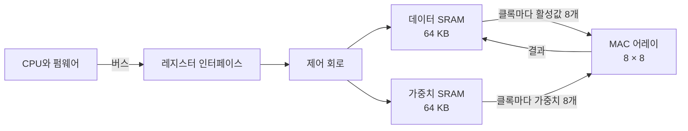

<!-- source: zh-TW/0-before-you-start/01-spec-and-architecture/README.md | sha: 0001bf06d141 -->

# 제1장 사양과 아키텍처: 어떤 칩을 만들지 정하기

> 📍 **설계의 현재 위치**
>
> - 이전 단계: 전체 그림. 설계 플로와 두 주인공을 알게 되었다
> - **이 장: `tiny_npu`의 사양과 아키텍처를 쓰고, `mac`을 몇 비트로 할지 정한다**
> - 다음 단계: 트랜지스터에서 논리 게이트로. 사양에 있는 연산을 어떤 회로로 만들지 본다

🪜 추상화 수준: **사양** ▸ RTL ▸ 네트리스트 ▸ 레이아웃 ▸ GDS ▸ 칩

---

## 사양서: 모두가 기준으로 삼는 문서

집을 짓기 전에는 방이 몇 개 필요한지, 예산은 얼마인지, 언제 입주하고 싶은지를 먼저 분명히 합니다. 칩도 마찬가지입니다. RTL을 쓰기 시작하기 전에 먼저 **사양서**가 있어야 합니다. 칩이 무엇을 하는지, 얼마나 빠른지, 면적과 전력을 얼마나 써도 되는지, 인터페이스는 어떤 모양인지, 언제 테이프아웃할지를 적습니다.

이후의 모든 관문은 사양서를 기준으로 합니다. RTL을 쓰는 사람은 그것에 따라 설계하고, 검증하는 사람은 그것에 따라 확인하고, 펌웨어 엔지니어는 그것에 따라 드라이버를 씁니다. 사양서가 모호한 곳은 각자 자기 가정으로 채워 버립니다.

> [!NOTE]
> **📖 용어｜사양서（Specification, 規格書）**
>
> - **정의**: 칩의 기능, 성능, 인터페이스, 제약을 적은 문서. 설계와 검증이 함께 기준으로 삼는다.
> - **현장에서는**: 보통 그냥 spec이라고 부른다. "이 경우는 spec에 안 나와 있으니 아키텍트에게 물어보자."
> - **관련 용어**: 아키텍처 문서, 레지스터 맵, 검증 계획
> - **흔한 혼동**: 사양서는 데이터시트가 아니다. 데이터시트는 고객을 위한 제품 설명이고, 사양서는 팀을 위한 설계 기준으로 내부의 세부 사항을 많이 담고 있다.

---

## tiny_npu는 무엇을 계산하는가

이미지를 인식하는 신경망에는 수십 개의 층이 있습니다. 각 층이 하는 일은 대체로 비슷합니다. 입력 데이터의 작은 덩어리와 가중치 한 묶음을 항목별로 곱하고, 전부 더합니다. 이 연산을 **내적**(Dot Product)이라고 합니다.

예를 들어 흔한 합성곱 층에서는 출력 점 하나마다 입력 이미지의 3 × 3 범위를 봅니다. 게다가 입력에는 128개의 채널이 있습니다. 그래서 출력 점 하나는 3 × 3 × 128 ＝ 1,152개 곱의 합입니다. 이미지 한 장에는 수만 개의 출력 점이 있고, 그 하나하나마다 이런 내적을 계산합니다.

그래서 `tiny_npu`에는 세 가지가 필요합니다. 넓게 늘어선 곱셈 누산기, 거기에 데이터를 공급하는 **SRAM**(Static Random-Access Memory), 그리고 CPU가 명령을 내리는 방법입니다.

면적과 전력을 아끼기 위해 `tiny_npu`는 부동소수점 수를 쓰지 않고, 데이터와 가중치를 모두 8비트 정수로 바꿉니다. 이를 **INT8**이라고 합니다. 8비트 부호 있는 정수는 -128부터 127까지 표현할 수 있습니다.

> [!NOTE]
> **📖 용어｜양자화（Quantization, 量化）**
>
> - **정의**: 신경망의 가중치와 데이터를 부동소수점 수에서 비트 수가 적은 정수로 바꾸어 계산하는 것.
> - **현장에서는**: "모델을 INT8로 양자화했더니 정확도가 아주 조금만 떨어졌다."
> - **관련 용어**: INT8, 부동소수점 수, 누산기, 포화
> - **흔한 혼동**: 입력이 8비트라고 해서 결과도 8비트면 되는 것은 아니다. 8비트끼리 곱하면 16비트가 되고, 그것을 천 항 넘게 더하면 수는 더 커진다.

---

## 아키텍처: 블록도 그리기

사양은 '무엇을 하는가'를, **아키텍처**는 '어떤 블록을 쓰고, 어떻게 연결하는가'를 말합니다. `tiny_npu`의 아키텍처는 다음과 같습니다.

클록마다 데이터 SRAM은 활성값 8개를, 가중치 SRAM은 가중치 8개를 내보냅니다. `r`행 `c`열의 MAC은 `r`번째 활성값에 `c`번째 가중치를 곱해 자기 누산기에 더합니다. 64개의 MAC이 동시에 이 일을 하고, 1,152클록 동안 계속하면 출력 점 64개를 얻습니다.

| 항목 | 사양 |
|---|---|
| 곱셈 누산기 | 8 × 8 ＝ 64개. 입력은 INT8, 누산기는 24비트, 오버플로 시 포화 |
| 메모리 | 데이터 SRAM, 가중치 SRAM 각각 64 KB |
| 클록 | 연산 쪽 500 MHz, 버스 쪽 100 MHz |
| 최대 성능 | 64 × 500 MHz ＝ 초당 320억 번의 곱셈 누산 |
| 공정 | 28 nm급 성숙 공정, 다이 한 변은 약 2 mm |

펌웨어는 몇 개의 레지스터를 통해 `tiny_npu`를 지휘합니다. 이 **레지스터 맵**도 사양의 일부이며, 펌웨어 엔지니어는 이것을 바탕으로 드라이버를 씁니다.

| 주소 | 이름 | 용도 |
|---|---|---|
| `0x00` | `CTRL` | `START` 비트에 1을 쓰면 연산을 한 번 시작한다 |
| `0x04` | `STATUS` | `BUSY`와 `DONE` 두 상태 비트 |
| `0x08` | `LEN` | 내적 하나에 몇 항을 누산할지 |
| `0x0C` | `ADDR` | SRAM 안에서 데이터와 가중치의 시작 주소 |

> [!TIP]
> **🔧 노하우｜아키텍처는 먼저 소프트웨어 모델로 돌려 보고, 그다음에 RTL을 쓴다**
>
> - **상황**: MAC을 몇 개 둘지, SRAM을 얼마나 크게 할지, 클록마다 데이터를 몇 개 보낼지 정해야 한다.
> - **방법**: Python이나 C++로 **아키텍처 모델**을 쓰고, 진짜 신경망을 한 번 돌려 본다. MAC이 데이터를 기다리며 노는 시간이 얼마인지, INT8과 24비트 누산기가 정확도에 영향을 주는지 계산한다.
> - **이유**: 소프트웨어에서는 아키텍처를 바꾸는 데 며칠이면 된다. RTL을 쓴 뒤에 바꾸면 몇 달이 걸린다. 이 모델은 나중에 검증용 참조 모델이 되기도 한다.
> - **안 하면 어떻게 되나**: 칩의 최대 성능은 그럴듯하지만, 메모리가 MAC에 데이터를 충분히 공급하지 못해 실제로는 일부만 발휘된다.
> - **관련 장**: [제6장 검증](../../2-front-end/06-verification/README.md)

---

## PPA: 세 지표는 동시에 잡을 수 없다

설계를 평가하는 가장 기본적인 세 지표는 **성능, 전력, 면적**(Performance, Power, Area, PPA)입니다. 셋은 자주 서로를 잡아당깁니다. MAC을 많이 둘수록 빨리 계산하지만 면적과 전력도 커집니다. 클록을 올릴수록 회로를 더 잘게 나눠야 하고, 전력도 따라 올라갑니다.

`mac`의 누산기를 몇 비트로 할지도 PPA의 트레이드오프입니다. 32비트라면 오버플로는 거의 일어나지 않습니다. 24비트라면 MAC 하나당 플립플롭 8개와 가산기 일부가 줄어들고, 64개의 MAC을 합치면 상당한 면적과 전력을 아낄 수 있습니다.

아키텍트는 24비트를 골랐고, 사양에 한 문장을 적어 넣었습니다. **누산 결과가 범위를 넘으면 최댓값이나 최솟값에서 멈춰야 한다.** 이를 **포화**(Saturation)라고 합니다. 자동차의 주행 거리계처럼 최댓값을 넘으면 처음으로 돌아가서는 안 됩니다. 그쪽은 **랩어라운드**(Wrap-around)라고 합니다.

> [!IMPORTANT]
> **💻 소프트웨어와 비교｜하드웨어에서는 비트 하나하나에 돈이 든다**
>
> - **닮은 점**: 프로그램에서 데이터 타입을 고르는 것. `int32_t`로 할지 `int64_t`로 할지.
> - **다른 점**: 소프트웨어에서는 비트를 몇 개 더 써도 비용이 거의 들지 않는다. 하드웨어에서는 비트가 하나 늘 때마다 64개의 MAC 모두에 플립플롭과 가산기가 한 벌씩 늘어난다. 양산하면 칩 하나하나가 그 면적과 전력을 계속 치른다.
> - **그래서 주의할 점**: 비트 폭은 최악의 경우부터 계산한다. 그리고 '범위를 넘으면 어떻게 하는가'를 사양에 분명히 적어, RTL을 쓰는 사람이 추측하게 두지 않는다.

🔍 조금 더 깊이: 24비트 누산기면 충분한가

INT8끼리 곱해서 절댓값이 가장 큰 곱은 (-128) × (-128) ＝ 16,384입니다. 24비트 부호 있는 수가 표현할 수 있는 최댓값은 8,388,607입니다.

- 모든 항이 최대 곱이라면, 512번째 항에서 딱 상한을 넘는다. 512 × 16,384 ＝ 8,388,608.
- 그러므로 데이터가 무엇이든 **511항 이내의 내적은 절대 오버플로하지 않는다**.
- 1,152항의 합성곱이 범위를 넘는 것은 부호가 같고 큰 곱이 많이 이어질 때뿐이다. 실제 데이터는 양수와 음수가 섞여 있는 경우가 많아서, 아키텍처 모델에서는 오버플로가 거의 보이지 않는다.

'거의 없다'는 '일어나지 않는다'가 아닙니다. 이것이 사양에서 포화를 요구하는 이유이고, 제15장 이야기의 복선이기도 합니다.

---

## 살 것인가, 직접 만들 것인가

모든 블록을 직접 설계하는 것은 아닙니다. `tiny_npu`의 분담은 다음과 같습니다.

- **직접 설계한다**: MAC 어레이, 제어 회로, 레지스터 인터페이스. 제품의 차이는 여기에서 나온다.
- **기성 IP를 쓴다**: SRAM은 메모리 컴파일러로 생성하고, PLL과 I/O 회로는 파운드리나 IP 공급사에서 받는다.
- **공정을 고른다**: 28 nm급 성숙 공정. 마스크가 첨단 공정보다 훨씬 싸고, 기술도 오랫동안 검증되었다. 500 MHz로 돌리기에는 이것으로 충분하다.

> [!TIP]
> **🔧 노하우｜사양을 동결한 뒤의 변경은 변경 절차를 거친다**
>
> - **상황**: RTL을 쓰는 도중에 누군가 새 기능을 하나 더 넣고 싶어 한다.
> - **방법**: 사양은 어느 시점에 '동결'한다. 그 뒤의 변경은 변경 요청을 내고, RTL, 검증, 타이밍, 일정에 미치는 영향을 평가해서, 모두가 동의한 뒤에 바꾼다.
> - **이유**: 사양 한 줄의 변경이 모든 관문의 작업에 줄줄이 영향을 준다.
> - **안 하면 어떻게 되나**: 마지막 순간에 들어온 기능은 테스트 시간이 가장 적어, 문제를 안은 채 테이프아웃하기 쉽다.
> - **관련 장**: [제14장 테이프아웃](../../4-to-the-fab/14-tape-out/README.md)

---

## 이 장의 핵심

1. 사양서는 칩이 무엇을 하고, 얼마나 빠르고, 비용을 얼마나 쓸지 적은 것으로, 이후 모든 관문이 함께 기준으로 삼는다.
2. 신경망의 핵심 연산은 내적이므로, AI 칩은 넓게 늘어선 MAC과 데이터를 공급하는 메모리로 이루어진다.
3. 아키텍처는 먼저 소프트웨어 모델로 확인한다. 이 모델은 나중에 검증의 참조 모델이 된다.
4. PPA는 성능, 전력, 면적의 트레이드오프다. `mac`은 24비트 누산기를 골랐고, 오버플로 시 포화하도록 정했다.
5. 모든 블록을 직접 만드는 것은 아니며, SRAM, PLL, I/O는 보통 기성 IP를 쓴다.

---

## 참고 자료

- John L. Hennessy, David A. Patterson, 『Computer Architecture: A Quantitative Approach』 제6판, 제7장(도메인 특화 아키텍처)
- Vivienne Sze, Yu-Hsin Chen, Tien-Ju Yang, Joel S. Emer, 『Efficient Processing of Deep Neural Networks』
- 『반도체 제조 입문』 [제14장 '몇 나노'란 무엇인가](https://github.com/chenwei810/Semiconductor_Manufacturing_Introduction/blob/main/ko/3-integration/14-process-nodes/README.md)

---

[← 제0장 IC 설계의 전체 그림](../00-overview/README.md) ｜ [목차](../../README.md) ｜ [제2장 트랜지스터에서 논리 게이트로 →](../../1-digital-logic/02-transistors-to-gates/README.md)
