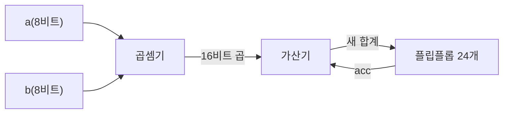
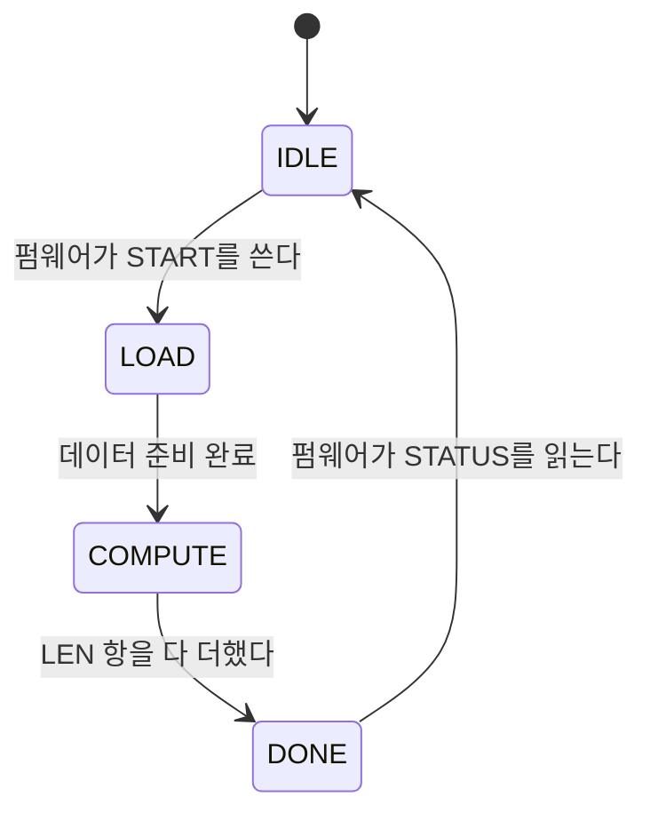

<!-- source: zh-TW/1-digital-logic/03-combinational-and-sequential/README.md | sha: 64db215d1d9c -->

# 제3장 조합 논리와 순차 논리: 계산도 하고 기억도 하는 회로

> 📍 **설계의 현재 위치**
>
> - 이전 단계: 트랜지스터에서 논리 게이트로. 스위치, 논리 게이트, 표준 셀을 알게 되었다
> - **이 장: 논리 게이트를 조합해 `mac`에 필요한 가산기, 곱셈기, 누산기를 만든다**
> - 다음 단계: RTL과 Verilog. 이 회로들을 코드로 기술한다

🪜 추상화 수준: 사양 ▸ **RTL ▸ 네트리스트** ▸ 레이아웃 ▸ GDS ▸ 칩

---

## 두 종류의 회로

디지털 회로는 두 종류로 나뉩니다.

- **조합 논리**: 출력이 지금의 입력만으로 정해진다. 계산기의 덧셈처럼, 3과 4를 누르면 답은 7이고, 방금 무엇을 계산했는지와는 관계없다.
- **순차 논리**: 기억이 있어서 출력이 과거에도 좌우된다. 카운터처럼 한 번 누를 때마다 1씩 늘어나고, 지금의 숫자는 그때까지 몇 번 눌렀는지로 정해진다.

`mac`에는 둘 다 있습니다. 곱셈기와 가산기는 **조합 논리**(Combinational Logic)이고, 누산 결과를 기억하는 레지스터는 **순차 논리**(Sequential Logic)입니다. 조합 논리에는 클록이 없지만, 시간을 신경 쓰지 않아도 되는 것은 아닙니다. 그 지연이야말로 클록을 얼마나 빠르게 돌릴 수 있는지를 정하는 열쇠입니다.

---

## 2진수와 음수

8비트로는 256가지 조합을 나타낼 수 있습니다. **부호 없는 수**(Unsigned)로 읽으면 0부터 255까지입니다. 그러면 음수는 어떻게 나타낼까요? 디지털 회로에서 가장 많이 쓰는 방법은 **2의 보수**(Two's Complement)로, 최상위 비트의 가중치를 음수로 봅니다. 8비트의 최상위 비트는 -128을 나타내고, 나머지 7비트는 평소처럼 64, 32, …, 1입니다. 그래서 8비트의 **부호 있는 수**(Signed)는 -128부터 127까지 나타낼 수 있습니다.

| 비트 | 부호 없는 수로 읽으면 | 부호 있는 수로 읽으면 |
|---|---|---|
| `0000_0011` | 3 | 3 |
| `1111_1101` | 253 | -3 |
| `1000_0001` | 129 | -127 |

같은 비트 열이 129일 수도 있고 -127일 수도 있습니다. 회로 자신은 답을 모릅니다. 어떻게 읽을지는 설계자가 정합니다.

부호 있는 수의 비트 폭을 넓힐 때는 최상위 비트를 새 비트에 복사합니다. 이를 **부호 확장**(Sign Extension)이라고 합니다. 예를 들어 -3을 16비트로 넓히면 `1111_1111_1111_1101`입니다. 앞에 0을 채우면 253이 되어 버립니다.

> [!NOTE]
> **📖 용어｜2의 보수（Two's Complement, 二補數）**
>
> - **정의**: 디지털 회로에서 가장 많이 쓰는 음수 표현법. 최상위 비트의 가중치가 음수다.
> - **현장에서는**: "이 신호는 2의 보수니까 signed 선언 잊지 마."
> - **관련 용어**: 부호 있는 수, 부호 없는 수, 부호 확장, 오버플로
> - **흔한 혼동**: 비트 자체에는 양수, 음수가 없다. 같은 `1000_0001`이 부호 없는 수로는 129, 부호 있는 수로는 -127이다. 어떻게 읽을지는 설계 안에 적어 두어야 한다.

> [!IMPORTANT]
> **💻 소프트웨어와 비교｜C 언어의 int8_t와 uint8_t와 비슷하다**
>
> - **닮은 점**: C 언어의 `int8_t`와 `uint8_t`. 똑같이 8비트이고, 읽는 법이 다르다.
> - **다른 점**: C 컴파일러는 변수마다 타입을 알고 있다. 회로의 배선은 그저 0과 1의 다발이고, 타입은 RTL의 선언 안에만 있다. 선언을 잘못해도 하드웨어는 오류를 내지 않고, 조용히 틀린 답을 계산한다.
> - **그래서 주의할 점**: C 언어에서 `int`와 `unsigned int`를 섞어 계산하면 슬그머니 부호 없는 연산이 된다. Verilog에도 비슷한 함정이 있고, 더 빠지기 쉽다. 제6장의 `mac`이 바로 거기에 빠진다.

---

## 가산기

2진수 덧셈은 10진수와 같습니다. 가장 낮은 자리부터 더하고, 2가 되면 자리 올림을 합니다.

- **반가산기**: 두 비트를 더해 '합'과 '자리 올림'을 출력한다. 합은 XOR, 자리 올림은 AND다.
- **전가산기**: 아래 자리에서 올라온 자리 올림을 하나 더 받으므로, 한 자리씩 이어 붙일 수 있다.
- **리플 캐리 가산기**(Ripple Carry Adder): 전가산기 24개를 한 줄로 이으면 24비트 수를 더할 수 있다.

리플 캐리 가산기는 면적이 작지만, 자리 올림이 한 자리씩 위로 전해지므로 자릿수가 많을수록 느려집니다. 더 빠른 가산기는 자리 올림을 미리 계산하는데, 그 대가로 논리 게이트가 늘어납니다. 이것도 PPA의 트레이드오프입니다.

---

## 곱셈기

2진수 곱셈은 손으로 하는 세로셈 곱셈과 같습니다. 승수의 각 비트는 0 아니면 1이므로, 각 줄의 결과도 두 가지뿐입니다. 0이거나, 피승수를 몇 자리 왼쪽으로 민 것입니다. 이 줄을 **부분곱**(Partial Product)이라고 하며, AND 게이트를 한 줄 늘어놓으면 만들 수 있습니다. 8비트 × 8비트에서는 부분곱이 8줄 생기고, 그것을 많은 가산기로 더해 16비트 곱을 얻습니다. 그래서 곱셈기는 가산기보다 훨씬 크고 훨씬 느리며, `mac`에서 가장 많은 면적을 차지하는 부분입니다.

🔍 조금 더 깊이: 부호 있는 수의 곱셈

2의 보수에서는 최상위 비트의 가중치가 음수이므로, 부호 있는 수의 곱셈에 부호 없는 수의 방법을 그대로 쓸 수 없습니다. 흔히 쓰는 방법은 두 가지입니다.

- 두 피연산자를 먼저 부호 확장한 뒤, 더 넓은 부호 없는 수로 곱해서 필요한 아래쪽 비트만 취한다. 간단하지만 논리 게이트를 낭비한다.
- 부분곱의 부호 비트를 조정해서, 합한 결과가 자동으로 맞게 한다. 업계에서 많이 쓰는 Baugh-Wooley 방식이 이런 종류다. Booth 인코딩을 쓰면 부분곱의 줄 수를 거의 절반으로 줄일 수 있다.

어느 쪽이든 설계자는 도구에 '이것은 부호 있는 수다'라고 알려 주어야 합니다. 논리 합성 도구는 부호 있는 곱셈을 보면 알맞은 구조를 자동으로 고릅니다.

---

## 플립플롭과 클록

**플립플롭**(Flip-Flop)은 1비트 기억 소자입니다. **클록**이 0에서 1로 바뀌는 순간(상승 에지)에만 입력을 받아들이고, 다음 상승 에지까지 그 값을 계속 유지합니다. 사진을 찍는 것과 비슷합니다. 셔터를 누른 순간의 장면이 찍히고, 그 뒤에 바깥이 어떻게 바뀌어도 사진은 변하지 않습니다. 플립플롭 여러 개를 나란히 놓은 것이 **레지스터**(Register)입니다.

클록은 오케스트라의 지휘자와 같아서, 모든 플립플롭이 같은 박자에 맞춰 나아갑니다. 플립플롭이 선명하게 '찍으려면' 데이터는 셔터 전후의 짧은 시간 동안 안정되어 있어야 합니다. 이 시간은 제8장에서 자세히 설명합니다.

> [!NOTE]
> **📖 용어｜플립플롭（Flip-Flop, 正反器）**
>
> - **정의**: 클록 에지에서 입력을 받아들여 유지하는 1비트 기억 소자.
> - **현장에서는**: 흔히 flop이나 DFF라고 부른다. "이 블록에는 flop이 이천 개가 넘는다."
> - **관련 용어**: 레지스터, 클록, 래치, setup, hold
> - **흔한 혼동**: **래치**(Latch)는 클록이 높은 레벨인 동안 내내 데이터를 통과시킨다. 에지에서 한 번만 받아들이는 것이 아니다. 둘은 동작이 다르고, 타이밍 분석도 다르다.

---

## 누산기: 조합 논리와 순차 논리의 결합

곱셈기, 가산기, 플립플롭 24개를 고리 모양으로 이으면 `mac`의 누산기가 됩니다.

클록마다 플립플롭은 지금의 합계를 출력하고, 여기에 새 곱을 더해 다음 상승 에지에서 플립플롭에 다시 저장합니다. 그래서 클록 한 주기는 '곱셈기와 가산기'의 지연보다 길어야 합니다. 가장 간단한 식으로 쓰면 **클록 주기 ≥ 경로상의 지연 합계**입니다. 제8장에서는 500 MHz에서 이 경로가 너무 길다는 것을 알게 됩니다.

> [!TIP]
> **🔧 노하우｜결과에 몇 비트가 필요한지 먼저 계산해 둔다**
>
> - **상황**: 가산기, 곱셈기, 누산기를 설계할 때 결과의 비트 폭을 정해야 한다.
> - **방법**: N비트끼리 더하면 결과는 N＋1비트가 된다. N비트 × M비트라면 결과는 N＋M비트다. K항을 누산한다면 K배를 담을 수 있을 만큼의 비트를 더 붙인다.
> - **이유**: 비트 폭이 모자라면 최상위 비트가 그냥 잘려 나가고, 회로는 오류를 내지 않는다.
> - **안 하면 어떻게 되나**: 값이 범위를 넘으면 최댓값에서 최솟값으로 갑자기 뛴다. 이런 오류는 평소에는 거의 나타나지 않다가, 나타나면 원인을 찾기가 매우 어렵다.
> - **관련 장**: [제1장 사양과 아키텍처](../../0-before-you-start/01-spec-and-architecture/README.md)

---

## 유한 상태 기계

`tiny_npu`의 제어 회로는 자기가 지금 무엇을 하고 있는지 기억해야 합니다. 쉬고 있는지, 데이터를 옮기고 있는지, 계산하고 있는지, 계산을 끝냈는지. 이런 회로를 **유한 상태 기계**(Finite State Machine, FSM)라고 합니다. 플립플롭 몇 개로 지금의 상태를 기억하고, 조합 논리로 지금의 상태와 입력에 따라 다음 클록에 어느 상태로 갈지 정합니다. `COMPUTE` 상태에서는 MAC 어레이가 클록마다 곱셈 누산을 한 번 하고, `LEN` 항을 다 더할 때까지 계속합니다.

> [!TIP]
> **🔧 노하우｜모든 플립플롭에 같은 클록을 쓰고, 논리 게이트로 클록을 임의로 만들지 않는다**
>
> - **상황**: 어떤 회로를 조금 느리게 돌리고 싶어서, 논리 게이트로 클록의 '몇 박자를 걸러 낸다'.
> - **방법**: 클록은 PLL과 전용 클록 회로에서만 만든다. 회로를 멈추고 싶으면 인에이블 신호를 쓰거나, 라이브러리에 있는 전용 클록 게이팅 셀을 쓴다(제5장).
> - **이유**: 일반 논리 게이트로 만든 클록은 아주 짧은 잡음 펄스를 낼 수 있고, 각 플립플롭에 도착하는 시각도 제어하기 어렵다.
> - **안 하면 어떻게 되나**: 플립플롭이 가끔 틀린 값을 받아들인다. 그것도 일부 칩, 일부 온도에서만 일어나며, 타이밍 분석 도구도 제대로 확인하지 못한다.
> - **관련 장**: [제5장 클록과 리셋](../../2-front-end/05-clocks-and-resets/README.md)

---

## 이 장의 핵심

1. 조합 논리의 출력은 지금의 입력만으로 정해진다. 순차 논리는 기억이 있어서 출력이 과거에도 좌우된다.
2. 2의 보수는 최상위 비트로 음의 부호를 나타낸다. 같은 비트 열이라도 부호 있는 수인지 부호 없는 수인지에 따라 뜻이 완전히 다르다.
3. 가산기는 전가산기를 이어 만든다. 곱셈기는 부분곱 여러 줄을 더한 것으로, 가산기보다 훨씬 크고 훨씬 느리다.
4. 플립플롭은 클록 에지에서 데이터를 받아들인다. 누산기는 곱셈기, 가산기, 플립플롭을 고리 모양으로 이은 것이다.
5. 클록 주기는 경로상의 지연 합계보다 길어야 한다.

---

## 참고 자료

- David Money Harris, Sarah L. Harris, 『Digital Design and Computer Architecture』 제2판, 제1～5장
- M. Morris Mano, Michael D. Ciletti, 『Digital Design』 제6판

---

[← 제2장 트랜지스터에서 논리 게이트로](../02-transistors-to-gates/README.md) ｜ [목차](../../README.md) ｜ [제4장 RTL과 Verilog →](../../2-front-end/04-rtl-and-verilog/README.md)
