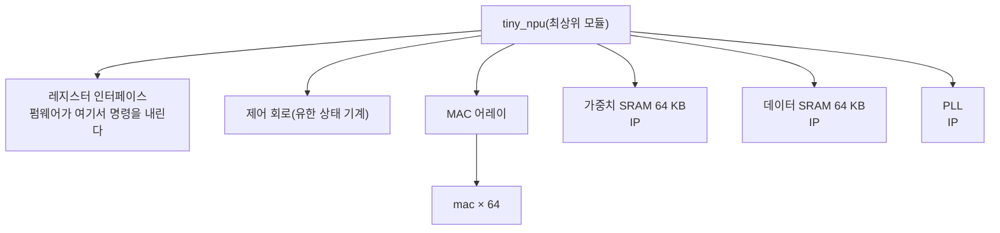

<!-- source: zh-TW/2-front-end/04-rtl-and-verilog/README.md | sha: 7966a18ce809 -->

# 제4장 RTL과 Verilog: 코드로 하드웨어 기술하기

> 📍 **설계의 현재 위치**
>
> - 이전 단계: 디지털 논리 기초. 가산기, 곱셈기, 플립플롭을 알게 되었다
> - **이 장: `mac`을 RTL로 쓰고, 처음으로 시뮬레이터에서 돌려 본다**
> - 다음 단계: 클록과 리셋. `tiny_npu` 전체의 플립플롭을 함께 움직인다

🪜 추상화 수준: 사양 ▸ **RTL** ▸ 네트리스트 ▸ 레이아웃 ▸ GDS ▸ 칩

---

## 왜 코드로 회로를 그리는가

초기의 칩에는 트랜지스터가 수천 개밖에 없어서, 엔지니어가 논리 게이트를 하나하나 그려 회로도를 만들 수 있었습니다. 지금의 칩에는 트랜지스터가 수십억 개 있어서 손으로 그리는 것은 이미 불가능합니다. 그래서 엔지니어는 **하드웨어 기술 언어**(Hardware Description Language, HDL)로 회로가 '무엇을 하는가'를 쓰고, 그것을 도구에 넘겨 논리 게이트로 바꿉니다. 이 단계가 논리 합성입니다(제7장). 가장 많이 쓰는 하드웨어 기술 언어는 Verilog와 그 확장인 SystemVerilog입니다.

집을 짓는 것과 비슷합니다. 건축가가 그리는 것은 설계도이고, 벽돌 하나하나를 어디에 놓을지까지 정하지는 않습니다. RTL은 칩의 설계도입니다. 클록마다 어떤 데이터를 어느 레지스터로 옮기고, 그 사이에 어떤 연산을 하는지를 기술하지만, 그 연산에 최종적으로 어떤 논리 게이트를 쓰는지는 따지지 않습니다.

> [!NOTE]
> **📖 용어｜레지스터 전송 수준（Register Transfer Level, RTL, 暫存器傳輸層級）**
>
> - **정의**: '데이터가 레지스터 사이를 어떻게 옮겨 가고, 그 사이에 어떤 연산을 하는가'로 회로를 기술하는 추상화 수준.
> - **현장에서는**: 다 쓴 Verilog 코드도 그냥 RTL이라고 부른다. "RTL은 프리즈됐으니, 이제부터는 ECO로만 고칠 수 있다."
> - **관련 용어**: 하드웨어 기술 언어, Verilog, 네트리스트, 논리 합성
> - **흔한 혼동**: RTL은 추상화 수준이지 언어가 아니다. Verilog나 VHDL이 언어이고, 그것으로 쓴 코드를 RTL이라고 부른다.

---

## MAC 하나의 Verilog

Verilog로 회로를 기술하는 기본 단위는 **모듈**(Module)입니다. 모듈은 상자와 같고, 상자 바깥에는 핀이 있는데 이를 **포트**(Port)라고 합니다. 제1장에서 정한 사양은 먼저 `mac`의 포트가 됩니다.

```verilog
module mac (
    input  wire        clk,
    input  wire        rst_n,   // active-low reset
    input  wire        clr,     // start a new dot product
    input  wire        en,      // accumulate a * b this cycle
    input  wire [7:0]  a,       // activation, INT8
    input  wire [7:0]  b,       // weight, INT8
    output reg  [23:0] acc      // 24-bit accumulator
);
```

- `clk`는 클록, `rst_n`은 리셋이다. 이름 뒤의 `_n`은 '로우 액티브', 즉 0일 때 리셋한다는 뜻이다.
- `clr`는 MAC에게 '새 내적을 시작하니 누산기를 0으로 지워라'라고 알린다.
- `en`이 1인 클록에서만 `a × b`를 누산기에 더한다. `[7:0]`은 8비트, `[23:0]`은 24비트를 뜻한다.

상자 안의 회로는 다음과 같습니다.

```verilog
    always @(posedge clk or negedge rst_n) begin
        if (!rst_n)
            acc <= 24'd0;          // reset: clear the accumulator
        else if (clr)
            acc <= 24'd0;          // a new dot product starts
        else if (en)
            acc <= acc + a * b;    // multiply, then add
    end
endmodule
```

`always @(posedge clk ...)`는 클록이 0에서 1로 바뀔 때마다(상승 에지) 안의 일을 한 번 한다는 뜻입니다. 그래서 이 코드가 기술하는 것은 바로 제3장의 '곱셈기와 가산기를 다시 플립플롭 24개에 연결한' 누산기입니다.

이 코드에는 문제가 두 개 숨어 있습니다. 시뮬레이션이 멈추지도 않고, 도구가 오류를 내지도 않습니다. 제6장과 제15장에서 하나씩 찾아냅니다.

> [!NOTE]
> **📖 용어｜모듈과 인스턴스（Module／Instance, 模組與實例）**
>
> - **정의**: 모듈은 어떤 회로의 설계도이고, 인스턴스는 그 설계도대로 칩에 놓은 실체 하나다.
> - **현장에서는**: 인스턴스를 놓는 것을 instantiate라고 하고, 놓은 것은 instance라고 부른다. "`tiny_npu`에서 `mac`을 64개 instantiate했다", "이 인스턴스 이름은 `u_mac`이다."
> - **관련 용어**: 포트, 계층, 최상위 모듈
> - **흔한 혼동**: 같은 모듈의 인스턴스를 64개 놓으면, 칩 위에는 정말로 회로가 64벌 생기고, 하나하나가 면적을 차지하고 전력을 쓴다. 소프트웨어에서 같은 함수를 64번 호출하는 것과는 완전히 다르다.

---

## 하드웨어는 동시에 일어난다

프로그램은 한 줄씩 차례로 실행됩니다. 회로는 그렇지 않습니다. 칩 위의 모든 논리 게이트가 매 순간 동시에 일하고 있습니다. 64개의 MAC도 차례로 계산하는 것이 아니라, 같은 클록에 함께 계산합니다.

그래서 Verilog의 `<=`에는 특별한 뜻이 있습니다. 이것을 **논블로킹 대입**(Non-blocking Assignment)이라고 하며, 같은 클록 에지에서 `<=`를 쓴 모든 레지스터가 '동시에' 갱신됩니다. 모두가 같은 호루라기 소리에 맞춰 일제히 자리를 바꾸는 것과 같아서, 누구도 남의 새 자리를 먼저 보지 못합니다.

> [!IMPORTANT]
> **💻 소프트웨어와 비교｜Verilog는 C처럼 생겼지만, 기술하는 것은 회로다**
>
> - **닮은 점**: 문법이 C와 아주 비슷해서 `if`, `else`, `+`, `*`가 있다. 모듈도 다시 쓸 수 있는 함수처럼 보인다.
> - **다른 점**: `acc <= acc + a * b`는 '계산하고 저장하는' 명령 하나가 아니다. 곱셈기 하나, 가산기 하나, 플립플롭 24개이며, 클록마다 계속 일한다. `*`를 하나 더 쓰면 칩 위에 논리 게이트가 수백 개 늘어난다.
> - **그래서 주의할 점**: RTL을 쓸 때는 그것이 어떤 회로가 될지 늘 떠올린다. `for` 루프는 '여러 번 실행하는' 것이 아니라 회로를 여러 벌 복제한다. `#10` 같은 지연과 `$display`는 테스트용 코드에서만 쓸 수 있고, 회로가 되지 않는다.

<details>
<summary>🔍 조금 더 깊이: 블로킹 대입과 논블로킹 대입</summary>

Verilog에는 두 가지 대입이 있습니다. `<=`는 논블로킹이고, `=`는 **블로킹 대입**(Blocking Assignment)입니다. 차이는 두 레지스터를 맞바꿀 때 가장 뚜렷합니다.

```verilog
    always @(posedge clk) begin
        x <= y;     // non-blocking: both read the old values
        y <= x;
    end
    always @(posedge clk) begin
        p = q;      // blocking: the next line sees the new p
        q = p;
    end
```

시뮬레이터에서 한 번 돌리면 `x`와 `y`는 1, 2에서 2, 1이 되어 정말로 맞바뀝니다. 그런데 `p`와 `q`는 둘 다 2가 됩니다. 업계에서 통하는 규칙은, 플립플롭을 기술하는 `always @(posedge clk)`에는 `<=`를, 조합 논리를 기술하는 `always @(*)`에는 `=`를 쓰는 것입니다. 한 블록에 둘을 섞으면 시뮬레이션 결과와 합성된 회로의 동작이 어긋날 수 있습니다.

</details>

---

## 쓸 수 있을 뿐 아니라 만들 수 있어야 한다

Verilog에는 두 가지 용도가 있습니다. 회로를 기술하는 것과 테스트를 기술하는 것입니다. 테스트를 기술할 때는 무엇이든 쓸 수 있습니다. 파일을 읽고, 메시지를 출력하고, 10 ns를 기다리는 것 등입니다. 회로를 기술할 때는 논리 합성 도구가 이해하고 논리 게이트로 바꿀 수 있는 작성법만 쓸 수 있습니다. 이를 **합성 가능한** 작성법이라고 합니다.

가장 흔한 함정은 조합 논리의 `if`를 다 쓰지 않는 것입니다. 회로는 '그 밖의 경우'에 무엇을 출력할지 모르니 이전 값을 기억해 둘 수밖에 없고, 결국 있을 리 없던 래치가 하나 생겨납니다.

> [!TIP]
> **🔧 노하우｜조합 논리의 if와 case는 반드시 모든 경우를 다 쓴다**
>
> - **상황**: `always @(*)`로 멀티플렉서를 쓰면서 `if (sel == 0)`과 `if (sel == 1)`만 쓰고, `sel`이 2나 3일 때는 아무것도 적지 않았다.
> - **방법**: 모든 분기에서 출력을 대입하거나, 블록 첫머리에서 출력에 기본값을 먼저 준다. `case`에는 `default`를 넣는다.
> - **이유**: 적혀 있지 않은 경우에 논리 합성 도구는 출력을 '원래 값 그대로 유지'할 수밖에 없고, 그러려면 기억 소자가 필요하다.
> - **안 하면 어떻게 되나**: 회로에 뜻밖의 래치가 생긴다. 제8장의 타이밍 분석은 이것을 다루기 어렵고, 시뮬레이션과 실제 칩의 동작이 달라질 수도 있다.
> - **관련 장**: [제3장 조합 논리와 순차 논리](../../1-digital-logic/03-combinational-and-sequential/README.md)

---

## MAC 하나에서 칩 전체로

`tiny_npu`의 최상위 모듈에는 레지스터 인터페이스, 제어 회로, MAC 어레이, SRAM 두 개, PLL이 들어 있습니다. MAC 어레이 안에는 다시 `mac`의 인스턴스가 64개 들어 있습니다. 이렇게 한 겹씩 감싸는 구조를 **계층**(Hierarchy)이라고 합니다. 이 가운데 SRAM과 PLL은 직접 쓴 RTL이 아니라, 파운드리나 IP 공급사에서 받은 기성 블록입니다.



인스턴스 64개를 64번 쓸 필요는 없습니다. `generate` 루프를 써서 `r`행의 MAC에는 `r`번째 활성값을, `c`열의 MAC에는 `c`번째 가중치를 줍니다.

```verilog
    genvar r, c;
    generate
        for (r = 0; r < 8; r = r + 1) begin : row
            for (c = 0; c < 8; c = c + 1) begin : col
                mac u_mac (.clk(clk), .rst_n(rst_n), .clr(clr), .en(en),
                           .a(act[8*r +: 8]), .b(wgt[8*c +: 8]),
                           .acc(acc[24*(8*r+c) +: 24]));
            end
        end
    endgenerate
```

> [!TIP]
> **🔧 노하우｜RTL도 버전 관리하고, 테이프아웃할 때 어느 버전을 썼는지 기록한다**
>
> - **상황**: 같은 RTL을 매일 누군가 고치고, 논리 합성, 검증, 물리 설계가 각자 가져다 쓴다.
> - **방법**: RTL은 Git 같은 버전 관리 시스템에 넣는다. 다음 관문에 넘길 때마다 어느 commit을 썼는지 기록하고, 테이프아웃한 버전에는 tag를 붙인다.
> - **이유**: 칩이 돌아와서 문제가 발견되었을 때 '그때 테이프아웃한 것이 도대체 어느 코드인가'를 찾아낼 수 있어야, 문제를 재현하고 고칠 수 있다.
> - **안 하면 어떻게 되나**: 사람마다 손에 든 RTL 버전이 달라서, 검증을 통과한 것과 실제로 테이프아웃한 것이 서로 다른 코드가 된다. 문제가 생겨도 원인조차 찾을 수 없다.
> - **관련 장**: [제15장 칩이 돌아온 뒤](../../4-to-the-fab/15-after-silicon/README.md), 『Git 입문』 [제8장 브랜치 전략과 릴리스](https://github.com/chenwei810/Git_Introduction/blob/main/ko/2-beyond-your-computer/08-branching-and-releases/README.md)

---

## 🧪 따라 해 보기: MAC을 처음으로 돌려 보기

먼저 [practice/README.md](../../../practice/README.md)에 따라 Icarus Verilog를 설치합니다. 이 절에서는 가장 간단한 테스트로 `mac`이 3 × 4 ＋ 5 × 6을 계산할 수 있는지 확인합니다.

테스트 입력은 `vectors/directed.txt`에 적혀 있습니다. 한 줄이 한 클록이고, `clr en a b`와 기대하는 누산기 값이 차례로 놓여 있습니다. 이 저장소의 루트에서 그다음 명령을 실행합니다.

```text
1 0 0 0 0
0 1 3 4 12
0 1 5 6 42
```

```bash
cd practice
iverilog -o sim rtl/mac_ch04.v tb/tb_mac.v
vvp sim +vec=vectors/directed.txt +verbose
```

`iverilog`는 RTL과 테스트용 코드를 컴파일해 시뮬레이션 파일 `sim`을 만들고, `vvp`가 그것을 실행합니다. `+verbose`를 붙이면 테스트용 코드가 검사를 한 건씩 출력합니다.

```text
clr                ->  acc = 0   (expected 0)
a =    3, b =    4  ->  acc = 12   (expected 12)
a =    5, b =    6  ->  acc = 42   (expected 42)
PASS: 3 of 3 checks passed
```

3 × 4 ＋ 5 × 6 ＝ 42로, MAC이 처음으로 맞게 계산했습니다. 다만 이것은 예 하나를 보였을 뿐입니다. 제6장에서 200건의 난수로 테스트하면, 첫 번째 문제가 모습을 드러냅니다.

---

## 이 장의 핵심

1. 현대의 칩은 하드웨어 기술 언어로 RTL을 쓰고, 도구가 그것을 논리 게이트로 바꾼다. RTL은 칩의 설계도다.
2. Verilog의 모듈에는 포트와 내부 회로가 있다. 칩에 놓는 인스턴스 하나하나가 진짜 회로다.
3. 회로는 동시에 동작한다. 플립플롭에는 논블로킹 대입 `<=`를 쓰며, 모든 레지스터가 같은 클록 에지에서 함께 갱신된다.
4. RTL에는 합성 가능한 작성법만 쓸 수 있다. 조합 논리의 `if`와 `case`를 다 쓰지 않으면 래치가 생긴다.
5. RTL은 버전 관리하고, 모든 관문이 자기가 어느 버전을 쓰는지 알아야 한다.

---

## 참고 자료

- Samir Palnitkar, 『Verilog HDL: A Guide to Digital Design and Synthesis』 제2판
- Clifford E. Cummings, 「Nonblocking Assignments in Verilog Synthesis, Coding Styles That Kill!」, 2000
- IEEE 1800(SystemVerilog) 표준. Verilog의 전체 문법을 포함한다

---

[← 제3장 조합 논리와 순차 논리](../../1-digital-logic/03-combinational-and-sequential/README.md) ｜ [목차](../../README.md) ｜ [제5장 클록과 리셋 →](../05-clocks-and-resets/README.md)
