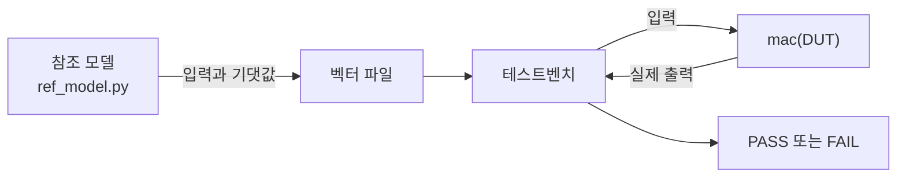

<!-- source: zh-TW/2-front-end/06-verification/README.md | sha: e6d963784a06 -->

# 제6장 검증: 설계가 맞다는 것을 보이기

> 📍 **설계의 현재 위치**
>
> - 이전 단계: 클록과 리셋. `tiny_npu`의 클록 도메인과 리셋을 모두 계획했다
> - **이 장: 참조 모델과 랜덤 테스트로 `mac`을 검사하고, 그 안에 숨은 첫 번째 문제를 찾아낸다**
> - 다음 단계: 논리 합성. 검증을 마친 RTL을 논리 게이트로 바꾼다

🪜 추상화 수준: 사양 ▸ **RTL** ▸ 네트리스트 ▸ 레이아웃 ▸ GDS ▸ 칩

---

## 검증은 왜 그렇게 중요한가

제0장에서 말했듯, 칩은 테이프아웃하고 나면 고치기가 어렵습니다. 그래서 테이프아웃 전에 RTL이 사양대로 동작한다는 것을 온 힘을 다해 보여야 합니다. 이 일을 **검증**(Verification)이라고 합니다. 많은 팀에서 검증 엔지니어가 RTL을 쓰는 사람보다 많고, 검증이 프로젝트 시간의 절반 이상을 차지하는 경우도 흔합니다.

검증의 기본 도구는 **테스트벤치**(Testbench)입니다. 시뮬레이터 안에서만 실행되는 프로그램으로, 테스트할 설계에 입력을 넣고 출력이 맞는지 확인합니다. 테스트되는 설계를 **검증 대상**(Design Under Test, DUT)이라고 하며, 이 장에서는 `mac`입니다.

> [!NOTE]
> **📖 용어｜테스트벤치（Testbench, 測試平台）**
>
> - **정의**: 시뮬레이터 안에서 입력을 만들고, 테스트할 설계를 구동하고, 출력을 확인하는 검증용 프로그램.
> - **현장에서는**: 흔히 TB라고 줄여 부른다. "일단 TB부터 연결하고 smoke test를 돌려 보자."
> - **관련 용어**: DUT, 참조 모델, 시뮬레이터, 파형
> - **흔한 혼동**: 테스트벤치는 회로가 되지 않으므로, 파일 읽기, 메시지 출력, 시간 기다리기처럼 합성할 수 없는 작성법을 쓸 수 있다(제4장).

---

## 지정 테스트와 랜덤 테스트

제4장의 3 × 4 ＋ 5 × 6은 **지정 테스트**(Directed Test)입니다. 엔지니어가 직접 입력을 고릅니다. 떠올릴 수 있는 상황은 테스트할 수 있지만, 떠올리지 못한 상황은 테스트할 수 없습니다.

그래서 검증은 **랜덤 테스트**에 더 많이 의지합니다. 프로그램이 입력을 무작위로 만들게 하되, 제약과 치우침을 줍니다. 올바른 값만 만들고, -128, -1, 0, 1, 127 같은 경계값이 특히 자주 나오게 합니다. 이를 **제약 랜덤 테스트**(Constrained Random Test)라고 합니다.

무작위로 만든 입력의 답은 누가 계산할까요? 소프트웨어로 쓴 **참조 모델**입니다. 제1장의 아키텍처 모델이 여기서 쓸모를 발휘합니다.



난수는 진짜로 제멋대로인 것이 아닙니다. 같은 **난수 시드**(Random Seed)에서는 언제나 같은 입력이 나옵니다. 테스트가 실패하면 시드만 기록해 두면 똑같이 재현할 수 있습니다.

> [!NOTE]
> **📖 용어｜참조 모델（Reference Model, 參考模型）**
>
> - **정의**: 소프트웨어로 쓰였고, 사양에 따라 정답을 계산할 수 있는 모델. RTL의 출력과 비교하는 데 쓴다.
> - **현장에서는**: 흔히 golden model이라고 부른다. "RTL이 golden model과 안 맞는다."
> - **관련 용어**: 아키텍처 모델, 난수 시드, 비교기
> - **흔한 혼동**: 참조 모델도 틀릴 수 있다. RTL과는 다른 사람이 각자 사양을 보고 쓰는 것이 좋다. 그래야 같은 실수를 하지 않는다.

---

## 첫 번째 문제를 잡다

시드 1로 내적 8묶음을 만듭니다. 한 묶음은 25항이고, 묶음마다 처음의 지우기를 더하면 검사는 모두 208건입니다. 제4장의 `mac`은 195건을 틀렸습니다.

첫 번째 오류는 -127 × -49입니다. 정답은 6,223인데, `mac`은 26,703을 계산했습니다. 26,703은 정확히 129 × 207이고, 129와 207은 -127과 -49를 부호 없는 수로 읽었을 때의 값입니다(제3장).

원인은 제4장의 포트에 `signed`를 선언하지 않은 것입니다. Verilog는 기본적으로 그것들을 부호 없는 수로 다룹니다. 고치려면 세 포트를 모두 부호 있는 수로 선언합니다. 이것이 `rtl/mac_ch06.v`입니다.

```verilog
    input  wire signed [7:0]  a,
    input  wire signed [7:0]  b,
    output reg  signed [23:0] acc
```

3 × 4 ＋ 5 × 6은 모두 양수이므로, `signed`를 선언하든 안 하든 결과가 같습니다. 그래서 지정 테스트로는 잡을 수 없습니다. 이것이 바로 랜덤 테스트의 가치입니다.

> [!TIP]
> **🔧 노하우｜식 안에 부호 없는 수가 하나라도 있으면 식 전체가 부호 없는 연산이 된다**
>
> - **상황**: `a`와 `b`는 `signed`로 선언했지만 `acc`를 잊었다.
> - **방법**: 같은 식 안의 피연산자는 모두 부호 있는 수로 선언한다. 확실하지 않으면 `$signed()`로 명시적으로 변환한다. Lint 도구로도 부호 있는 수와 부호 없는 수를 섞어 쓴 곳을 찾을 수 있다.
> - **이유**: 이것은 Verilog의 규칙이다. 피연산자가 하나라도 부호 없는 수이면 식 전체가 부호 없는 수로 계산되고, 음수는 부호 확장되지 않는다. C 언어에서 `int`와 `unsigned int`를 섞을 때도 비슷한 규칙이 있다.
> - **안 하면 어떻게 되나**: 실제로 해 보면 `a`와 `b`만 고치고 `acc`를 고치지 않았을 때, 208건 가운데 여전히 195건이 틀린다. 양수 테스트는 모두 통과하므로, 문제는 한참 뒤까지 숨어 있게 된다.
> - **관련 장**: [제3장 조합 논리와 순차 논리](../../1-digital-logic/03-combinational-and-sequential/README.md)

---

## 테스트는 끝났는가: 커버리지

테스트가 충분한지는 어떻게 알 수 있을까요? **커버리지**로 잽니다.

- **코드 커버리지**: RTL의 모든 줄과 모든 분기가 실행되었는가. `mac`의 코드는 몇 줄뿐이어서, 랜덤 테스트를 돌리면 리셋, 지우기, 누산의 모든 분기를 지나간다. 코드 커버리지는 100%다.
- **기능 커버리지**: 사양에 있는 각 상황이 실제로 일어났는가. 예를 들어 '누산기가 양의 방향으로 범위를 넘었다', '음의 방향으로 범위를 넘었다', '`LEN`이 1이었다'.

코드 커버리지에는 맹점이 있습니다. 잴 수 있는 것은 '쓰인 코드'뿐입니다. 사양이 요구하는 포화는 제4장에서 아예 쓰이지 않았으므로, 실행되지 않은 줄은 하나도 없습니다. 이 랜덤 테스트의 내적은 25항뿐이어서, 누산기의 값은 많아야 5만 남짓이고, 24비트의 상한인 800만 남짓에는 한참 못 미칩니다.

> [!NOTE]
> **📖 용어｜커버리지（Coverage, 覆蓋率）**
>
> - **정의**: 테스트가 충분한지 재는 지표. 코드 커버리지는 RTL이 실행되었는지를, 기능 커버리지는 사양의 상황이 테스트되었는지를 본다.
> - **현장에서는**: "coverage가 100%가 되어야 signoff할 수 있다", "이 corner는 아직 cover가 안 됐다."
> - **관련 용어**: 검증 계획, 어서션, 회귀 테스트
> - **흔한 혼동**: 코드 커버리지가 100%여도 오류가 없다는 뜻은 아니다. 쓰이지 않은 기능에는 잴 코드가 아예 없다.

> [!TIP]
> **🔧 노하우｜검증 계획은 사양에서 한 항목씩 뽑아 쓴다**
>
> - **상황**: 검증을 시작하기 전에 무엇을 테스트할지 정해야 한다.
> - **방법**: 사양서를 한 항목씩 읽고, 각 항목을 검증 계획의 한 항목으로 쓴 뒤, 테스트와 기능 커버리지에 대응시킨다. 다 쓰면 설계자와 아키텍트에게 함께 검토를 받는다.
> - **이유**: RTL을 보며 테스트를 쓰면 RTL이 '무엇을 하는지'만 확인하고, '무엇을 해야 하는지'는 확인하지 않는다.
> - **안 하면 어떻게 되나**: 사양에는 있지만 아무도 구현하지 않은 기능은 아무도 테스트하지도 않는다. 제15장의 `mac`이 바로 이렇게 사고를 낸다.
> - **관련 장**: [제15장 칩이 돌아온 뒤](../../4-to-the-fab/15-after-silicon/README.md)

---

## 그 밖의 검증 방법

- **어서션**(Assertion): 설계나 테스트벤치에 쓰는, 언제나 성립해야 하는 규칙. 예를 들어 '`BUSY`와 `DONE`이 동시에 1이 되는 일은 없다'. 시뮬레이션 중에 어기면 바로 오류를 낸다.
- **형식 검증**(Formal Verification): 입력에 기대지 않고, 어떤 성질이 '가능한 모든 입력'에서 성립한다는 것을 수학적으로 증명한다. 작고 중요한 회로에 알맞다.
- **회귀 테스트**(Regression Test): 매일 밤 다른 시드로 모든 테스트를 다시 돌려, 새 변경이 이전 기능을 망가뜨리지 않았는지 확인한다.
- **FPGA 프로토타입**: RTL을 FPGA에 넣어 돌린다. 시뮬레이션보다 수천, 수만 배 빨라서, 테이프아웃 전에 진짜 신경망과 펌웨어를 돌릴 수 있다.

큰 프로젝트에서는 보통 SystemVerilog와 업계 표준인 **UVM**(Universal Verification Methodology, IEEE 1800.2)으로 다시 쓸 수 있는 테스트벤치를 꾸립니다.

> [!IMPORTANT]
> **💻 소프트웨어와 비교｜검증은 단위 테스트와 비슷하지만 기준이 훨씬 높다**
>
> - **닮은 점**: 단위 테스트, 지속적 통합, 그리고 무작위 입력으로 오류를 찾는 퍼징(Fuzzing).
> - **다른 점**: 소프트웨어는 오류가 있어도 수정판을 배포할 수 있지만, 칩은 그럴 수 없다. 게다가 큰 칩의 시뮬레이션은 진짜 칩보다 백만 배 이상 느리다. 진짜 칩이라면 1초에 끝날 일이 시뮬레이션에서는 며칠이 걸릴 수 있어서, 모든 것을 테스트할 수는 없다.
> - **그래서 주의할 점**: 테스트는 영리하게 한다. 사양에서 검증 계획을 쓰고, 제약 랜덤 테스트와 기능 커버리지로 테스트하지 못한 곳을 찾는다. 테스트 횟수만 계속 늘리는 것이 아니다.

---

## 🧪 따라 해 보기: 참조 모델로 signed 오류 잡기

`practice/` 폴더에서 실행합니다. 먼저 참조 모델로 시드 1의 랜덤 테스트를 만듭니다.

```bash
python3 ref_model.py random --seed 1 > vectors/random.txt
head -n 3 vectors/random.txt
```

```text
1 0 0 0 0
0 1 -127 -49 6223
0 1 80 50 10223
```

첫 줄은 지우기이고, 그 뒤의 각 줄이 `a`와 `b` 한 쌍입니다. 마지막 열은 참조 모델이 계산한 누산기 값입니다. 제4장의 `mac`으로 돌려 봅니다.

```bash
iverilog -o sim rtl/mac_ch04.v tb/tb_mac.v
vvp sim +vec=vectors/random.txt
```

```text
MISMATCH at line 2: a = -127, b = -49, expected 6223, got 26703
MISMATCH at line 3: a = 80, b = 50, expected 10223, got 30703
MISMATCH at line 4: a = -12, b = -73, expected 11099, got 75355
FAIL: 195 of 208 checks failed
```

`signed`를 선언한 버전으로 바꿔 랜덤 테스트를 다시 돌리고, 제4장의 지정 테스트도 다시 돌립니다.

```bash
iverilog -o sim rtl/mac_ch06.v tb/tb_mac.v
vvp sim +vec=vectors/random.txt
vvp sim +vec=vectors/directed.txt
```

```text
PASS: 208 of 208 checks passed
PASS: 3 of 3 checks passed
```

새 문제를 고친 뒤에는 이전 테스트도 다시 돌려, 원래 기능을 망가뜨리지 않았는지 확인합니다. 이것이 가장 작은 회귀 테스트입니다. 파형을 보고 싶다면 `vvp` 줄에 `+vcd`를 붙이고, 만들어진 `mac.vcd`를 GTKWave로 엽니다.

---

## 이 장의 핵심

1. 검증은 테이프아웃 전에 RTL이 사양대로 동작한다는 것을 보이는 일로, 프로젝트 시간의 절반 이상을 차지하는 경우도 많다.
2. 지정 테스트는 떠올릴 수 있는 상황만 테스트한다. 제약 랜덤 테스트와 참조 모델을 함께 쓰면 생각지 못한 오류를 찾을 수 있다.
3. `mac`의 첫 번째 문제는 `signed`를 선언하지 않은 것이다. 음수가 부호 없는 수로 읽혔지만, 양수 테스트는 모두 통과했다.
4. 코드 커버리지는 쓰이지 않은 기능을 잴 수 없다. 검증 계획은 사양에서 한 항목씩 뽑아 쓴다.
5. 어서션, 형식 검증, 회귀 테스트, FPGA 프로토타입이 각각 시뮬레이션의 모자란 점을 메운다.

---

## 참고 자료

- Janick Bergeron, 『Writing Testbenches: Functional Verification of HDL Models』 제2판
- Chris Spear, Greg Tumbush, 『SystemVerilog for Verification』 제3판
- Accellera, 『Universal Verification Methodology (UVM) User's Guide』

---

[← 제5장 클록과 리셋](../05-clocks-and-resets/README.md) ｜ [목차](../../README.md) ｜ [제7장 논리 합성 →](../07-logic-synthesis/README.md)
