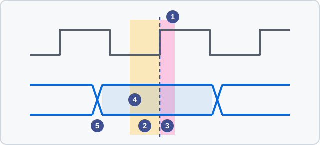

<!-- source: zh-TW/2-front-end/08-static-timing-analysis/README.md | sha: c46d880dc210 -->

# 제8장 정적 타이밍 분석: 모든 경로가 제시간에 도착해야 한다

> 📍 **설계의 현재 위치**
>
> - 이전 단계: 논리 합성. `mac`은 셀 865개가 되었다
> - **이 장: `mac`이 500 MHz에 맞는지 확인하고, 파이프라인 한 단을 넣는다**
> - 다음 단계: 테스트 용이성 설계. 공장에서 불량 칩을 찾을 수 있게 한다

🪜 추상화 수준: 사양 ▸ RTL ▸ **네트리스트** ▸ 레이아웃 ▸ GDS ▸ 칩

---

## 이어달리기: 데이터는 다음 호루라기 전에 도착해야 한다

클록 에지마다 플립플롭은 데이터를 내보냅니다. 데이터는 조합 논리 여러 단을 지나, 다음 클록 에지 전에 다음 플립플롭에 도착해야 합니다. 이어달리기와 비슷합니다. 모든 주자는 호루라기가 울리기 전에 다음 주자에게 배턴을 넘겨야 합니다.

배턴을 넘기는 데는 규칙이 두 가지 더 있습니다.

- **Setup**: 클록 에지 전에 데이터가 잠시 안정되어 있어야 한다. 그래야 플립플롭이 선명하게 찍을 수 있다.
- **Hold**: 클록 에지 뒤에도 데이터가 잠시 바뀌지 않아야 한다. 다음 데이터에 너무 빨리 덮어쓰여서는 안 된다.

그래서 setup의 요구는 이렇게 쓸 수 있습니다. **클록 주기 ≥ 플립플롭의 출력 지연 ＋ 조합 논리의 지연 ＋ setup 시간**.



*그림 설명: 위는 클록, 아래는 데이터. ① 클록의 상승 에지. ② setup 시간. ③ hold 시간. ④ 데이터가 안정된 구간으로, ②와 ③을 완전히 덮어야 한다. ⑤ 데이터가 바뀌는 시각으로, ②와 ③ 바깥에만 놓일 수 있다.*

> [!NOTE]
> **📖 용어｜Setup과 Hold（Setup 與 Hold）**
>
> - **정의**: setup time은 클록 에지 전에 데이터가 안정되어 있어야 하는 시간이고, hold time은 클록 에지 뒤에 데이터가 바뀌지 않아야 하는 시간이다.
> - **현장에서는**: "setup이 안 맞으면 주파수를 낮추면 되지만, hold가 안 맞으면 칩을 쓸 수 없다."
> - **관련 용어**: 슬랙, 크리티컬 패스, 클록 스큐
> - **흔한 혼동**: setup 위반은 클록 주파수와 관계가 있어서 주파수를 낮추면 해결된다. hold 위반은 주파수와 관계가 없어서 주파수를 낮춰도 살릴 수 없다.

---

## 정적: 입력이 필요 없는 타이밍 분석

시뮬레이션에는 입력이 필요하고, 모든 경로를 다 시험해 볼 수도 없습니다. **정적 타이밍 분석**(Static Timing Analysis, STA)은 다른 방법을 씁니다. 입력은 아무것도 돌리지 않고, 라이브러리에서 각 셀의 지연을 찾고, 배선마다 지연을 추정해서, 칩의 모든 경로의 지연을 하나씩 더합니다.

칩에는 수백만 개, 때로는 수십억 개의 경로가 있지만, STA는 몇 시간 안에 모두 확인할 수 있습니다.

> [!NOTE]
> **📖 용어｜정적 타이밍 분석（Static Timing Analysis, STA, 靜態時序分析）**
>
> - **정의**: 테스트 입력 없이 경로마다 지연을 계산해, setup과 hold를 만족하는지 확인하는 방법.
> - **현장에서는**: "STA 다 돌렸는데 WNS가 아직 -0.12 ns다", "이 경로는 STA에서 false path로 설정해."
> - **관련 용어**: 슬랙, WNS, TNS, 타이밍 제약
> - **흔한 혼동**: STA는 타이밍만 보고 기능은 보지 않는다. 논리를 잘못 써도 STA는 모두 통과할 수 있다.

---

## 슬랙: 시간이 얼마나 남았는가

모든 경로에는 '늦어도 이 시각까지 도착해야 하는 시각'과 '실제로 도착한 시각'이 있고, 둘의 차가 **슬랙**(slack)입니다.

- 슬랙이 양수: 데이터가 일찍 도착해서 아직 여유가 있다.
- 슬랙이 음수: 데이터가 늦었고, 이 경로는 위반이다.

슬랙이 가장 나쁜 경로를 **크리티컬 패스**(Critical Path)라고 하며, 칩이 얼마나 빨리 돌 수 있는지는 이것으로 정해집니다. 보고서에서 가장 많이 보는 숫자는 **최악 음수 슬랙**(Worst Negative Slack, WNS)과 **총 음수 슬랙**(Total Negative Slack, TNS, 모든 음수 슬랙의 합) 두 가지입니다. WNS는 최악의 경로가 얼마나 모자란지를, TNS는 문제가 얼마나 퍼져 있는지를 보여 줍니다.

---

## 공정 코너: 가장 느린 칩도 제시간에 맞아야 한다

같은 설계로 만든 칩이라도 속도가 완전히 같지는 않습니다. 공정에는 편차가 있고, 전압은 떨어지고, 온도도 바뀝니다. 그래서 STA는 한 번 계산하고 끝나는 것이 아니라, 여러 극단적인 조건에서 각각 계산합니다. 이 조건을 **공정 코너**라고 합니다.

- **setup**은 보통 가장 느린 코너에서 확인한다. 트랜지스터는 느린 쪽, 전압은 낮은 쪽, 온도는 높은 쪽.
- **hold**는 보통 가장 빠른 코너에서 확인한다. 트랜지스터는 빠른 쪽, 전압은 높은 쪽, 온도는 낮은 쪽.

비교적 새로운 공정에는 낮은 전압에서 직관과 반대되는 현상도 있습니다. 낮은 온도에서 오히려 회로가 느려지는 것으로, **온도 역전**(Temperature Inversion)이라고 합니다. 28 nm급인 `tiny_npu`도 이것을 고려해야 합니다. 그래서 확인해야 할 코너는 직관으로 떠올리는 것보다 많습니다. 같은 칩 안에서 위치에 따른 차이는 **온칩 변동**(On-Chip Variation, OCV)으로 따로 여유를 더해 다룹니다.

> [!NOTE]
> **📖 용어｜공정 코너（Process Corner, 製程角落）**
>
> - **정의**: 공정, 전압, 온도(PVT)의 극단값을 조합한 분석 조건.
> - **현장에서는**: NMOS와 PMOS의 빠르기를 두 글자로 나타낸다. "SS 코너에서 setup이 안 맞는다", "FF 코너에서 hold를 본다."
> - **관련 용어**: PVT, OCV, 멀티 코너 멀티 모드 분석(MCMM)
> - **흔한 혼동**: 코너는 웨이퍼의 모서리가 아니라, 공정, 전압, 온도를 조합한 극단적인 상황이다.

<details>
<summary>🔍 조금 더 깊이: 왜 hold는 클록 주파수와 관계가 없는가</summary>

setup이 비교하는 것은 이번 클록에 내보낸 데이터가 **다음** 클록 에지 전에 도착할 수 있는가입니다. 그 사이에 주기가 통째로 하나 있으므로, 주기가 길어지면 setup을 만족하기 쉬워집니다.

hold가 비교하는 것은 이번 클록에 내보낸 새 데이터가 너무 빨리 도착해서, **같은** 클록 에지에서 다음 플립플롭이 아직 제대로 찍지 못한 이전 데이터를 덮어쓰지 않는가입니다. 내보내기와 받기가 같은 에지에서 일어나므로, 식 안에 주기라는 항이 아예 없습니다.

그래서 hold 위반은 주로 데이터 경로를 길게 만들어 고칩니다. 예를 들어 지연용 버퍼를 넣습니다. 칩이 만들어진 뒤에는 전압이나 온도를 바꿔 조금 영향을 줄 수 있을 뿐, 손쓸 방법이 거의 없습니다.

</details>

---

## mac은 제시간에 못 맞춘다: 파이프라인 한 단 넣기

`mac`의 크리티컬 패스는 입력 `a`, `b`에서 출발해 곱셈기와 가산기를 지나 누산기의 플립플롭에 도착합니다. `tiny_npu`에서 `a`와 `b`는 SRAM이 클록마다 내보내는 데이터로, 이것도 플립플롭에서 나옵니다. 논리 합성 뒤에 이 경로는 최장 32단의 논리 게이트를 지납니다. 한 단의 평균이 70 ps라면 논리만으로 2.24 ns가 되어, 500 MHz의 주기 2 ns를 이미 넘습니다.

고치는 방법은 곱셈기와 가산기 사이에 플립플롭을 한 줄 넣어 긴 경로를 둘로 자르는 것입니다. 이를 **파이프라인**(Pipeline)이라고 합니다. 이것이 `rtl/mac_ch08.v`의 앞부분입니다.

```verilog
    // Stage 1: multiply, and delay the control signals to match.
    reg signed [15:0] prod;
    reg               clr_d, en_d;
    always @(posedge clk or negedge rst_n) begin
        if (!rst_n) begin
            prod  <= 16'sd0;
            clr_d <= 1'b0;
            en_d  <= 1'b0;
        end else begin
            prod  <= a * b;
            clr_d <= clr;
            en_d  <= en;
        end
    end
```

뒷부분에서 `prod`를 누산기에 더합니다. 가장 긴 경로는 32단에서 24단으로 줄었습니다. 이제 가장 긴 것은 곱셈기 구간이고, 가산기에서 누산기로 돌아오는 고리는 훨씬 짧습니다. 대가로 플립플롭이 18개 늘었고(16비트 곱과, 한 클록 늦추는 제어 신호 두 개), 결과도 한 클록 늦게 나옵니다. 즉 **레이턴시**(Latency)가 1클록에서 2클록이 되었습니다. 그래도 클록마다 곱셈 누산을 한 번 끝내는 것은 같으므로, **처리량**(Throughput)은 변하지 않았습니다.

> [!IMPORTANT]
> **💻 소프트웨어와 비교｜파이프라인은 CPU의 명령어 파이프라인과 비슷하지만, 지연을 아무도 대신 챙겨 주지 않는다**
>
> - **닮은 점**: CPU는 명령어 하나를 여러 단계로 나누어, 생산 라인처럼 여러 명령어를 동시에 처리한다.
> - **다른 점**: RTL에 파이프라인 한 단을 넣으면, '몇 클록 뒤에 결과가 나오는가'에 기대는 모든 곳을 함께 고쳐야 한다. 제어 회로는 한 클록 더 기다리고, 테스트벤치는 한 클록 늦게 비교하고, 펌웨어의 가정도 바꿔야 할 수 있다. 자동으로 맞춰 주는 것은 아무것도 없다.
> - **그래서 주의할 점**: 파이프라인 깊이를 바꾸면 그것에 기대는 모든 곳을 찾아내고 검증을 다시 돌린다. 따라 해 보기에서는 테스트벤치를 고치지 않으면 무슨 일이 생기는지 본다.

---

## 타이밍 클로저

모든 위반을 고쳐 슬랙이 어디에서도 음수가 아니게 만드는 것을 **타이밍 클로저**(Timing Closure)라고 합니다. 흔히 쓰는 수단은 RTL 아키텍처를 바꾸거나 파이프라인을 넣는 것, 셀을 구동 능력이 더 큰 것으로 바꾸는 것, 크리티컬 패스 위의 셀을 낮은 Vt의 것으로 바꾸는 것입니다. hold 위반에는 지연용 버퍼를 넣습니다.

논리 합성 뒤의 STA는 배선 지연을 추정할 뿐입니다. 제12장에서 진짜 배선을 연결한 뒤, 추출한 값으로 한 번 더 합니다.

> [!TIP]
> **🔧 노하우｜큰 타이밍 문제는 RTL 단계에서 해결한다**
>
> - **상황**: 논리 합성 뒤의 STA에서 크리티컬 패스가 수백 피코초 모자란다고 나왔다.
> - **방법**: RTL로 돌아가 아키텍처를 바꾸거나 파이프라인을 넣는다. 논리 합성 단계에서 주기의 일부를 남겨, 나중에 생길 배선 지연의 여유로 삼는다.
> - **이유**: 백엔드 도구가 잘하는 것은 셀의 크기나 위치를 조정하는 것 같은 작은 위반의 수정이다. 많이 모자란 경로는 논리 구조를 바꾸는 수밖에 없다.
> - **안 하면 어떻게 되나**: 백엔드가 몇 주 동안 이리저리 시도하다가 결국 RTL로 돌아가 고치게 되고, 일정이 모두 뒤로 밀린다.
> - **관련 장**: [제12장 배선과 기생 성분](../../3-physical-design/12-routing-and-parasitics/README.md)

> [!TIP]
> **🔧 노하우｜hold 위반은 테이프아웃 전에 반드시 모두 없앤다**
>
> - **상황**: 테이프아웃 직전에 아주 조금 모자란 hold 위반이 몇 개 있고, 누군가 그냥 두자고 한다.
> - **방법**: 모든 코너에서 hold는 위반이 없어질 때까지 고친다. '돌아오면 주파수를 낮추면 된다'는 생각은 하지 않는다.
> - **이유**: setup이 모자라면 주파수를 낮춰 쓸 수 있다. hold는 주파수와 관계가 없어서, 주파수를 낮춰도 소용이 없다.
> - **안 하면 어떻게 되나**: 칩이 돌아온 뒤 아무리 느리게 돌려도 오동작하고, 마스크를 다시 만드는 수밖에 없다.
> - **관련 장**: [제13장 사인오프](../../3-physical-design/13-signoff/README.md)

---

## 🧪 따라 해 보기: 논리 깊이를 비교하고 파이프라인 검증하기

이 실습은 진짜 라이브러리의 지연 데이터에 연결되어 있지 않으므로, 여기서는 **논리 깊이**(경로에서 논리 게이트를 몇 단 지나는가)를 지연 대신 씁니다. `practice/` 폴더에서 파이프라인을 넣기 전과 후의 가장 긴 경로를 비교합니다.

```bash
yosys -q -p "read_verilog rtl/mac_ch06.v; synth -top mac; tee -o /dev/stdout ltp -noff" | grep Longest
yosys -q -p "read_verilog rtl/mac_ch08.v; synth -top mac; tee -o /dev/stdout ltp -noff" | grep Longest
```

```text
Longest topological path in mac (length=32):
Longest topological path in mac (length=24):
```

다른 버전의 Yosys를 쓰면 논리 깊이가 조금 다를 수 있습니다. 다음으로 제6장의 테스트벤치로 파이프라인 버전의 `mac`을 테스트합니다.

```bash
iverilog -o sim rtl/mac_ch08.v tb/tb_mac.v
vvp sim +vec=vectors/random.txt
```

```text
MISMATCH at line 2: a = -127, b = -49, expected 6223, got 0
MISMATCH at line 3: a = 80, b = 50, expected 10223, got 6223
MISMATCH at line 4: a = -12, b = -73, expected 11099, got 10223
FAIL: 188 of 208 checks failed
```

`mac`은 계산을 틀리지 않았습니다. 3번째 줄에서 받은 6,223은 바로 2번째 줄의 답입니다. 결과가 한 클록 늦었는데, 테스트벤치는 원래 시각에 비교하고 있습니다. 레이턴시가 2클록이 되었다고 테스트벤치에 알려 주고 다시 돌립니다.

```bash
iverilog -P tb.LAT=2 -o sim rtl/mac_ch08.v tb/tb_mac.v
vvp sim +vec=vectors/random.txt
```

```text
PASS: 208 of 208 checks passed
```

이 파이프라인 버전이 이제부터 테이프아웃할 버전입니다.

---

## 이 장의 핵심

1. 데이터는 다음 클록 에지 전에 도착해 setup과 hold를 만족해야 한다. 주기는 경로상의 지연 합계보다 길어야 한다.
2. STA는 입력 없이 경로마다 슬랙을 계산하고, 여러 공정 코너에서 확인한다.
3. setup 위반은 주파수를 낮추면 해결되지만, hold 위반은 주파수와 관계없으므로 테이프아웃 전에 반드시 없앤다.
4. `mac`은 500 MHz에서 경로가 너무 길다. 파이프라인 한 단을 넣으면 논리 깊이가 32단에서 24단으로 줄고, 결과는 한 클록 늦게 나온다.
5. 파이프라인 깊이를 바꾸면 레이턴시에 기대는 모든 곳을 고치고 다시 검증한다.

---

## 참고 자료

- J. Bhasker, Rakesh Chadha, 『Static Timing Analysis for Nanometer Designs: A Practical Approach』
- Neil H. E. Weste, David Money Harris, 『CMOS VLSI Design: A Circuits and Systems Perspective』 제4판, 제10장

---

[← 제7장 논리 합성](../07-logic-synthesis/README.md) ｜ [목차](../../README.md) ｜ [제9장 테스트 용이성 설계 →](../09-design-for-test/README.md)
