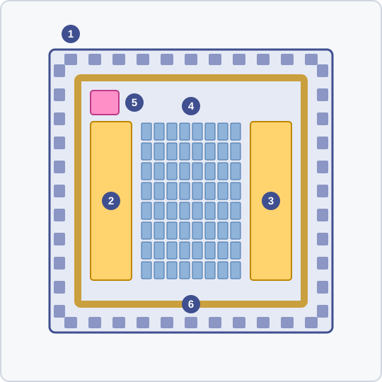

<!-- source: zh-TW/3-physical-design/10-floorplan-and-power/README.md | sha: 52480cf240ea -->

# 제10장 플로어플랜과 전원망: 먼저 칩의 지도를 그리기

> 📍 **설계의 현재 위치**
>
> - 이전 단계: 테스트 용이성 설계. 네트리스트에 스캔 체인과 MBIST를 넣었다
> - **이 장: 칩의 크기를 정하고, SRAM, MAC 어레이, I/O를 알맞은 위치에 놓고, 전원을 깐다**
> - 다음 단계: 배치와 클록 트리. 표준 셀을 하나하나 놓고, 클록을 모든 플립플롭에 보낸다

🪜 추상화 수준: 사양 ▸ RTL ▸ 네트리스트 ▸ **레이아웃** ▸ GDS ▸ 칩

---

## 네트리스트에서 레이아웃으로

네트리스트는 '무엇이 무엇에 연결되는가'만 말할 뿐, '무엇을 어디에 놓는가'는 말하지 않습니다. 이 장부터 시작하는 **물리 설계**에서는 모든 셀에 좌표를 주고, 진짜 금속 배선으로 그것들을 연결합니다.

**플로어플랜 → 배치 → 클록 트리 → 배선 → 사인오프**

1. **플로어플랜**: 칩의 크기, 큰 블록의 위치, 전원망을 정한다(이 장).
2. **배치**: 표준 셀마다 자리를 찾는다(제11장).
3. **클록 트리**: 클록을 모든 플립플롭에 보낸다(제11장).
4. **배선**: 모든 연결을 금속 배선으로 잇는다(제12장).
5. **사인오프**: 테이프아웃 전 점검을 항목별로 마친다(제13장).

새 도시를 계획하는 것과 비슷합니다. 먼저 도시의 범위를 정하고, 체육관이나 병원 같은 큰 건물을 놓고, 주요 수도관과 전선을 깐 다음, 마지막에 집을 한 채씩 짓습니다.

물리 설계의 입력에는 네트리스트와 타이밍 제약 외에, 각 셀의 물리 정보도 있습니다. 외곽의 크기, 핀의 위치, 어느 금속층에 배선하면 안 되는지 등이며, 흔히 LEF 형식으로 기술합니다. 공정의 규칙은 파운드리의 **공정 설계 키트**(Process Design Kit, PDK)에서 옵니다.

> [!NOTE]
> **📖 용어｜플로어플랜（Floorplan, 平面規劃）**
>
> - **정의**: 다이의 크기, 큰 블록의 위치, I/O의 배열, 전원 구조를 정하는 단계.
> - **현장에서는**: "floorplan도 아직 안 정해졌는데 배치부터 서두르지 마."
> - **관련 용어**: 매크로, I/O 셀, 전원망, 사용률
> - **흔한 혼동**: 플로어플랜에서는 표준 셀을 하나하나 놓지 않는다. 그것은 다음 장인 배치의 일이다.

---

## 칩은 얼마나 커야 하는가

다이의 크기는 다음 두 가지 가운데 큰 쪽으로 정해집니다.

- **코어**: 모든 표준 셀과 SRAM을 합친 면적에, 배선을 위한 공간을 조금 더한 것.
- **둘레의 패드**: 칩과 패키지를 잇는 금속 접점으로, 다이의 가장자리를 따라 한 바퀴 늘어놓아야 한다.

`tiny_npu`에는 표준 셀 약 10만 개와 SRAM 두 개가 있어서, 코어는 사실 그리 크지 않습니다. 그런데 패드는 약 100개가 필요합니다. 버스, 클록, 리셋, JTAG에 더해 전원과 접지 패드가 많기 때문입니다. 패드 100개를 한 바퀴 늘어놓으면 한 변이 2 mm 가까이 됩니다. 그래서 `tiny_npu`의 크기는 패드가 정하고, 코어 안에는 오히려 공간이 넉넉합니다.

> [!NOTE]
> **📖 용어｜패드 제한과 코어 제한（Pad-limited／Core-limited）**
>
> - **정의**: 다이의 크기가 패드의 수로 정해지는 것을 pad-limited, 코어 회로의 면적으로 정해지는 것을 core-limited라고 한다.
> - **현장에서는**: "이건 pad-limited라서 안에 디커플링 커패시터를 넉넉히 넣어도 괜찮다."
> - **관련 용어**: 패드, I/O 셀, 다이 면적, 사용률
> - **흔한 혼동**: pad-limited 칩은 논리를 아무리 줄여도 다이가 작아지지 않는다. 면적을 줄이고 싶다면 먼저 패드를 줄여야 한다.

---

## 큰 블록 놓기

**매크로**(Macro)는 SRAM이나 PLL처럼 모양이 정해진 큰 블록입니다. 이것들을 먼저 놓고, 남은 공간을 표준 셀에 줍니다.

`tiny_npu`의 플로어플랜은 다음과 같습니다. 둘레에는 I/O 셀과 패드가 있습니다. 데이터 SRAM은 왼쪽에, 가중치 SRAM은 오른쪽에 놓고, MAC 어레이를 그 사이에 끼워 두 SRAM이 모두 바짝 붙게 합니다. PLL은 한쪽 모서리에 놓습니다. 클록 핀에 가깝고, 전환이 잦은 MAC 어레이에서는 먼 곳입니다.

*그림 설명: ① 둘레의 I/O 셀과 패드. ② 데이터 SRAM. ③ 가중치 SRAM. ④ 8 × 8 MAC 어레이. ⑤ PLL. ⑥ 코어를 둘러싼 전원 링.*

> [!TIP]
> **🔧 노하우｜SRAM의 핀은 그것을 쓰는 회로 쪽으로 향하게 한다**
>
> - **상황**: SRAM의 데이터와 주소 핀은 한쪽 변에 모여 있고, 놓을 때 회전하거나 뒤집을 수 있다.
> - **방법**: 핀이 있는 변을 MAC 어레이 쪽으로 향하게 하고, 양쪽의 데이터선을 정렬한다. 매크로 사이에는 충분한 배선 통로를 남긴다.
> - **이유**: SRAM마다 클록마다 64비트의 데이터를 내보낸다. 핀을 반대로 두면 이 배선들이 SRAM 전체를 빙 돌아가야 한다.
> - **안 하면 어떻게 되나**: SRAM에서 MAC으로 가는 경로가 길어져 타이밍이 맞지 않는다. 배선이 몰려 아예 지나가지 못할 수도 있다.
> - **관련 장**: [제12장 배선과 기생 성분](../12-routing-and-parasitics/README.md)

---

## 전원망: 모든 셀이 물을 마실 수 있도록

모든 표준 셀은 전원과 접지에 연결되어야 합니다. 전기는 패드에서 들어와 먼저 코어를 둘러싼 굵은 **전원 링**으로 흐르고, 위층 금속의 평행한 **전원 스트라이프** 여러 줄로 나뉜 다음, 마지막으로 표준 셀의 각 줄에 있는 전원 레일로 흘러듭니다. 수돗물이 본관과 지관을 거쳐 집집마다 전해지는 것과 같습니다.

배선에는 모두 저항이 있습니다. 저항에 전류가 흐르면 전압이 떨어지는데, 이를 **IR 드롭**이라고 합니다. 패드에서 멀고 전기를 많이 쓰는 곳일수록 셀이 받는 전압이 낮아지고, 동작도 느려집니다. 전류가 오랫동안 너무 몰리면 금속 원자가 조금씩 밀려나 결국 배선이 끊어지는데, 이를 **일렉트로마이그레이션**이라고 합니다.

그래서 전원망은 충분히 촘촘하고 굵어야 합니다. 하지만 전원망이 차지한 금속은 신호선 배선에 쓸 수 없습니다. 이것도 트레이드오프입니다. 전기를 가장 많이 쓰는 블록 옆에는 **디커플링 커패시터**(Decoupling Capacitor)를 더 둡니다. 작은 물탱크 같은 것으로, 쓰는 전기가 갑자기 늘 때 가까이에서 전류를 보충합니다.

> [!NOTE]
> **📖 용어｜IR 드롭（IR Drop, IR 壓降）**
>
> - **정의**: 전류가 전원 배선의 저항을 흐르기 때문에, 셀이 받는 전압이 전원보다 낮아지는 것. 이름은 전압 ＝ 전류 × 저항(V ＝ IR)에서 왔다.
> - **현장에서는**: "어레이 한가운데 IR drop이 너무 크니까, 거기 timing은 여유를 더 잡아."
> - **관련 용어**: 전원망, 디커플링 커패시터, 일렉트로마이그레이션
> - **흔한 혼동**: 정적 IR 드롭은 평균 전류를 본다. 동적 IR 드롭은 많은 셀이 동시에 전환되는 순간을 보는 것으로, 대개 훨씬 심각하다(제13장).

> [!TIP]
> **🔧 노하우｜전원망은 배치 전에 정해 둔다**
>
> - **상황**: 플로어플랜 때 빨리 배치로 넘어가고 싶어서, 전원망은 일단 대충 깔아 둔다.
> - **방법**: 먼저 영역마다 전력을 추정한다. 예를 들어 MAC 어레이가 가장 촘촘하고 전력을 가장 많이 쓴다. 그에 맞춰 전원 스트라이프의 폭과 간격을 정한다.
> - **이유**: 전원 스트라이프는 정해진 배선 트랙을 차지한다. 나중에 굵게 하면, 놓아 둔 셀과 깔아 둔 배선을 모두 다시 해야 한다.
> - **안 하면 어떻게 되나**: 제13장의 사인오프에 와서야 MAC 어레이의 IR 드롭이 너무 크다는 것을 알게 되어, 플로어플랜으로 돌아가 다시 하느라 몇 주를 잃는다.
> - **관련 장**: [제13장 사인오프](../13-signoff/README.md)

---

## 전원 도메인: 회로의 일부를 완전히 끄기

제5장의 클록 게이팅은 쉬는 회로의 전환을 멈출 수 있지만, 누설은 막지 못합니다. 누설까지 아끼고 싶다면 그 블록의 전원을 통째로 끕니다. 이를 **파워 게이팅**(Power Gating)이라고 합니다.

`tiny_npu`는 MAC 어레이를 독립된 **전원 도메인**에 넣고, 전원 스위치 한 줄로 제어합니다. 펌웨어가 맡길 일이 없을 때는 어레이 전체의 전원을 끕니다. 이 전원 도메인은 제1장의 아키텍처 단계에서 이미 정해졌고, 논리 합성과 검증도 그에 따라 다룹니다. 플로어플랜에서 정하는 것은 칩 위에서 그 범위와, 전원 스위치를 어디에 놓을지입니다. 이로 인해 몇 가지 새 요구가 생깁니다.

- 전원이 꺼진 블록의 출력은 떠다니므로, 거기서 나오는 모든 신호는 **아이솔레이션 셀**을 거쳐 정해진 값으로 고정한다.
- 두 전원 도메인의 전압이 다를 때는 신호를 **레벨 시프터**에 통과시킨다.
- 어떤 블록의 전원을 끌 수 있는지, 어떻게 분리하는지는 UPF(IEEE 1801) 같은 표준 형식으로 기술해서, 논리 합성, 물리 설계, 검증 도구가 모두 이해할 수 있게 한다.

> [!IMPORTANT]
> **💻 소프트웨어와 비교｜전원 도메인은 쓰지 않는 서버를 끄는 것과 비슷하다**
>
> - **닮은 점**: 클라우드에서 트래픽이 없는 서버를 꺼 두었다가, 필요할 때 다시 켠다.
> - **다른 점**: 전원이 꺼진 블록은 안의 상태가 모두 사라지고, 다시 전원을 넣으면 전원이 안정되기를 기다린 뒤 리셋을 다시 해야 한다. 꺼져 있는 동안 그 출력선은 0도 1도 아니므로, 받는 쪽은 반드시 아이솔레이션 셀로 보호해야 한다.
> - **그래서 주의할 점**: 전원을 켜고 끄는 순서는 사양에 적고, 펌웨어도 그대로 따른다. 먼저 사용을 멈추고, 분리한 뒤, 전원을 끈다. 켤 때는 그 반대다.

🔍 조금 더 깊이: 전원 스위치는 왜 하나씩 켜는가

MAC 어레이 전체의 전원이 꺼져 있을 때는 안의 커패시턴스가 모두 방전되어 있습니다. 모든 전원 스위치를 동시에 켜면 이 커패시턴스들이 한순간에 한꺼번에 충전되면서 아주 큰 돌입 전류가 흐릅니다. 돌입 전류는 칩 전체의 전원 전압을 갑자기 떨어뜨리고, 옆에서 아직 일하고 있는 회로가 오동작할 수 있습니다.

그래서 전원 스위치는 보통 한 줄의 체인으로 잇습니다. 앞의 스위치가 켜진 뒤에야 다음 스위치를 켜서, 전류를 천천히 늘립니다. 대가로 깨어나는 데 시간이 더 걸립니다. 이 시간도 사양에 적어, 펌웨어가 얼마나 기다려야 하는지 알게 합니다.

---

## 이 장의 핵심

1. 물리 설계는 네트리스트의 모든 셀에 위치를 주고, 진짜 배선을 연결한다. 첫걸음은 플로어플랜이다.
2. 다이의 크기는 코어의 면적이나 패드의 수로 정해진다. `tiny_npu`는 pad-limited다.
3. SRAM이나 PLL 같은 매크로를 먼저 놓고, 핀은 그것을 쓰는 회로 쪽으로 향하게 한다.
4. 전원망은 패드, 전원 링, 전원 스트라이프를 거쳐 모든 셀에 전기를 보낸다. IR 드롭과 일렉트로마이그레이션을 억제해야 한다.
5. 파워 게이팅은 누설까지 아낄 수 있지만, 아이솔레이션 셀, 레벨 시프터, 분명한 켜고 끄는 순서가 필요하다.

---

## 참고 자료

- Andrew B. Kahng, Jens Lienig, Igor L. Markov, Jin Hu, 『VLSI Physical Design: From Graph Partitioning to Timing Closure』 제3장
- 『반도체 제조 입문』 [제10장 금속 배선](https://github.com/chenwei810/Semiconductor_Manufacturing_Introduction/blob/main/ko/2-process-modules/10-metallization/README.md)

---

[← 제9장 테스트 용이성 설계](../../2-front-end/09-design-for-test/README.md) ｜ [목차](../../README.md) ｜ [제11장 배치와 클록 트리 →](../11-placement-and-cts/README.md)
