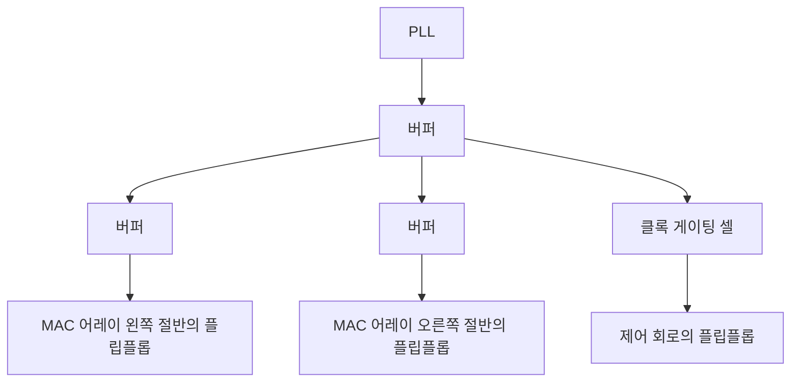

<!-- source: zh-TW/3-physical-design/11-placement-and-cts/README.md | sha: a4fbe88924f3 -->

# 제11장 배치와 클록 트리: 셀을 놓고 클록을 보내기

> 📍 **설계의 현재 위치**
>
> - 이전 단계: 플로어플랜과 전원망. SRAM, MAC 어레이, 전원의 위치가 정해졌다
> - **이 장: 표준 셀 10만 개를 칩에 놓고, 클록을 모든 플립플롭에 보낸다**
> - 다음 단계: 배선과 기생 성분. 모든 셀을 금속 배선으로 연결한다

🪜 추상화 수준: 사양 ▸ RTL ▸ 네트리스트 ▸ **레이아웃** ▸ GDS ▸ 칩

---

## 배치: 셀 10만 개의 자리 찾기

표준 셀은 모두 높이가 같아서, 전원 레일 사이에 한 줄씩 늘어놓을 수 있습니다. 책장에 책을 꽂는 것과 같습니다. **배치**(Placement)란 네트리스트의 모든 표준 셀에 책장 위의 자리를 하나씩 찾아 주는 일입니다.

좋은 배치에서는 서로 연결된 셀끼리 가까이 모여, 배선이 짧고 지연이 작으며 덜 붐빕니다. 도구는 보통 세 단계로 마무리합니다.

**전역 배치 → 정규화 → 배치 후 최적화**

1. **전역 배치**: 먼저 각 셀의 대략적인 위치를 계산한다. 이 단계에서는 셀끼리 겹쳐도 된다.
2. **정규화**: 각 셀을 가장 가까운 올바른 위치로 밀어 셀 줄에 맞춘다. 겹쳐서는 안 된다.
3. **배치 후 최적화**: 타이밍 결과에 따라 셀 크기를 조정하고, 버퍼를 넣고, 크리티컬 패스 위의 셀을 조금 더 가깝게 옮긴다.

`tiny_npu`의 64개 `mac`은 구조가 완전히 같습니다. 도구는 `mac`마다 수백 개의 셀을 한데 모아, 한 칸씩 가지런히 늘어선 어레이를 만듭니다.

> [!NOTE]
> **📖 용어｜사용률（Utilization, 使用率）**
>
> - **정의**: 표준 셀이 차지한 면적이, 코어에서 배치할 수 있는 면적에서 차지하는 비율.
> - **현장에서는**: "이번엔 utilization 70%로 시작했는데, MAC 어레이 쪽은 벌써 85%다."
> - **관련 용어**: 혼잡, 필러 셀, 다이 면적
> - **흔한 혼동**: 사용률은 높을수록 좋은 것이 아니다. 너무 높으면 배선이 지나가지 못하고, 나중에 버퍼를 넣거나 ECO용 예비 셀을 놓을 공간도 필요하다.

셀을 너무 빽빽하게 놓으면, 어떤 영역을 지나가야 할 배선이 그곳에서 쓸 수 있는 트랙보다 많아집니다. 이를 **혼잡**(Congestion)이라고 합니다. MAC 어레이의 곱셈기는 배선이 많고 얽혀 있어서, `tiny_npu`에서 가장 혼잡해지기 쉬운 곳입니다.

> [!TIP]
> **🔧 노하우｜중요한 논리 근처에 예비 셀을 미리 뿌려 둔다**
>
> - **상황**: 테이프아웃 뒤에 작은 오류가 발견되었을 때, 되도록 마스크를 전부 다시 만들고 싶지 않다.
> - **방법**: 배치할 때 칩 곳곳, 특히 MAC 어레이 같은 중요한 논리 근처에, 쓰지 않는 **예비 셀**이나 금속층만 바꾸면 논리 게이트가 되는 **ECO 셀**을 미리 뿌려 둔다.
> - **이유**: 이런 셀이 있으면, 작은 수정은 위쪽 몇 층 금속의 마스크만 다시 만들어 그것들을 회로에 이으면 된다. 그 아래 수십 층의 마스크는 손대지 않아도 된다.
> - **안 하면 어떻게 되나**: 아무리 작은 수정이라도 트랜지스터 층부터 다시 만들어야 해서, 몇 달의 시간과 큰 마스크 비용이 더 든다.
> - **관련 장**: [제15장 칩이 돌아온 뒤](../../4-to-the-fab/15-after-silicon/README.md), 『반도체 제조 입문』 [제24장 공정이 펌웨어에 미치는 영향](https://github.com/chenwei810/Semiconductor_Manufacturing_Introduction/blob/main/ko/6-beyond-the-fab/24-process-and-firmware/README.md)

배치가 끝나면 스캔 체인도 셀의 실제 위치에 맞춰 다시 정렬합니다. 체인에서 이웃한 플립플롭이 칩 위에서도 이웃하게 해서 배선을 짧게 합니다(제9장).

---

## 클록 트리: 클록을 모든 플립플롭에 동시에 도착시키기

`tiny_npu`에는 수천 개의 플립플롭이 있고, 64개의 `mac`만 해도 2,688개입니다. 클록은 모든 플립플롭에 거의 동시에 도착해야 합니다. 하지만 배선 하나로 수천 개의 부하를 구동할 수는 없고, PLL에서 거리가 다른 플립플롭은 클록이 도착하는 시각도 달라집니다.

**클록 트리 합성**(Clock Tree Synthesis, CTS)은 여러 단의 버퍼로 클록을 나뭇가지처럼 나누어 보내고, 가지마다 길이와 버퍼를 조정해, 모든 플립플롭에 클록이 최대한 같은 시각에 도착하게 합니다.

클록이 발생원에서 플립플롭까지 가는 시간을 **삽입 지연**(Insertion Delay)이라고 하고, 같은 클록이 서로 다른 플립플롭에 도착하는 시각의 차이를 **클록 스큐**라고 합니다. 클록 트리는 클록마다 전환되고 버퍼도 많아서, 칩에서 전력을 가장 많이 쓰는 망이 되는 경우가 많습니다. 그래서 제5장의 클록 게이팅 셀도 트리의 가지 위에 놓입니다.

> [!NOTE]
> **📖 용어｜클록 스큐（Clock Skew, 時脈偏移）**
>
> - **정의**: 같은 클록이 서로 다른 플립플롭에 도착하는 시각의 차이.
> - **현장에서는**: 그냥 skew라고 하는 경우가 많다. "CTS를 했는데도 이 영역 skew가 아직 너무 크다."
> - **관련 용어**: 클록 트리, 삽입 지연, 클록 지터, 유용한 스큐
> - **흔한 혼동**: 스큐는 '서로 다른 위치' 사이의 시각 차이다. **클록 지터**(Jitter)는 '같은 위치'에서 클록마다 시각이 흔들리는 것으로, 주로 PLL과 전원 잡음에서 온다.

🔍 조금 더 깊이: 스큐를 도구로 쓰기

클록 스큐가 꼭 나쁜 것만은 아닙니다. 경로 A→B가 너무 길고, B→C는 짧다고 해 봅시다. 일부러 B에 클록이 조금 늦게 도착하게 하면, A→B 구간에는 시간이 조금 더 생깁니다. B→C 구간은 같은 만큼 시간이 줄지만, 원래 여유가 넉넉합니다.

이렇게 일부러 만드는 스큐를 **유용한 스큐**(Useful Skew)라고 합니다. 긴 경로가 다음 구간에서 시간을 빌리는 셈입니다. 타이밍 클로저에서 자주 쓰는 수단 가운데 하나지만, 대가로 hold 분석이 복잡해집니다. 클록을 늦게 도착시키면, 앞 단의 데이터가 너무 일찍 도착하기 쉬워지기 때문입니다.

> [!TIP]
> **🔧 노하우｜hold는 클록 트리를 만든 뒤에 고친다**
>
> - **상황**: 클록 트리를 만들기 전의 STA는 클록이 모든 플립플롭에 동시에 도착한다고 가정한다.
> - **방법**: 처음에는 setup만 본다. 클록 트리를 만들고 진짜 클록 도착 시각으로 다시 분석한 뒤에, 지연용 버퍼를 넣어 hold를 고친다.
> - **이유**: 클록 트리를 만들기 전에는 진짜 스큐가 얼마인지 모른다. 이때 hold를 고치면 엉뚱한 곳을 고치거나 너무 많이 고치기 쉽다.
> - **안 하면 어떻게 되나**: 필요 없는 버퍼를 잔뜩 넣어 면적과 전력을 낭비하고, setup까지 느리게 만든다. 정작 위반인 경로는 오히려 그대로 남는다.
> - **관련 장**: [제8장 정적 타이밍 분석](../../2-front-end/08-static-timing-analysis/README.md)

> [!IMPORTANT]
> **💻 소프트웨어와 비교｜클록 트리는 모든 서버의 시각을 맞추는 것과 비슷하다**
>
> - **닮은 점**: 네트워크로 시각을 맞춰 모든 서버의 시각을 같게 해야, 로그를 서로 맞춰 볼 수 있다.
> - **다른 점**: 서버끼리 시각이 몇 밀리초 어긋나는 것은 보통 문제가 되지 않는다. 칩 안에서는 수십 피코초만 어긋나도 데이터를 잘못 받을 수 있다. 게다가 이 시각 차이는 배선 길이와 버퍼가 정하는 물리량이어서, 칩이 만들어지면 고정되고 나중에 소프트웨어로 보정할 수 없다.
> - **그래서 주의할 점**: 클록은 칩에서 부하가 가장 많고, 가장 자주 전환되고, 잡음에 가장 민감한 신호다. 물리 설계에서는 언제나 가장 먼저 다룬다.

---

## 이 장의 핵심

1. 배치는 표준 셀을 코어에 한 줄씩 놓는 일로, 전역 배치, 정규화, 배치 후 최적화의 세 단계로 나뉜다.
2. 사용률이 너무 높으면 혼잡이 생긴다. 버퍼와 ECO용 예비 셀을 위한 공간을 남겨 둔다.
3. 예비 셀을 미리 뿌려 두면, 테이프아웃 뒤의 작은 수정을 금속층만으로 끝낼 수도 있다.
4. 클록 트리는 여러 단의 버퍼로 클록을 모든 플립플롭에 거의 동시에 보낸다. 스큐와 지터는 모두 타이밍 여유를 깎아 먹는다.
5. hold는 클록 트리를 만든 뒤에, 진짜 클록 도착 시각으로 고친다.

---

## 참고 자료

- Andrew B. Kahng, Jens Lienig, Igor L. Markov, Jin Hu, 『VLSI Physical Design: From Graph Partitioning to Timing Closure』 제4, 7장
- 『반도체 제조 입문』 [제24장 공정이 펌웨어에 미치는 영향](https://github.com/chenwei810/Semiconductor_Manufacturing_Introduction/blob/main/ko/6-beyond-the-fab/24-process-and-firmware/README.md)

---

[← 제10장 플로어플랜과 전원망](../10-floorplan-and-power/README.md) ｜ [목차](../../README.md) ｜ [제12장 배선과 기생 성분 →](../12-routing-and-parasitics/README.md)
