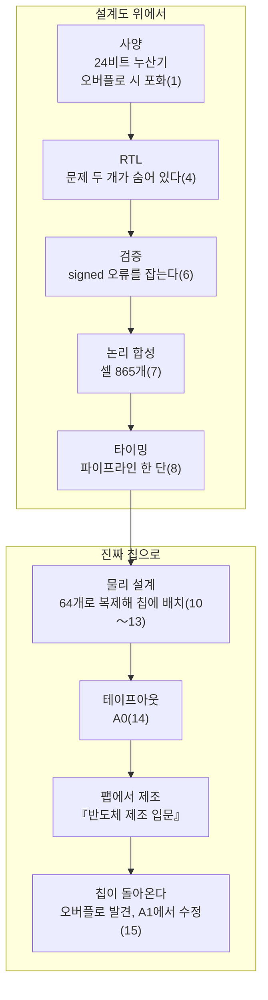

<!-- source: zh-TW/README.md | sha: ec0bdb1f7edf -->

<div align="center">


# IC 설계 입문

**곱셈 누산기 하나를 따라 코드에서 칩까지의 여정을 걸어 봅니다**

🌐 [繁體中文](../zh-TW/README.md) ｜ [English](../en/README.md) ｜ [日本語](../ja/README.md) ｜ **한국어** ｜ [홈](../README.md)

</div>

---

## 이 책은 무엇을 다루나요

팹은 수십 장의 마스크를 사용해 웨이퍼 위에 수십억 개의 트랜지스터를 한 층씩 만들어 냅니다. 그렇다면 그 마스크의 패턴은 누가, 어떻게 그렸을까요?

이 책은 『[반도체 제조 입문](https://github.com/chenwei810/Semiconductor_Manufacturing_Introduction)』의 프리퀄입니다. 두 주인공을 따라갑니다.

- **칩 하나**: `tiny_npu`. 작은 AI 추론 칩으로, 곱셈 누산기 64개, 메모리 2개, 그리고 CPU가 명령을 내리는 인터페이스를 갖추고 있다.
- **단위 하나**: `mac`. 그중 곱셈 누산기 하나다. 사양서의 한 문장에서 출발해, Verilog 십여 줄로 쓰이고, 테스트에서 오류가 발견되고, 천 개 가까운 논리 게이트로 합성되고, 64개로 복제되어 칩에 배치된다. 마지막으로 진짜 칩 위에서 오랫동안 숨어 있던 문제를 드러낸다.

어려운 수식은 다루지 않고, 다음 세 가지에 집중합니다.

- **흐름**: 각 단계가 무엇을 하는지, 왜 그렇게 하는지, 잘못되면 어떻게 되는지.
- **용어**: 영어와 중국어 이름, 그리고 IC 설계 현장에서 실제로 어떻게 쓰이는지.
- **노하우**: 교과서에는 잘 나오지 않지만 프로젝트에서는 반드시 마주치는 것들.

## 이런 분께 추천합니다

| 독자 | 읽을 곳 | 다 읽고 나면 |
|---|---|---|
| 🌱 이공계 배경이지만 IC 설계는 처음 | 본문. '조금 더 깊이'는 건너뛰어도 된다 | 칩이 사양에서 테이프아웃까지 가는 모든 단계와, 현장에서 자주 쓰는 용어를 설명할 수 있다 |
| 🎓 전기전자·컴퓨터공학 전공 학생 | 전부. '조금 더 깊이'와 '따라 해 보기'까지 | 각 단계 뒤의 원리를 이해하고, 오픈 소스 도구로 직접 한 번 돌려 볼 수 있다 |
| 💻 소프트웨어·펌웨어 엔지니어 | 본문. 특히 '소프트웨어와 비교' | 하드웨어가 소프트웨어와 정말로 다른 점을 알고, 하드웨어 팀과 말이 통하게 된다 |

회로 이론이나 반도체 물리의 배경지식은 필요 없습니다. 프로그램을 조금 쓸 줄 알면 도움이 되지만, 몰라도 괜찮습니다.

## 모든 장에 있는 길잡이

| 표시 | 내용 |
|---|---|
| 📍 설계의 현재 위치 | 두 주인공이 여정의 어느 지점에 있는지, 앞뒤 단계는 무엇인지 |
| 🪜 추상화 수준 | 그 장이 '사양 ▸ RTL ▸ 네트리스트 ▸ 레이아웃 ▸ GDS ▸ 칩' 가운데 어느 층에 있는지 |
| 📖 용어 상자 | 정의, 현장에서 쓰는 법, 관련 용어, 흔한 혼동 |
| 🔧 노하우 상자 | 현장의 방법과, 왜 그렇게 하는지, 안 하면 어떻게 되는지 |
| 💻 소프트웨어와 비교 | 소프트웨어 개발과 어디가 닮았는지, 그리고 더 중요한, 어디가 다른지 |
| 🔍 조금 더 깊이 | 전기전자·컴퓨터공학 전공자를 위한 원리 설명. 처음에는 접혀 있고, 건너뛰어도 된다 |
| 🧪 따라 해 보기 | 제4, 6, 7, 8, 15장. 오픈 소스 도구로 직접 한 번 돌려 본다. 책에 실린 출력은 모두 실제로 실행한 결과다 |

예를 들어 제6장 '검증'의 노하우 상자는 이렇습니다.

> [!TIP]
> **🔧 노하우｜검증 계획은 사양에서 한 항목씩 뽑아 쓴다**
>
> - **상황**: 검증을 시작하기 전에 무엇을 테스트할지 정해야 한다.
> - **방법**: 사양서를 한 항목씩 읽고, 각 항목을 검증 계획의 한 항목으로 쓴 뒤, 테스트와 기능 커버리지에 대응시킨다.
> - **이유**: RTL을 보며 테스트를 쓰면 RTL이 '무엇을 하는지'만 확인하고, '무엇을 해야 하는지'는 확인하지 않는다.
> - **안 하면 어떻게 되나**: 사양에는 있지만 아무도 구현하지 않은 기능은 아무도 테스트하지도 않는다. 제15장의 `mac`이 바로 이렇게 사고를 낸다.

## 실습 파일

이 책에는 실습 파일이 딸려 있으며, [`practice/`](../practice/README.md) 폴더에 있습니다. 이야기에 나오는 모든 버전의 `mac`, 테스트벤치, 그리고 Python으로 쓴 참조 모델입니다. Icarus Verilog와 Yosys라는 두 오픈 소스 도구를 설치하면, 책에 실린 모든 출력을 자기 컴퓨터에서 재현할 수 있습니다.

```bash
cd practice
iverilog -o sim rtl/mac_ch04.v tb/tb_mac.v
vvp sim +vec=vectors/directed.txt +verbose
```

---

## 전체 지도

이 그림은 `mac`이 걷는 여정입니다. 괄호 안은 장 번호입니다.



제0장에서 플로 전체를 내려다보고, 제2, 3장에서 디지털 논리의 기초를 채우고, 제5장에서 클록과 리셋을 다루고, 제9장에서 공장이 칩을 테스트할 수 있게 하는 회로를 넣습니다.

---

## 목차

### 제0부 시작하기 전에

| 장 | 읽을 내용 |
|---|---|
| [제0장 IC 설계의 전체 그림](0-before-you-start/00-overview/README.md) | 칩이 아이디어에서 테이프아웃까지 가는 여정, 산업의 분업, 그리고 두 주인공 |
| [제1장 사양과 아키텍처](0-before-you-start/01-spec-and-architecture/README.md) | 사양서, 블록도, PPA 트레이드오프, 그리고 누산기를 몇 비트로 할지 |

### 제1부 디지털 논리 기초

| 장 | 읽을 내용 |
|---|---|
| [제2장 트랜지스터에서 논리 게이트로](1-digital-logic/02-transistors-to-gates/README.md) | CMOS, 논리 게이트, 지연, 전력, 표준 셀 |
| [제3장 조합 논리와 순차 논리](1-digital-logic/03-combinational-and-sequential/README.md) | 2의 보수, 가산기, 곱셈기, 플립플롭, 유한 상태 기계 |

### 제2부 프런트엔드 설계

| 장 | 읽을 내용 |
|---|---|
| [제4장 RTL과 Verilog](2-front-end/04-rtl-and-verilog/README.md) | Verilog로 `mac` 작성하기, 그리고 하드웨어와 프로그램의 차이 |
| [제5장 클록과 리셋](2-front-end/05-clocks-and-resets/README.md) | PLL, 클록 도메인 크로싱, 준안정 상태, 리셋 동기화, 클록 게이팅 |
| [제6장 검증](2-front-end/06-verification/README.md) | 테스트벤치, 참조 모델, 랜덤 테스트, 커버리지, 검증 계획 |
| [제7장 논리 합성](2-front-end/07-logic-synthesis/README.md) | 표준 셀 라이브러리, 타이밍 제약, 네트리스트, 등가성 검사 |
| [제8장 정적 타이밍 분석](2-front-end/08-static-timing-analysis/README.md) | 셋업, 홀드, 슬랙, 공정 코너, 파이프라인 |
| [제9장 테스트 용이성 설계](2-front-end/09-design-for-test/README.md) | 스캔 체인, ATPG, MBIST, JTAG |

### 제3부 물리 설계

| 장 | 읽을 내용 |
|---|---|
| [제10장 플로어플랜과 전원망](3-physical-design/10-floorplan-and-power/README.md) | 칩 크기, 매크로 배치, IR 드롭, 전원 도메인 |
| [제11장 배치와 클록 트리](3-physical-design/11-placement-and-cts/README.md) | 배치, 사용률, 예비 셀, 클록 트리, 클록 스큐 |
| [제12장 배선과 기생 성분](3-physical-design/12-routing-and-parasitics/README.md) | 금속층, 배선, 기생 성분 추출, 크로스토크, 안테나 효과 |
| [제13장 사인오프](3-physical-design/13-signoff/README.md) | 멀티 코너 멀티 모드 분석, DRC, LVS, 전원 사인오프, 웨이버 |

### 제4부 팹에 넘기기

| 장 | 읽을 내용 |
|---|---|
| [제14장 테이프아웃](4-to-the-fab/14-tape-out/README.md) | GDS, 마스크 데이터 준비, OPC, 멀티 프로젝트 웨이퍼 |
| [제15장 칩이 돌아온 뒤](4-to-the-fab/15-after-silicon/README.md) | 브링업, 포스트 실리콘 검증, 에라타, 금속층만 바꾸는 수정 |

### 부록

| 부록 | 읽을 내용 |
|---|---|
| [부록 A 용어집](appendix/glossary.md) | 책에 나오는 용어와 중국어, 약어 대응표. 책 전체 용어의 기준이기도 하다 |
| [부록 B 설계 현장 용어](appendix/jargon.md) | IC 설계 팀에서 자주 듣는 표현과 예문 |
| [부록 C 참고 자료](appendix/further-reading.md) | 교과서, 표준, 오픈 소스 도구 |
| [부록 D Verilog 빠른 참조](appendix/verilog-quick-reference.md) | 책에서 쓰는 Verilog 문법 한눈에 보기 |

---

## 읽는 방법 추천

처음부터 차례대로 읽는 것이 전체를 이해하는 가장 좋은 방법이지만, 목적에 맞게 다음 경로로 시작할 수도 있습니다.

| 경로 | 추천 장 |
|---|---|
| 🚀 전체를 빠르게 훑어보기 | 제0, 1, 7, 10, 14장 |
| 💻 소프트웨어·펌웨어 엔지니어 | 제0, 1, 3, 4, 6, 8, 15장과, 장마다 있는 '소프트웨어와 비교' |
| 🏭 IC 설계 업계 입문 준비 | 전체를 차례로. 특히 제6, 8, 13장과 부록 B |
| 🔬 『반도체 제조 입문』을 읽은 분 | 제0, 2, 10, 12, 13, 14장. 설계가 공정과 어떻게 이어지는지 본다 |
| 🧪 직접 해 보고 싶은 분 | 제4, 6, 7, 8, 15장의 '따라 해 보기' |

---

## 참여하기

이 책은 열린 프로젝트입니다. 언제든 함께해 주세요.

- **잘못된 내용을 발견했다면**: [Issues](../../../issues)에서 'Erratum' 템플릿으로 알려 주세요.
- **내용이나 그림을 추가하고 싶다면**: [기여 가이드](../CONTRIBUTING.md)와 [스타일 가이드](../STYLE_GUIDE.md)를 읽어 주세요.
- **다른 언어로 번역하고 싶다면**: [번역 가이드](../TRANSLATIONS.md)를 읽어 주세요.

이 책이 도움이 되었다면 ⭐ Star를 눌러 주세요. 더 많은 사람에게 전해집니다.

---

## 면책 조항

- 이 책은 공개된 자료와 업계의 일반적인 지식을 바탕으로 합니다. 특정 기업의 기밀 정보, 내부 절차, 설계 데이터는 포함하지 않으며, 어느 파운드리 PDK의 실제 값도 포함하지 않습니다.
- 특정 반도체 기업이나 EDA 도구 공급사와는 관계가 없습니다. 이름을 밝힌 것은 '따라 해 보기'에서 쓰는 오픈 소스 도구뿐이며, 상용 도구의 이름은 쓰지 않습니다.
- `tiny_npu`는 교육용으로 지어낸 칩이며, 사양과 이야기는 설명을 위한 것입니다. 수치는 대부분 규모나 대략적인 값입니다. 실제 값은 공정, 제품, 기업에 따라 다릅니다.
- 잘못되었거나 오래된 내용을 발견하면 Issue로 알려 주세요.

## 라이선스

이 책의 글, 그림, 실습 파일은 [크리에이티브 커먼즈 저작자표시-비영리-동일조건변경허락 4.0 국제 라이선스](../LICENSE)(CC BY-NC-SA 4.0)로 제공됩니다. 출처를 밝히고, 비영리 목적으로, 같은 라이선스로 공유한다면 자유롭게 전재, 변형, 번역할 수 있습니다.

원문은 번체 중국어로 쓰였으며, 한국어판은 그 번역입니다. 내용에 차이가 있으면 중국어판을 기준으로 합니다.
