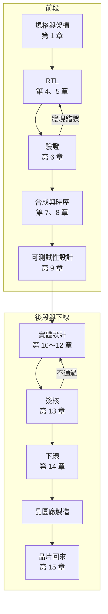

# 第 0 章　IC 設計全景：一顆晶片的設計之旅

> 📍 **設計位置**
>
> - 前一站：還沒出發
> - **本章：鳥瞰一顆晶片從想法到下線的旅程，認識這本書的兩個主角**
> - 下一站：規格與架構，決定要做一顆什麼樣的晶片

🪜 抽象層級：**規格 ▸ RTL ▸ 網表 ▸ 佈局 ▸ GDS ▸ 晶片**

---

## 晶片是先設計出來的

晶圓廠用數十片光罩，在晶圓上一層一層做出電晶體和導線。可是光罩上的圖形是從哪裡來的？答案是 IC 設計。**積體電路**（Integrated Circuit，IC）設計，就是把一個想法，例如「讓相機即時認出照片裡的貓」，一步一步變成晶圓廠做得出來的幾何圖形。這很像蓋房子：先講清楚需求，再畫設計圖、施工圖，最後把施工圖交給營造廠。

《半導體製造概論》跟著一片晶圓走過工廠。這本書是它的前傳：跟著一段程式碼，走到光罩交給工廠的那一刻。

---

## 這本書的兩個主角

- **一顆晶片**：`tiny_npu`，一顆小型的 AI 推論晶片。它有 64 個乘加單元、兩塊 64 KB 的記憶體，以及讓 CPU 下指令的介面，目標是每秒做 320 億次乘加。這是為了教學虛構的規格，但每個決定都是真實晶片會遇到的。
- **一個單元**：`mac`，其中一個乘加單元。它只做一件事：把兩個 8 位元的數相乘，加進累加器。

神經網路的計算，絕大部分是「一串數字乘上一串權重，再全部加起來」。所以 AI 晶片的核心，就是一大片乘加單元。`mac` 很小，十幾行 Verilog 就寫得完。但它會走過書裡的每一站：被寫成程式碼、被測出錯誤、變成近千個邏輯閘、被複製 64 份排進晶片，最後在真正的晶片上露出一個藏了很久的問題。

> [!NOTE]
> **📖 名詞｜乘加單元（Multiply-Accumulate Unit，MAC）**
>
> - **定義**：把兩個數相乘，再把乘積加進累加器的電路。
> - **現場用法**：AI 晶片常用 MAC 的數量和每秒能做幾次乘加來比較算力，例如「這一代的 MAC 數加倍了」。
> - **相關名詞**：累加器、點積、神經網路處理器（NPU）
> - **常見混淆**：網路設備的 MAC 位址（Media Access Control）是另一個東西，只是縮寫剛好一樣。

---

## 旅程地圖

**規格 → RTL → 驗證 → 合成 → 時序分析 → 可測試性設計 → 實體設計 → 簽核 → 下線**

| 階段 | 發生什麼事 | 本書章節 |
|---|---|---|
| 規格與架構 | 決定晶片要做什麼、做多快、花多少面積和功耗 | 第 1 章 |
| 暫存器傳輸層級（Register Transfer Level，RTL） | 用硬體描述語言寫下電路的行為 | 第 4、5 章 |
| 驗證 | 證明 RTL 照規格工作 | 第 6 章 |
| 合成與時序分析 | 把 RTL 變成邏輯閘，確認每條路徑都趕得上時脈 | 第 7、8 章 |
| 可測試性設計 | 加入讓工廠能測出壞晶片的電路 | 第 9 章 |
| 實體設計 | 把邏輯閘擺進晶片、接上導線 | 第 10～12 章 |
| 簽核與下線 | 做完所有檢查，把佈局交給晶圓廠 | 第 13、14 章 |
| 晶片回來之後 | 點亮、除錯，必要時改版 | 第 15 章 |

第 2、3 章不在地圖上，它們補上走這趟旅程需要的數位邏輯基礎。

---

## 前段與後段

IC 設計最常見的分法是**前段**和**後段**：

- **前段**：從規格到網表，處理「電路的邏輯對不對」。包括 RTL、驗證與合成。
- **後段**：從網表到佈局，處理「電路放不放得下、接不接得起來、跑不跑得快」。也叫實體設計。

> [!NOTE]
> **📖 名詞｜前段與後段（Front End／Back End）**
>
> - **定義**：IC 設計裡，前段指邏輯設計與驗證，後段指實體設計。
> - **現場用法**：「他是做前段的」「網表交給後段了」。
> - **相關名詞**：RTL、網表、實體設計、簽核
> - **常見混淆**：《半導體製造概論》也有前段與後段，指的是晶圓製造與封裝測試；晶圓廠內部還有 FEOL 與 BEOL。聽到這兩個詞，要看說話的人在設計公司還是工廠。

---

## 誰負責什麼

一顆晶片通常由好幾種公司分工完成：

| 角色 | 做什麼 |
|---|---|
| IC 設計公司（Fabless） | 定義產品、設計晶片、負責銷售，但沒有自己的工廠 |
| 矽智財供應商 | 提供設計好的電路區塊，例如 CPU 核心、記憶體、介面電路 |
| 電子設計自動化（Electronic Design Automation，EDA）工具供應商 | 提供合成、模擬、實體設計等每一步用的軟體 |
| 設計服務公司 | 代為完成後段設計或下線流程 |
| 晶圓代工廠（Foundry） | 製造晶片，並提供設計規則與元件庫 |
| 封裝測試廠（OSAT） | 封裝晶片，並做出貨前的測試 |

設計團隊裡也有分工：架構師定規格；前段設計工程師寫 RTL；驗證工程師證明 RTL 是對的，人數常常比寫 RTL 的還多；可測試性設計（Design for Test，DFT）工程師負責讓工廠測得出壞晶片；實體設計工程師把電路變成佈局；CAD 工程師維護工具與流程。晶片回來之後，還有測試、產品與韌體工程師接手。

> [!NOTE]
> **📖 名詞｜矽智財（Silicon Intellectual Property，IP）**
>
> - **定義**：已經設計好、可以授權放進自己晶片裡的電路區塊。
> - **現場用法**：「PLL 用買的 IP」「這顆 IP 有沒有在這個製程驗證過？」
> - **相關名詞**：記憶體編譯器、標準元件庫、PDK
> - **常見混淆**：和網路的 IP 位址無關。在 IC 設計現場講 IP，通常就是指一個電路區塊，不是在講法律上的智慧財產權。

---

## 數位、類比與這本書的範圍

晶片裡的電路分成兩大類。**數位電路**只處理 0 和 1，可以用 RTL 描述、用工具自動合成；**類比電路**處理連續變化的電壓，例如產生時脈的鎖相迴路（Phase-Locked Loop，PLL）、類比數位轉換器和電源電路，大多要靠工程師手工設計。這本書只走數位電路的流程。`tiny_npu` 裡的 PLL 是類比電路，直接用買來的 IP。

數位電路也不一定要做成專屬的晶片。**現場可程式化邏輯閘陣列**（Field-Programmable Gate Array，FPGA）是一種內部邏輯可以重新設定的晶片，改設計只要重新下載，不用重做光罩。它常被用來在下線前試跑設計（第 6 章），或用在量不大的產品。為特定用途專門做的晶片叫**特定應用積體電路**（Application-Specific Integrated Circuit，ASIC），前期成本高，但量大時每顆更便宜、更快也更省電。

> [!IMPORTANT]
> **💻 軟體對照｜下線，像是發布一個永遠不能更新的版本**
>
> - **像什麼**：軟體的正式發布，程式碼凍結、打上版本號、交出去。
> - **不一樣的地方**：晶片下線後，要等好幾個月才拿到實物。截至 2020 年代中期，28 nm 這類成熟製程的一套光罩大約在百萬美元的量級，更舊的製程便宜得多，最先進的製程則要再貴上許多倍。發現錯誤時不能推送更新，只能改版重做，或請韌體想辦法繞過。
> - **所以要注意**：軟體「先上線再修」的習慣，在晶片上代價非常高。所以硬體團隊花在驗證的力氣，常常比寫 RTL 還多。

> [!TIP]
> **🔧 Know-how｜問題越早發現，修起來越便宜**
>
> - **情境**：同一個錯誤，可能在寫 RTL 時、驗證時、下線前，或晶片回來之後才被發現。
> - **做法**：把檢查盡量往前移：寫完 RTL 先跑靜態檢查，驗證和 RTL 同時進行，合成後馬上看時序。
> - **為什麼**：在 RTL 階段改一行只要幾分鐘；晶片回來才發現，就要重做光罩，花上幾個月和大筆費用。
> - **沒做會怎樣**：錯誤一路漏到晶片上，整個產品的上市時間跟著延後。第 15 章的 `mac` 就會遇到這種事。
> - **相關章節**：[第 6 章 驗證](../../2-front-end/06-verification/README.md)、[第 15 章 晶片回來之後](../../4-to-the-fab/15-after-silicon/README.md)

> [!TIP]
> **🔧 Know-how｜時程是從下線日往回排的**
>
> - **情境**：第一版晶片要搭晶圓廠的共乘班次下線，班次的日期是固定的。
> - **做法**：從下線日往回推，排出每一關的完成日期，並且留下緩衝時間。
> - **為什麼**：錯過一個班次，可能要再等一兩個月，產品上市也跟著延後。
> - **沒做會怎樣**：前面每一關都晚一點，最後擠壓到簽核，大家只好跳過檢查趕著下線，錯誤就是這樣漏出去的。
> - **相關章節**：[第 14 章 下線](../../4-to-the-fab/14-tape-out/README.md)

---

## 本章重點

1. IC 設計把一個想法變成晶圓廠做得出來的幾何圖形，這本書是《半導體製造概論》的前傳。
2. 兩個主角：AI 推論晶片 `tiny_npu`，以及其中的乘加單元 `mac`。
3. 流程大致是規格、RTL、驗證、合成、時序、可測試性、實體設計、簽核、下線；前段管邏輯，後段管實體。
4. 晶片由設計公司、IP 與 EDA 供應商、晶圓代工廠和封測廠分工完成。
5. 下線之後很難修改，所以問題越早發現越便宜。

---

## 延伸閱讀

- Neil H. E. Weste、David Money Harris，《CMOS VLSI Design: A Circuits and Systems Perspective》第四版，第 1 章
- 《半導體製造概論》[第 0 章 半導體製造全景](https://github.com/chenwei810/Semiconductor_Manufacturing_Introduction/blob/main/zh-TW/0-before-you-start/00-overview/README.md)

---

[目錄](../../README.md) ｜ [下一章：第 1 章 規格與架構 →](../01-spec-and-architecture/README.md)
