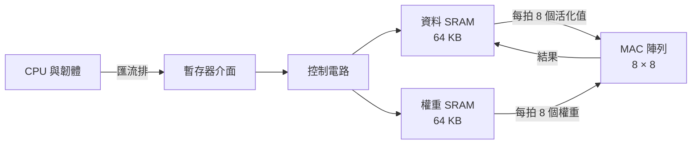

# 第 1 章　規格與架構：決定要做一顆什麼樣的晶片

> 📍 **設計位置**
>
> - 前一站：全景，認識了設計流程與兩個主角
> - **本章：寫下 `tiny_npu` 的規格與架構，決定 `mac` 要用幾個位元**
> - 下一站：從電晶體到邏輯閘，看看規格裡的運算要用什麼電路做出來

🪜 抽象層級：**規格** ▸ RTL ▸ 網表 ▸ 佈局 ▸ GDS ▸ 晶片

---

## 規格書：所有人的共同依據

蓋房子之前，要先說清楚幾房幾廳、預算多少、哪天要住進去。晶片也一樣。動手寫 RTL 之前，要先有一份**規格書**，寫下晶片要做什麼、做多快、可以用多少面積和功耗、介面長什麼樣子、什麼時候要下線。

之後的每一關都以規格書為準：寫 RTL 的人照它設計，驗證的人照它檢查，韌體工程師照它寫驅動程式。規格書寫得模糊的地方，每個人就會各自用自己的假設補上。

> [!NOTE]
> **📖 名詞｜規格書（Specification）**
>
> - **定義**：描述晶片的功能、效能、介面與限制的文件，是設計與驗證的共同依據。
> - **現場用法**：通常直接叫 spec，例如「這個情況 spec 沒寫，要去問架構師」。
> - **相關名詞**：架構文件、暫存器對照表、驗證計畫
> - **常見混淆**：規格書不是資料表（Datasheet）。資料表是給客戶看的產品說明；規格書是給團隊用的設計依據，包含大量內部細節。

---

## tiny_npu 要算什麼

一個辨識影像的神經網路，有好幾十層。每一層做的事情大同小異：拿一小塊輸入資料，和一組權重逐項相乘，再全部加起來。這個運算叫**點積**（Dot Product）。

例如一個常見的卷積層：每個輸出點，要看輸入影像上 3 × 3 的範圍，而且輸入有 128 個通道。所以一個輸出點就是 3 × 3 × 128 ＝ 1,152 個乘積的總和。一張影像有成千上萬個輸出點，每個都要做一次這樣的點積。

所以 `tiny_npu` 需要三樣東西：一大片乘加單元、餵資料給它們的**靜態隨機存取記憶體**（Static Random-Access Memory，SRAM），以及讓 CPU 下指令的方法。

為了省面積和功耗，`tiny_npu` 不用浮點數，而是把資料和權重都換成 8 位元的整數，叫做 **INT8**。8 位元有號整數能表示 -128 到 127。

> [!NOTE]
> **📖 名詞｜量化（Quantization）**
>
> - **定義**：把神經網路的權重和資料，從浮點數換成位元數較少的整數來計算。
> - **現場用法**：「模型量化成 INT8 之後，準確率只掉了一點點。」
> - **相關名詞**：INT8、浮點數、累加器、飽和
> - **常見混淆**：輸入是 8 位元，不代表結果也只要 8 位元。兩個 8 位元相乘是 16 位元，再加總上千項，數字還會更大。

---

## 架構：把方塊圖畫出來

規格說「要做什麼」，**架構**說「用哪些方塊、怎麼接起來」。`tiny_npu` 的架構是這樣：

每個時脈，資料 SRAM 送出 8 個活化值，權重 SRAM 送出 8 個權重。第 `r` 列、第 `c` 行的 MAC，把第 `r` 個活化值乘上第 `c` 個權重，加進自己的累加器。64 個 MAC 同時做，連做 1,152 拍，就得到 64 個輸出點。

| 項目 | 規格 |
|---|---|
| 乘加單元 | 8 × 8 ＝ 64 個，輸入 INT8，累加器 24 位元，溢位時飽和 |
| 記憶體 | 資料 SRAM、權重 SRAM 各 64 KB |
| 時脈 | 運算側 500 MHz，匯流排側 100 MHz |
| 峰值運算量 | 64 × 500 MHz ＝ 每秒 320 億次乘加 |
| 製程 | 28 nm 等級的成熟製程，晶粒邊長約 2 mm |

韌體透過幾個暫存器指揮 `tiny_npu`。這張**暫存器對照表**也是規格的一部分，韌體工程師要靠它寫驅動程式：

| 位址 | 名稱 | 用途 |
|---|---|---|
| `0x00` | `CTRL` | 寫 1 到 `START` 位元，開始一次運算 |
| `0x04` | `STATUS` | `BUSY` 與 `DONE` 兩個狀態位元 |
| `0x08` | `LEN` | 每個點積要累加幾項 |
| `0x0C` | `ADDR` | 資料與權重在 SRAM 裡的起始位址 |

> [!TIP]
> **🔧 Know-how｜架構先用軟體模型跑過，再寫 RTL**
>
> - **情境**：要決定放幾個 MAC、SRAM 要多大、每拍要送幾筆資料。
> - **做法**：用 Python 或 C++ 寫一個**架構模型**，拿真正的神經網路跑一遍，算出 MAC 有多少時間在空等資料、INT8 和 24 位元累加器會不會影響準確率。
> - **為什麼**：在軟體裡改架構只要幾天；RTL 寫好之後再改，要好幾個月。這個模型之後還會變成驗證用的參考模型。
> - **沒做會怎樣**：晶片的峰值算力很漂亮，但記憶體餵不飽 MAC，實際只發揮出一小部分。
> - **相關章節**：[第 6 章 驗證](../../2-front-end/06-verification/README.md)

---

## PPA：三個指標不能兼得

評估一個設計，最基本的三個指標是**效能、功耗、面積**（Performance, Power, Area，PPA）。三者常常互相拉扯：MAC 放越多，算得越快，但面積和功耗也越大；時脈拉越高，電路要切得更細，功耗跟著上升。

`mac` 的累加器要用幾個位元，就是一個 PPA 的取捨。32 位元幾乎不可能溢位；24 位元每個 MAC 少 8 個正反器和一段加法器，64 個 MAC 加起來省下可觀的面積和功耗。

架構師選了 24 位元，並在規格裡寫下一句：**累加結果超出範圍時，要停在最大值或最小值**，叫做**飽和**（Saturation）。不能像汽車里程表一樣，超過最大值就從頭開始，那叫做**繞回**（Wrap-around）。

> [!IMPORTANT]
> **💻 軟體對照｜在硬體裡，每一個位元都要付錢**
>
> - **像什麼**：寫程式時選資料型別，用 `int32_t` 還是 `int64_t`。
> - **不一樣的地方**：在軟體裡多用幾個位元幾乎不花錢；在硬體裡，每多一個位元，64 個 MAC 都要多一份正反器和加法器。量產時，每一顆晶片都要付這個面積和功耗。
> - **所以要注意**：位元寬度要從最壞的情況算起，而且規格裡要寫清楚「超出範圍時怎麼辦」，不能留給寫 RTL 的人自己猜。

🔍 深入一點：24 位元的累加器夠不夠用？

兩個 INT8 相乘，絕對值最大的乘積是 (-128) × (-128) ＝ 16,384。24 位元有號數最大能表示 8,388,607。

- 每一項都是最大乘積時，加到第 512 項會剛好超過上限：512 × 16,384 ＝ 8,388,608。
- 所以不管資料是什麼，**511 項以內的點積保證不會溢位**。
- 一個 1,152 項的卷積，只有在很多乘積同號而且都很大時，才會超出範圍。實際的資料大多正負交錯，所以架構模型裡很少看到溢位。

「很少」不是「不會」。這就是規格要求飽和的原因，也是第 15 章故事的伏筆。

---

## 買現成的，還是自己做

不是每個方塊都要自己設計。`tiny_npu` 的分工是：

- **自己設計**：MAC 陣列、控制電路、暫存器介面。這是產品的差異所在。
- **使用現成的 IP**：SRAM 用記憶體編譯器產生，PLL 和 I/O 電路向晶圓廠或 IP 供應商取得。
- **選擇製程**：28 nm 等級的成熟製程。光罩比先進製程便宜得多，技術也經過長期驗證，跑 500 MHz 已經足夠。

> [!TIP]
> **🔧 Know-how｜規格凍結之後，修改要走變更流程**
>
> - **情境**：RTL 寫到一半，有人希望再加一個新功能。
> - **做法**：規格在某個時間點「凍結」。之後的修改要提出變更申請，評估對 RTL、驗證、時序和時程的影響，大家同意後才改。
> - **為什麼**：一條規格的修改，會一路影響到每一關的工作。
> - **沒做會怎樣**：最後一刻加進來的功能，測試時間最少，最容易帶著錯誤下線。
> - **相關章節**：[第 14 章 下線](../../4-to-the-fab/14-tape-out/README.md)

---

## 本章重點

1. 規格書寫下晶片要做什麼、做多快、花多少成本，是之後每一關的共同依據。
2. 神經網路的核心運算是點積，所以 AI 晶片是一大片 MAC，加上餵資料的記憶體。
3. 架構先用軟體模型驗證，這個模型之後會變成驗證的參考模型。
4. PPA 是效能、功耗與面積的取捨；`mac` 選了 24 位元累加器，並規定溢位時要飽和。
5. 不是每個方塊都要自己做，SRAM、PLL 和 I/O 通常使用現成的 IP。

---

## 延伸閱讀

- John L. Hennessy、David A. Patterson，《Computer Architecture: A Quantitative Approach》第六版，第 7 章（領域專用架構）
- Vivienne Sze、Yu-Hsin Chen、Tien-Ju Yang、Joel S. Emer，《Efficient Processing of Deep Neural Networks》
- 《半導體製造概論》[第 14 章「幾奈米」是什麼意思](https://github.com/chenwei810/Semiconductor_Manufacturing_Introduction/blob/main/zh-TW/3-integration/14-process-nodes/README.md)

---

[← 上一章：第 0 章 IC 設計全景](../00-overview/README.md) ｜ [目錄](../../README.md) ｜ [下一章：第 2 章 從電晶體到邏輯閘 →](../../1-digital-logic/02-transistors-to-gates/README.md)
