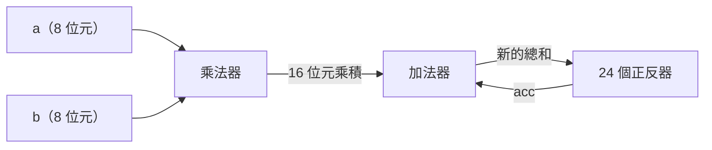
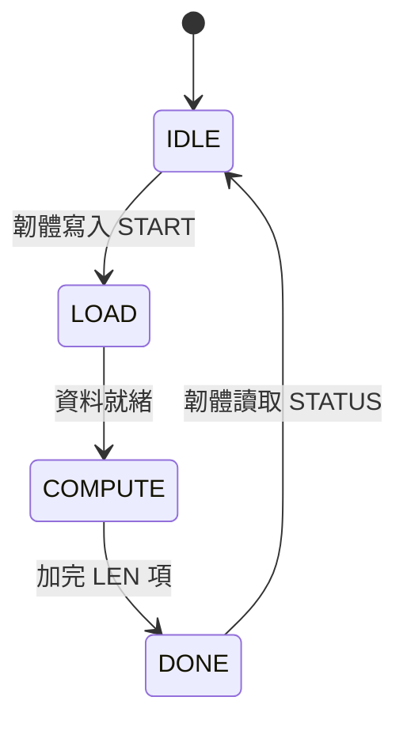

# 第 3 章　組合邏輯與循序邏輯：會算數，也會記憶

> 📍 **設計位置**
>
> - 前一站：從電晶體到邏輯閘，認識了開關、邏輯閘與標準元件
> - **本章：用邏輯閘拼出 `mac` 需要的加法器、乘法器與累加器**
> - 下一站：RTL 與 Verilog，用程式碼描述這些電路

🪜 抽象層級：規格 ▸ **RTL ▸ 網表** ▸ 佈局 ▸ GDS ▸ 晶片

---

## 兩種電路

數位電路分成兩種：

- **組合邏輯**：輸出只看現在的輸入。像計算機上的加法，按下 3 和 4，答案就是 7，和剛才算過什麼無關。
- **循序邏輯**：輸出還和過去有關，因為它有記憶。像計數器，按一下加一，現在的數字取決於之前按了幾次。

`mac` 兩種都有：乘法器和加法器是**組合邏輯**（Combinational Logic），記住累加結果的暫存器是**循序邏輯**（Sequential Logic）。組合邏輯雖然沒有時脈，卻不是不用管時間：它的延遲，正是決定時脈能跑多快的關鍵。

---

## 二進位與負數

8 個位元能表示 256 種組合。當成**無號數**（Unsigned）時，代表 0 到 255。那負數怎麼表示？數位電路最常用**二補數**（Two's Complement）：把最高位元的權重當成負的。8 位元的最高位元代表 -128，其餘七個位元照常是 64、32 一路到 1。所以 8 位元的**有號數**（Signed）能表示 -128 到 127。

| 位元 | 當成無號數 | 當成有號數 |
|---|---|---|
| `0000_0011` | 3 | 3 |
| `1111_1101` | 253 | -3 |
| `1000_0001` | 129 | -127 |

同一串位元，可以是 129，也可以是 -127。電路本身不知道答案，要由設計者決定怎麼解讀。

有號數要加寬時，要把最高位元複製到新的位元，叫做**符號延伸**（Sign Extension）。例如 -3 加寬成 16 位元是 `1111_1111_1111_1101`；如果在前面補 0，就變成了 253。

> [!NOTE]
> **📖 名詞｜二補數（Two's Complement）**
>
> - **定義**：數位電路最常用的負數表示法，最高位元的權重是負的。
> - **現場用法**：「這個訊號是二補數，記得宣告 signed。」
> - **相關名詞**：有號數、無號數、符號延伸、溢位
> - **常見混淆**：位元本身沒有正負。同一串 `1000_0001`，當無號數是 129，當有號數是 -127，怎麼解讀要寫在設計裡。

> [!IMPORTANT]
> **💻 軟體對照｜像 C 語言的 int8_t 和 uint8_t**
>
> - **像什麼**：C 語言的 `int8_t` 和 `uint8_t`：一樣是 8 個位元，讀法不同。
> - **不一樣的地方**：C 的編譯器知道每個變數的型別。電路裡的導線只是一束 0 和 1，型別只存在於 RTL 的宣告裡；宣告錯了，硬體也不會報錯，只會默默算出錯的答案。
> - **所以要注意**：C 語言裡，`int` 和 `unsigned int` 混在一起運算，會偷偷變成無號運算。Verilog 也有類似的陷阱，而且更容易踩到，第 6 章的 `mac` 就會掉進去。

---

## 加法器

二進位加法和十進位一樣，從最低位開始加，滿 2 就進位。

- **半加器**：把兩個位元相加，輸出「和」與「進位」。和是 XOR，進位是 AND。
- **全加器**：再多收一個從低位傳來的進位，所以能一位接一位串起來。
- **漣波進位加法器**（Ripple Carry Adder）：把 24 個全加器串成一排，就能加 24 位元的數。

漣波進位加法器很省面積，但進位要一位一位傳上去，位數越多越慢。更快的加法器會提前算出進位，代價是更多邏輯閘。這又是一個 PPA 的取捨。

---

## 乘法器

二進位的乘法就是直式乘法。乘數的每一個位元只有 0 或 1，所以每一行只有兩種結果：0，或把被乘數往左移幾位。這一行叫做**部分積**（Partial Product），用一排 AND 閘就能做出來。8 位元乘 8 位元，會有 8 行部分積，再用一大片加法器把它們加起來，得到 16 位元的乘積。所以乘法器比加法器大得多，也慢得多，是 `mac` 裡最占面積的部分。

🔍 深入一點：有號數的乘法

二補數的最高位元權重是負的，所以有號數乘法不能直接照搬無號數的做法。常見的處理方式有兩種：

- 把兩個運算元先做符號延伸，再當成較寬的無號數相乘，只取需要的低位元。做法簡單，但浪費邏輯閘。
- 調整部分積的符號位元，讓加總的結果自動正確。業界常用的 Baugh-Wooley 方法就是這類做法；Booth 編碼則能把部分積的行數減少將近一半。

不論哪一種，設計者都要告訴工具「這是有號數」。合成工具看到有號數的乘法，就會自動選擇正確的結構。

---

## 正反器與時脈

**正反器**（Flip-Flop）是一個 1 位元的記憶元件。它只在**時脈**從 0 變成 1 的瞬間（上升緣）讀進輸入，然後一直保持這個值，直到下一個上升緣。這很像拍照：快門按下的那一刻拍進畫面，之後外面怎麼變，照片都不會變。好幾個正反器並排，就是一個**暫存器**（Register）。

時脈像樂團的指揮，所有正反器跟著同一個節拍前進。資料必須在快門按下前後一小段時間保持穩定，正反器才能拍得清楚，第 8 章會詳細說明這段時間。

> [!NOTE]
> **📖 名詞｜正反器（Flip-Flop）**
>
> - **定義**：在時脈邊緣讀進輸入並保持住的 1 位元記憶元件。
> - **現場用法**：常叫 flop 或 DFF，例如「這個區塊有兩千多個 flop」。
> - **相關名詞**：暫存器、時脈、閂鎖器、setup、hold
> - **常見混淆**：**閂鎖器**（Latch）在時脈是高電位的整段期間都讓資料通過，不是只在邊緣讀一次。兩者行為不同，時序分析也不同。

---

## 累加器：組合與循序的合體

把乘法器、加法器和 24 個正反器接成一圈，就是 `mac` 的累加器：

每個時脈，正反器輸出目前的總和，加上新的乘積，再在下一個上升緣存回正反器。所以一個時脈週期，必須比「乘法器加上加法器」的延遲還長。用最簡單的式子寫：**時脈週期 ≥ 路徑上的延遲總和**。第 8 章會發現，在 500 MHz 下，這條路徑太長了。

> [!TIP]
> **🔧 Know-how｜先算好結果需要幾個位元**
>
> - **情境**：設計加法器、乘法器或累加器時，要決定結果的位元寬度。
> - **做法**：兩個 N 位元相加，結果要 N＋1 位元；N 位元乘 M 位元，結果要 N＋M 位元；累加 K 項，還要再多出足夠容納 K 倍的位元。
> - **為什麼**：位元寬度不夠時，最高位元會被直接截掉，電路不會報錯。
> - **沒做會怎樣**：數值超出範圍後，會從最大值突然跳到最小值。這種錯誤平常很少出現，一出現就很難查。
> - **相關章節**：[第 1 章 規格與架構](../../0-before-you-start/01-spec-and-architecture/README.md)

---

## 有限狀態機

`tiny_npu` 的控制電路要記得自己現在在做什麼：閒著、在搬資料、在計算，還是算完了。這種電路叫**有限狀態機**（Finite State Machine，FSM）：用幾個正反器記住目前的狀態，再用組合邏輯，依照目前的狀態和輸入，決定下一拍要進入哪個狀態。在 `COMPUTE` 狀態裡，MAC 陣列每一拍做一次乘加，直到加完 `LEN` 項為止。

> [!TIP]
> **🔧 Know-how｜所有正反器都用同一個時脈，不要自己用邏輯閘做時脈**
>
> - **情境**：想讓某一塊電路跑慢一點，於是用一個邏輯閘把時脈「擋掉一些拍」。
> - **做法**：時脈只從 PLL 和專用的時脈電路產生；要讓電路暫停，改用致能訊號，或用元件庫裡專門的時脈閘控元件（第 5 章）。
> - **為什麼**：用一般邏輯閘做出來的時脈，可能產生極短的雜訊脈衝，抵達每個正反器的時間也難以控制。
> - **沒做會怎樣**：正反器偶爾讀到錯的值，而且只在某些晶片、某些溫度下發生，時序分析工具也無法正確檢查。
> - **相關章節**：[第 5 章 時脈與重置](../../2-front-end/05-clocks-and-resets/README.md)

---

## 本章重點

1. 組合邏輯的輸出只看現在的輸入；循序邏輯有記憶，輸出也和過去有關。
2. 二補數用最高位元表示負號；同一串位元當有號數或無號數，意思完全不同。
3. 加法器由全加器串成，乘法器是一排排部分積加起來，比加法器大得多也慢得多。
4. 正反器在時脈邊緣讀進資料；累加器是乘法器、加法器和正反器接成的一個圈。
5. 時脈週期必須比路徑上的延遲總和還長。

---

## 延伸閱讀

- David Money Harris、Sarah L. Harris，《Digital Design and Computer Architecture》第二版，第 1～5 章
- M. Morris Mano、Michael D. Ciletti，《Digital Design》第六版

---

[← 上一章：第 2 章 從電晶體到邏輯閘](../02-transistors-to-gates/README.md) ｜ [目錄](../../README.md) ｜ [下一章：第 4 章 RTL 與 Verilog →](../../2-front-end/04-rtl-and-verilog/README.md)
