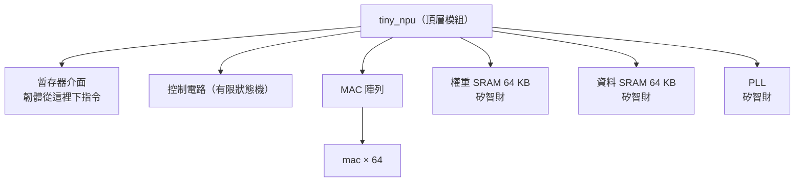

# 第 4 章　RTL 與 Verilog：用程式碼描述硬體

> 📍 **設計位置**
>
> - 前一站：數位邏輯基礎，認識了加法器、乘法器與正反器
> - **本章：把 `mac` 寫成 RTL，第一次讓它在模擬器裡跑起來**
> - 下一站：時脈與重置，讓整顆 `tiny_npu` 的正反器一起前進

🪜 抽象層級：規格 ▸ **RTL** ▸ 網表 ▸ 佈局 ▸ GDS ▸ 晶片

---

## 為什麼要用程式碼畫電路

早期的晶片只有幾千個電晶體，工程師可以一個邏輯閘、一個邏輯閘地畫電路圖。現在一顆晶片有數十億個電晶體，用手畫已經不可能。所以工程師改用**硬體描述語言**（Hardware Description Language，HDL）寫下電路「要做什麼」，再交給工具轉成邏輯閘，這一步叫合成（第 7 章）。最常用的硬體描述語言是 Verilog，以及它的延伸 SystemVerilog。

這很像蓋房子：建築師畫的是設計圖，不會去規定每一塊磚放在哪裡。RTL 就是晶片的設計圖。它描述每個時脈要把哪些資料搬進哪個暫存器、途中做什麼運算，但不管這些運算最後用了哪些邏輯閘。

> [!NOTE]
> **📖 名詞｜暫存器傳輸層級（Register Transfer Level，RTL）**
>
> - **定義**：用「資料在暫存器之間怎麼搬、途中做什麼運算」來描述電路的抽象層級。
> - **現場用法**：寫好的 Verilog 程式碼也直接叫 RTL，例如「RTL freeze 了，之後只能改 ECO」。
> - **相關名詞**：硬體描述語言、Verilog、網表、合成
> - **常見混淆**：RTL 是一個抽象層級，不是一種語言。Verilog 和 VHDL 是語言，用它們寫出來的程式碼才叫 RTL。

---

## 一個 MAC 的 Verilog

Verilog 描述電路的基本單位是**模組**（Module）。模組像一個盒子，盒子外面有接腳，叫做**埠**（Port）。第 1 章定好的規格，先變成 `mac` 的埠：

```verilog
module mac (
    input  wire        clk,
    input  wire        rst_n,   // active-low reset
    input  wire        clr,     // start a new dot product
    input  wire        en,      // accumulate a * b this cycle
    input  wire [7:0]  a,       // activation, INT8
    input  wire [7:0]  b,       // weight, INT8
    output reg  [23:0] acc      // 24-bit accumulator
);
```

- `clk` 是時脈，`rst_n` 是重置。名字後面的 `_n` 代表「低電位有效」，也就是 0 的時候才重置。
- `clr` 告訴 MAC「要開始一組新的點積了，把累加器清成 0」。
- `en` 為 1 的那一拍，才把 `a × b` 加進累加器。`[7:0]` 代表 8 個位元，`[23:0]` 代表 24 個位元。

盒子裡面的電路是這樣：

```verilog
    always @(posedge clk or negedge rst_n) begin
        if (!rst_n)
            acc <= 24'd0;          // reset: clear the accumulator
        else if (clr)
            acc <= 24'd0;          // a new dot product starts
        else if (en)
            acc <= acc + a * b;    // multiply, then add
    end
endmodule
```

`always @(posedge clk ...)` 的意思是：每當時脈從 0 變成 1（上升緣），就做一次裡面的事。所以這段程式碼描述的，正是第 3 章那個「乘法器加上加法器，再接回 24 個正反器」的累加器。

這段程式碼裡藏著兩個問題。它們不會讓模擬當掉，也不會讓工具報錯，第 6 章和第 15 章會分別把它們找出來。

> [!NOTE]
> **📖 名詞｜模組與實例（Module／Instance）**
>
> - **定義**：模組是一種電路的設計圖；實例是照著設計圖放進晶片裡的一份實體。
> - **現場用法**：放一個實例叫 instantiate，實例本身直接叫 instance，例如「`tiny_npu` 裡 instantiate 了 64 個 `mac`」「這個 instance 叫 `u_mac`」。
> - **相關名詞**：埠、階層、頂層模組
> - **常見混淆**：同一個模組放 64 個實例，晶片上就真的有 64 份電路，每份都佔面積、都耗電。這和軟體呼叫 64 次同一個函式完全不同。

---

## 硬體是同時發生的

程式是一行一行依序執行的。電路不是：晶片上所有的邏輯閘，每一刻都同時在工作。64 個 MAC 也不是輪流計算，而是在同一個時脈裡一起算。

所以 Verilog 裡的 `<=` 有特別的意思。它叫做**非阻隔式指定**（Non-blocking Assignment）：同一個時脈邊緣上，所有用 `<=` 的暫存器會「同時」更新。就像大家約好在同一聲哨音一起換位置，沒有人會先看到別人的新位置。

> [!IMPORTANT]
> **💻 軟體對照｜Verilog 長得像 C，但它描述的是電路**
>
> - **像什麼**：語法很像 C，有 `if`、`else`、`+`、`*`，模組也像可以重複使用的函式。
> - **不一樣的地方**：`acc <= acc + a * b` 不是「先算再存」的一道指令，而是一個乘法器、一個加法器和 24 個正反器，每個時脈都在工作。多寫一個 `*`，晶片上就多了幾百個邏輯閘。
> - **所以要注意**：寫 RTL 時，要一直想像它會變成什麼電路。`for` 迴圈不是「執行很多次」，而是把電路複製很多份；`#10` 這種延遲和 `$display` 只能用在測試程式，變不成電路。

<details>
<summary>🔍 深入一點：阻隔式與非阻隔式指定</summary>

Verilog 有兩種指定：`<=` 是非阻隔式，`=` 是**阻隔式**（Blocking Assignment）。差別在交換兩個暫存器時最明顯：

```verilog
    always @(posedge clk) begin
        x <= y;     // non-blocking: both read the old values
        y <= x;
    end
    always @(posedge clk) begin
        p = q;      // blocking: the next line sees the new p
        q = p;
    end
```

在模擬器裡跑一次，`x`、`y` 從 1、2 變成 2、1，真的交換了；`p`、`q` 卻都變成 2。業界通用的規則是：描述正反器的 `always @(posedge clk)` 用 `<=`；描述組合邏輯的 `always @(*)` 用 `=`。兩種混在同一個區塊裡，模擬結果可能和合成出來的電路不一樣。

</details>

---

## 寫得出來，也要做得出來

Verilog 有兩種用途：描述電路，以及描述測試。描述測試時，什麼都可以寫，例如讀檔案、印訊息、等 10 ns。描述電路時，只能寫合成工具看得懂、能變成邏輯閘的寫法，叫做**可合成**的寫法。

最常見的陷阱是組合邏輯的 `if` 沒有寫完整。電路不知道「其他情況」要輸出什麼，只好把上一個值記住，結果憑空多出一個閂鎖器。

> [!TIP]
> **🔧 Know-how｜組合邏輯的 if 和 case 一定要寫完整**
>
> - **情境**：用 `always @(*)` 寫一個多工器，只寫了 `if (sel == 0)` 和 `if (sel == 1)`，`sel` 是 2 或 3 時沒有交代。
> - **做法**：每個分支都要指定輸出，或在區塊開頭先給輸出一個預設值；`case` 要加 `default`。
> - **為什麼**：沒有交代的情況，合成工具只能讓輸出「保持原值」，這就需要一個記憶元件。
> - **沒做會怎樣**：電路裡多出意料之外的閂鎖器，第 8 章的時序分析很難處理它，模擬和實際晶片的行為也可能不同。
> - **相關章節**：[第 3 章 組合邏輯與循序邏輯](../../1-digital-logic/03-combinational-and-sequential/README.md)

---

## 從一個 MAC 到一整顆晶片

`tiny_npu` 的頂層模組裡，放了暫存器介面、控制電路、MAC 陣列、兩塊 SRAM 和 PLL。MAC 陣列再放進 64 個 `mac` 的實例。這種一層包一層的結構叫做**階層**（Hierarchy）。其中 SRAM 和 PLL 不是自己寫的 RTL，而是向晶圓廠或矽智財供應商取得的現成區塊。



64 個實例不用寫 64 次。用 `generate` 迴圈，讓第 `r` 列的 MAC 拿到第 `r` 個活化值，第 `c` 行的 MAC 拿到第 `c` 個權重：

```verilog
    genvar r, c;
    generate
        for (r = 0; r < 8; r = r + 1) begin : row
            for (c = 0; c < 8; c = c + 1) begin : col
                mac u_mac (.clk(clk), .rst_n(rst_n), .clr(clr), .en(en),
                           .a(act[8*r +: 8]), .b(wgt[8*c +: 8]),
                           .acc(acc[24*(8*r+c) +: 24]));
            end
        end
    endgenerate
```

> [!TIP]
> **🔧 Know-how｜RTL 也要版本控制，下線時記下用的是哪一版**
>
> - **情境**：同一份 RTL 每天都有人修改，合成、驗證、實體設計各自拿去用。
> - **做法**：RTL 放進 Git 這類版本控制系統。每次交給下一關，都標記用的是哪一個 commit；下線的那一版打上 tag。
> - **為什麼**：晶片回來發現問題時，要能找出「當初下線的到底是哪一份程式碼」，才能重現問題、做出修正。
> - **沒做會怎樣**：大家手上的 RTL 版本不同，驗證通過的和實際下線的不是同一份。出事時連原因都找不到。
> - **相關章節**：[第 15 章 晶片回來之後](../../4-to-the-fab/15-after-silicon/README.md)、《Git 概論》[第 8 章 分支策略與版本發布](https://github.com/chenwei810/Git_Introduction/blob/main/zh-TW/2-beyond-your-computer/08-branching-and-releases/README.md)

---

## 🧪 跟著做：讓 MAC 第一次跑起來

先照 [practice/README.md](../../../practice/README.md) 裝好 Icarus Verilog。這一節用一個最簡單的測試，確認 `mac` 會算 3 × 4 ＋ 5 × 6。

測試的輸入寫在 `vectors/directed.txt`，一行是一拍，依序是 `clr en a b` 和期望的累加器值。在這本書的根目錄執行後面的指令：

```text
1 0 0 0 0
0 1 3 4 12
0 1 5 6 42
```

```bash
cd practice
iverilog -o sim rtl/mac_ch04.v tb/tb_mac.v
vvp sim +vec=vectors/directed.txt +verbose
```

`iverilog` 把 RTL 和測試程式編譯成一個模擬檔 `sim`，`vvp` 執行它。`+verbose` 讓測試程式印出每一筆檢查：

```text
clr                ->  acc = 0   (expected 0)
a =    3, b =    4  ->  acc = 12   (expected 12)
a =    5, b =    6  ->  acc = 42   (expected 42)
PASS: 3 of 3 checks passed
```

3 × 4 ＋ 5 × 6 ＝ 42，MAC 第一次算對了。不過這只證明了一個例子。第 6 章會拿兩百筆亂數來測，第一個問題就會現形。

---

## 本章重點

1. 現代晶片用硬體描述語言寫成 RTL，再由工具轉成邏輯閘；RTL 是晶片的設計圖。
2. Verilog 的模組有埠和內部電路；放進晶片的每個實例，都是一份真正的電路。
3. 電路是同時運作的。正反器用非阻隔式指定 `<=`，所有暫存器在同一個時脈邊緣一起更新。
4. RTL 只能用可合成的寫法；組合邏輯的 `if` 和 `case` 沒寫完整，會多出閂鎖器。
5. RTL 要版本控制，每一關都要知道自己用的是哪一版。

---

## 延伸閱讀

- Samir Palnitkar，《Verilog HDL: A Guide to Digital Design and Synthesis》第二版
- Clifford E. Cummings，〈Nonblocking Assignments in Verilog Synthesis, Coding Styles That Kill!〉，2000 年
- IEEE 1800（SystemVerilog）標準，其中包含 Verilog 的完整語法

---

[← 上一章：第 3 章 組合邏輯與循序邏輯](../../1-digital-logic/03-combinational-and-sequential/README.md) ｜ [目錄](../../README.md) ｜ [下一章：第 5 章 時脈與重置 →](../05-clocks-and-resets/README.md)
