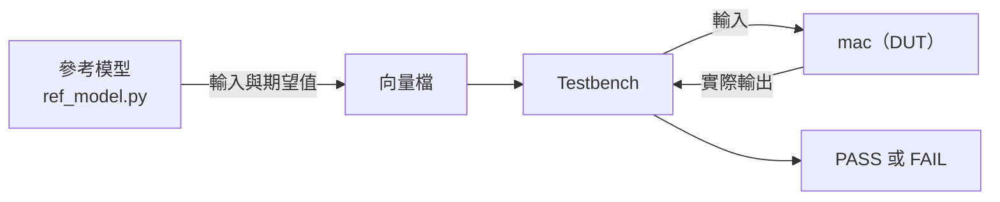

# 第 6 章　驗證：證明設計是對的

> 📍 **設計位置**
>
> - 前一站：時脈與重置，`tiny_npu` 的時脈域和重置都規劃好了
> - **本章：用參考模型和亂數測試檢查 `mac`，找出藏在裡面的第一個問題**
> - 下一站：邏輯合成，把驗證過的 RTL 變成邏輯閘

🪜 抽象層級：規格 ▸ **RTL** ▸ 網表 ▸ 佈局 ▸ GDS ▸ 晶片

---

## 為什麼驗證這麼重要

第 0 章說過，晶片下線之後就很難修改。所以在下線之前，要盡全力證明 RTL 照著規格工作，這件事叫做**驗證**（Verification）。在很多團隊裡，驗證工程師比寫 RTL 的人還多，驗證也常常佔掉專案一半以上的時間。

驗證的基本工具是 **Testbench**：一段只在模擬器裡執行的程式。它把輸入送進被測的設計，再檢查輸出對不對。被測的設計叫做**待測設計**（Design Under Test，DUT），在這一章就是 `mac`。

> [!NOTE]
> **📖 名詞｜Testbench（測試平台）**
>
> - **定義**：在模擬器裡產生輸入、驅動被測設計、檢查輸出的驗證程式。
> - **現場用法**：常簡稱 TB，例如「TB 先接起來，跑個 smoke test 看看」。
> - **相關名詞**：DUT、參考模型、模擬器、波形
> - **常見混淆**：Testbench 不會變成電路，所以可以使用讀檔、印訊息、等待時間這些不能合成的寫法（第 4 章）。

---

## 定向測試與亂數測試

第 4 章的 3 × 4 ＋ 5 × 6 是**定向測試**（Directed Test）：工程師自己挑輸入。它能測到你想得到的情況，卻測不到你沒想到的情況。

所以驗證更依賴**亂數測試**。讓程式隨機產生輸入，並加上限制和偏好：只產生合法的值，而且特別常出現 -128、-1、0、1、127 這些邊界值。這叫**受約束的亂數測試**（Constrained Random Test）。

亂數產生的輸入，答案要由誰來算？由一個用軟體寫的**參考模型**。第 1 章的架構模型，這時就派上用場了：



亂數不是真的亂。同一個**亂數種子**（Random Seed），永遠產生同一組輸入。測試失敗時，只要記下種子，就能一模一樣地重現。

> [!NOTE]
> **📖 名詞｜參考模型（Reference Model）**
>
> - **定義**：用軟體寫成、能依照規格算出正確答案的模型，用來和 RTL 的輸出比對。
> - **現場用法**：常叫 golden model，例如「RTL 跟 golden model 對不起來」。
> - **相關名詞**：架構模型、亂數種子、比對器
> - **常見混淆**：參考模型也可能寫錯。它和 RTL 最好由不同的人，各自依照規格寫出來，才不會犯同樣的錯。

---

## 抓到第一個問題

用種子 1 產生 8 組點積，每組 25 項，加上每組開頭的清除，一共 208 筆檢查。第 4 章的 `mac` 錯了 195 筆。

第一筆錯誤是 -127 × -49。正確答案是 6,223，`mac` 卻算出 26,703。26,703 正好是 129 × 207，而 129 和 207，就是 -127 和 -49 被當成無號數時的值（第 3 章）。

原因是第 4 章的埠沒有宣告 `signed`，Verilog 預設把它們當成無號數。修正的方法是把三個埠都宣告成有號數，這就是 `rtl/mac_ch06.v`：

```verilog
    input  wire signed [7:0]  a,
    input  wire signed [7:0]  b,
    output reg  signed [23:0] acc
```

3 × 4 ＋ 5 × 6 全是正數，有沒有宣告 `signed` 結果都一樣，所以定向測試抓不到。這正是亂數測試的價值。

> [!TIP]
> **🔧 Know-how｜運算式裡只要有一個無號數，整個運算式都會變成無號運算**
>
> - **情境**：把 `a`、`b` 宣告成 `signed`，卻忘了 `acc`。
> - **做法**：同一個運算式裡的運算元，全部宣告成有號數；不確定時用 `$signed()` 明確轉換。Lint 工具也能找出有號數和無號數混用的地方。
> - **為什麼**：這是 Verilog 的規則：只要有一個運算元是無號數，整個運算式都會當成無號數計算，負數就不會做符號延伸。C 語言的 `int` 和 `unsigned int` 混用，也有類似的規則。
> - **沒做會怎樣**：實際試過，只改 `a` 和 `b`、不改 `acc`，208 筆仍然錯 195 筆。正數的測試全部通過，問題一路藏到很後面。
> - **相關章節**：[第 3 章 組合邏輯與循序邏輯](../../1-digital-logic/03-combinational-and-sequential/README.md)

---

## 測完了嗎：覆蓋率

怎麼知道測試做得夠不夠？用**覆蓋率**來量。

- **程式碼覆蓋率**：RTL 的每一行、每一個分支，有沒有被執行過。`mac` 的程式碼只有幾行，跑完亂數測試，重置、清除、累加每個分支都走過了，程式碼覆蓋率是 100%。
- **功能覆蓋率**：規格裡的每一種情況，有沒有真的發生過。例如「累加器往正的方向超出範圍」「往負的方向超出範圍」「`LEN` 是 1」。

程式碼覆蓋率有一個盲點：它只能量「寫出來的程式碼」。規格要求的飽和，第 4 章根本沒有寫，所以沒有任何一行程式碼沒被執行。這組亂數測試的點積只有 25 項，累加器的值最大也只到五萬多，離 24 位元的上限八百多萬還很遠。

> [!NOTE]
> **📖 名詞｜覆蓋率（Coverage）**
>
> - **定義**：衡量測試是否足夠的指標。程式碼覆蓋率看 RTL 有沒有被執行過，功能覆蓋率看規格裡的情況有沒有被測到。
> - **現場用法**：「coverage 收到 100% 才能 signoff」「這個 corner 還沒 cover 到」。
> - **相關名詞**：驗證計畫、斷言、回歸測試
> - **常見混淆**：程式碼覆蓋率 100% 不代表沒有錯誤。沒有寫出來的功能，根本沒有程式碼可以量。

> [!TIP]
> **🔧 Know-how｜驗證計畫要從規格逐條寫出來**
>
> - **情境**：開始驗證之前，要決定測哪些東西。
> - **做法**：把規格書一條一條讀過，每一條都寫成驗證計畫的一個項目，並對應到測試和功能覆蓋率。寫好之後，請設計者和架構師一起檢查。
> - **為什麼**：照著 RTL 寫測試，只會檢查 RTL「做了什麼」，不會檢查它「該做什麼」。
> - **沒做會怎樣**：規格裡有、但沒人實作的功能，也不會有人去測。第 15 章的 `mac` 就是這樣出事的。
> - **相關章節**：[第 15 章 晶片回來之後](../../4-to-the-fab/15-after-silicon/README.md)

---

## 其他驗證方法

- **斷言**（Assertion）：寫在設計或 Testbench 裡、永遠必須成立的規則，例如「`BUSY` 和 `DONE` 不會同時是 1」。模擬時一旦違反，馬上報錯。
- **形式驗證**（Formal Verification）：不靠輸入，用數學方法證明某個性質對「所有可能的輸入」都成立。適合用在小而關鍵的電路。
- **回歸測試**（Regression Test）：每晚用不同的種子把所有測試重跑一遍，確認新的修改沒有弄壞舊的功能。
- **FPGA 原型**：把 RTL 放進 FPGA 裡跑。速度比模擬快成千上萬倍，下線前就能跑真正的神經網路和韌體。

大型專案通常用 SystemVerilog 和業界標準的 **UVM**（Universal Verification Methodology，IEEE 1800.2）建立可以重複使用的 Testbench。

> [!IMPORTANT]
> **💻 軟體對照｜驗證像寫單元測試，但標準高得多**
>
> - **像什麼**：單元測試、持續整合，以及用亂數輸入找錯誤的模糊測試（Fuzzing）。
> - **不一樣的地方**：軟體出錯可以發布修正；晶片不行。而且模擬一顆大晶片，比真正的晶片慢上百萬倍以上，真實晶片跑一秒的工作，模擬可能要跑好幾天，不可能什麼都測。
> - **所以要注意**：測試要測得聰明：從規格寫出驗證計畫，用受約束的亂數和功能覆蓋率找出沒測到的地方，而不是一直增加測試次數。

---

## 🧪 跟著做：用參考模型抓出 signed 錯誤

在 `practice/` 資料夾裡執行。先用參考模型產生亂數測試，種子是 1：

```bash
python3 ref_model.py random --seed 1 > vectors/random.txt
head -n 3 vectors/random.txt
```

```text
1 0 0 0 0
0 1 -127 -49 6223
0 1 80 50 10223
```

第一行是清除，之後每一行是一組 `a`、`b`，最後一欄是參考模型算出的累加器值。拿第 4 章的 `mac` 來跑：

```bash
iverilog -o sim rtl/mac_ch04.v tb/tb_mac.v
vvp sim +vec=vectors/random.txt
```

```text
MISMATCH at line 2: a = -127, b = -49, expected 6223, got 26703
MISMATCH at line 3: a = 80, b = 50, expected 10223, got 30703
MISMATCH at line 4: a = -12, b = -73, expected 11099, got 75355
FAIL: 195 of 208 checks failed
```

換成宣告了 `signed` 的版本，再跑一次亂數測試，也把第 4 章的定向測試重跑一次：

```bash
iverilog -o sim rtl/mac_ch06.v tb/tb_mac.v
vvp sim +vec=vectors/random.txt
vvp sim +vec=vectors/directed.txt
```

```text
PASS: 208 of 208 checks passed
PASS: 3 of 3 checks passed
```

修好新問題之後，把舊的測試也重跑，確認沒有弄壞原本的功能，這就是最小的回歸測試。想看波形，可以在 `vvp` 那一行加上 `+vcd`，再用 GTKWave 打開產生的 `mac.vcd`。

---

## 本章重點

1. 驗證是在下線前證明 RTL 照規格工作，常常佔掉專案一半以上的時間。
2. 定向測試只測得到想得到的情況；受約束的亂數測試搭配參考模型，能找出沒想到的錯誤。
3. `mac` 的第一個問題是沒有宣告 `signed`：負數被當成無號數，正數的測試卻全部通過。
4. 程式碼覆蓋率量不到沒寫出來的功能；驗證計畫要從規格逐條寫出來。
5. 斷言、形式驗證、回歸測試與 FPGA 原型，各自補上模擬的不足。

---

## 延伸閱讀

- Janick Bergeron，《Writing Testbenches: Functional Verification of HDL Models》第二版
- Chris Spear、Greg Tumbush，《SystemVerilog for Verification》第三版
- Accellera，《Universal Verification Methodology (UVM) User's Guide》

---

[← 上一章：第 5 章 時脈與重置](../05-clocks-and-resets/README.md) ｜ [目錄](../../README.md) ｜ [下一章：第 7 章 邏輯合成 →](../07-logic-synthesis/README.md)
