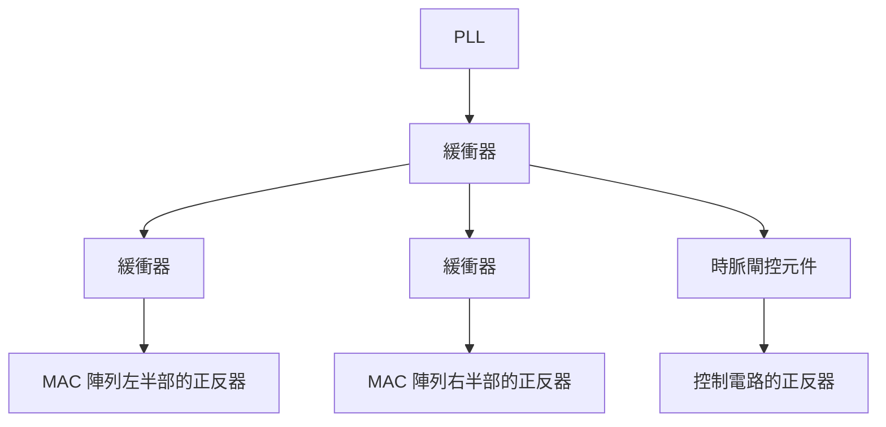

# 第 11 章　擺置與時脈樹：把元件放上去，把時脈送過去

> 📍 **設計位置**
>
> - 前一站：平面規劃與電源網路，SRAM、MAC 陣列與電源都有了位置
> - **本章：把十萬個標準元件擺進晶片，再把時脈送到每一個正反器**
> - 下一站：繞線與寄生效應，用金屬導線把所有元件接起來

🪜 抽象層級：規格 ▸ RTL ▸ 網表 ▸ **佈局** ▸ GDS ▸ 晶片

---

## 擺置：替十萬個元件找位置

標準元件的高度都一樣，所以可以一排一排地擺在電源軌之間，就像把書排上書架。**擺置**（Placement）就是替網表裡的每一個標準元件，在書架上找一個位置。

好的擺置，讓互相連接的元件靠在一起，導線短、延遲小，也比較不會擠成一團。工具通常分三步完成：

**全域擺置 → 合法化 → 擺置後最佳化**

1. **全域擺置**：先算出每個元件的大概位置，這時允許元件互相重疊。
2. **合法化**：把每個元件推到最近的合法位置，對齊元件排，不能重疊。
3. **擺置後最佳化**：依照時序結果調整元件大小、插入緩衝器，把關鍵路徑上的元件挪近一點。

`tiny_npu` 的 64 個 `mac` 結構完全相同。工具會把每個 `mac` 的幾百個元件聚在一起，形成一格一格整齊的陣列。

> [!NOTE]
> **📖 名詞｜使用率（Utilization）**
>
> - **定義**：標準元件所佔的面積，佔核心可擺放面積的比例。
> - **現場用法**：「這一版 utilization 開 70%，MAC 陣列那邊已經到 85% 了。」
> - **相關名詞**：擁塞、填充元件、晶粒面積
> - **常見混淆**：使用率不是越高越好。太高會繞不過去，而且之後插入緩衝器、放 ECO 用的備用元件，都需要空間。

元件擺得太擠，同一塊區域要通過的導線，比那裡能走的軌道還多，叫做**擁塞**（Congestion）。MAC 陣列裡乘法器的連線又多又亂，是 `tiny_npu` 最容易擁塞的地方。

> [!TIP]
> **🔧 Know-how｜在重要的邏輯附近，預先撒一些備用元件**
>
> - **情境**：下線之後，如果發現一個小錯誤，最好不必重做全部的光罩。
> - **做法**：擺置時在晶片各處，特別是 MAC 陣列這種重要的邏輯附近，預先撒進一些沒有使用的**備用元件**，或是只要改金屬層就能變成邏輯閘的 **ECO 元件**。
> - **為什麼**：有了這些元件，小的修改只要重做上面幾層金屬的光罩，把它們接進電路就好，前面幾十層的光罩都不用動。
> - **沒做會怎樣**：再小的修正，都要從電晶體那一層開始重做，多花好幾個月和大筆的光罩費用。
> - **相關章節**：[第 15 章 晶片回來之後](../../4-to-the-fab/15-after-silicon/README.md)、《半導體製造概論》[第 24 章 製程如何影響韌體](https://github.com/chenwei810/Semiconductor_Manufacturing_Introduction/blob/main/zh-TW/6-beyond-the-fab/24-process-and-firmware/README.md)

擺置完成後，掃描鏈也會依照元件的實際位置重新排序，讓鏈上相鄰的正反器在晶片上也相鄰，縮短導線（第 9 章）。

---

## 時脈樹：讓時脈同時抵達每一個正反器

`tiny_npu` 有幾千個正反器，光是 64 個 `mac` 就有 2,688 個。時脈必須幾乎同時抵達每一個正反器。可是一條導線推不動幾千個負載，離 PLL 遠近不同的正反器，時脈抵達的時間也會不同。

**時脈樹合成**（Clock Tree Synthesis，CTS）用一層又一層的緩衝器，把時脈像樹枝一樣分出去，並調整每一枝的長度和緩衝器，讓每個正反器拿到時脈的時間盡量一致。

時脈從源頭走到正反器的時間叫**插入延遲**（Insertion Delay）；同一個時脈抵達不同正反器的時間差，叫做**時脈偏移**。時脈樹每一拍都在切換，緩衝器又多，常常是晶片裡最耗電的一張網，所以第 5 章的時脈閘控元件也會擺在樹的分枝上。

> [!NOTE]
> **📖 名詞｜時脈偏移（Clock Skew）**
>
> - **定義**：同一個時脈抵達不同正反器的時間差。
> - **現場用法**：常直接說 skew，例如「CTS 之後這一區的 skew 還是太大」。
> - **相關名詞**：時脈樹、插入延遲、時脈抖動、有用偏移
> - **常見混淆**：skew 是「不同地點」之間的時間差；**時脈抖動**（Jitter）是「同一個地點」每一拍之間的時間變化，主要來自 PLL 和電源雜訊。

🔍 深入一點：把偏移當成工具

時脈偏移不一定是壞事。假設路徑 A→B 太長，B→C 卻很短。如果故意讓時脈晚一點到達 B，A→B 這一段就多出一點時間；B→C 那一段少了同樣多的時間，但它本來就很寬裕。

這種刻意安排的偏移叫做**有用偏移**（Useful Skew），等於讓長路徑向下一段借時間。它是時序收斂的常用手段之一，代價是 hold 的分析變得更複雜：讓時脈晚到，就等於讓前一級的資料更容易太早抵達。

> [!TIP]
> **🔧 Know-how｜時脈樹建好之後，才開始修 hold**
>
> - **情境**：時脈樹建好之前，STA 假設時脈同時抵達所有正反器。
> - **做法**：先只看 setup；建好時脈樹、用真實的時脈抵達時間重新分析之後，才插入延遲緩衝器修 hold。
> - **為什麼**：時脈樹建好之前，不知道真正的偏移是多少。這時候修 hold，常常修錯地方，或修得太多。
> - **沒做會怎樣**：多插了一堆不需要的緩衝器，浪費面積和功耗，還拖慢了 setup；真正違規的路徑反而還在。
> - **相關章節**：[第 8 章 靜態時序分析](../../2-front-end/08-static-timing-analysis/README.md)

> [!IMPORTANT]
> **💻 軟體對照｜時脈樹像替所有伺服器對時**
>
> - **像什麼**：用網路校時，讓每台伺服器的時間一致，日誌才對得起來。
> - **不一樣的地方**：伺服器之間的時間差個幾毫秒，通常沒關係；晶片裡差幾十皮秒，資料就可能被拍錯。而且這個時間差是導線長度和緩衝器決定的物理量，晶片做好就固定了，不能事後用軟體校正。
> - **所以要注意**：時脈是晶片裡負載最多、切換最頻繁、對雜訊最敏感的訊號。它在實體設計裡永遠被優先處理。

---

## 本章重點

1. 擺置把標準元件一排排地放進核心，分成全域擺置、合法化與擺置後最佳化三步。
2. 使用率太高會造成擁塞；要留空間給緩衝器和 ECO 用的備用元件。
3. 預先撒進備用元件，下線後的小修正就可能只改金屬層。
4. 時脈樹用一層層的緩衝器，讓時脈幾乎同時抵達每個正反器；偏移和抖動都會吃掉時序餘裕。
5. 時脈樹建好之後，才用真實的時脈抵達時間修 hold。

---

## 延伸閱讀

- Andrew B. Kahng、Jens Lienig、Igor L. Markov、Jin Hu，《VLSI Physical Design: From Graph Partitioning to Timing Closure》，第 4、7 章
- 《半導體製造概論》[第 24 章 製程如何影響韌體](https://github.com/chenwei810/Semiconductor_Manufacturing_Introduction/blob/main/zh-TW/6-beyond-the-fab/24-process-and-firmware/README.md)

---

[← 上一章：第 10 章 平面規劃與電源網路](../10-floorplan-and-power/README.md) ｜ [目錄](../../README.md) ｜ [下一章：第 12 章 繞線與寄生效應 →](../12-routing-and-parasitics/README.md)
