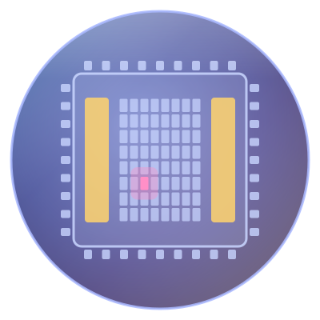
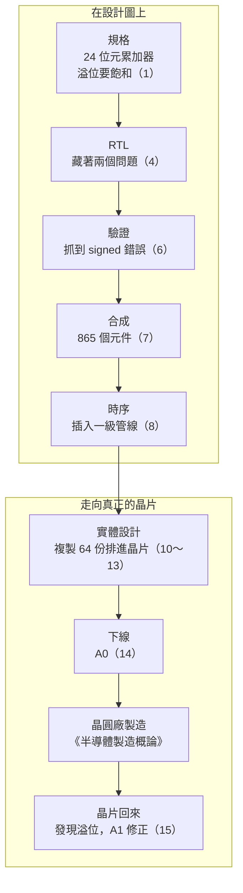

<div align="center">



# IC 設計概論

**跟著一個乘加單元，走完從程式碼到晶片的旅程**

🌐 **繁體中文** ｜ [English](../en/README.md) ｜ [日本語](../ja/README.md) ｜ [한국어](../ko/README.md) ｜ [總覽首頁](../README.md)

</div>

---

## 這本書在講什麼

晶圓廠用數十片光罩，在晶圓上一層一層做出數十億個電晶體。可是光罩上的圖形，是誰畫的？又是怎麼畫出來的？

這本書是《[半導體製造概論](https://github.com/chenwei810/Semiconductor_Manufacturing_Introduction)》的前傳。它跟著兩個主角走：

- **一顆晶片**：`tiny_npu`，一顆小型的 AI 推論晶片。它有 64 個乘加單元、兩塊記憶體，以及讓 CPU 下指令的介面。
- **一個單元**：`mac`，其中一個乘加單元。它從規格書上的一句話開始，被寫成十幾行 Verilog，被測出錯誤、合成成近千個邏輯閘、複製 64 份排進晶片，最後在真正的晶片上露出一個藏了很久的問題。

書裡不寫艱深的公式，而是專注在三件事：

- **流程**：每一步在做什麼，為什麼要這樣做，做壞了會怎樣。
- **名詞**：中英對照，以及在 IC 設計現場實際怎麼使用這些詞。
- **Know-how**：教科書不太寫、但在專案裡一定會遇到的事。

## 適合誰讀

| 讀者 | 讀什麼 | 讀完能做到 |
|---|---|---|
| 🌱 理工背景，但沒碰過 IC 設計 | 正文，跳過「深入一點」 | 說出一顆晶片從規格到下線的每一步，以及現場常用的名詞 |
| 🎓 電機、資工系學生 | 全部，包括「深入一點」與「跟著做」 | 理解每一步背後的原理，並用開源工具親手跑一遍 |
| 💻 軟體與韌體工程師 | 正文，特別留意「軟體對照」 | 知道硬體和軟體真正不一樣的地方，和硬體團隊溝通時不再雞同鴨講 |

不需要電路學或半導體物理的背景。會寫一點程式更好，不會也沒關係。

## 每一章都有的小幫手

| 標示 | 內容 |
|---|---|
| 📍 設計位置 | 兩個主角現在走到旅程的哪一站，前一站和下一站是什麼 |
| 🪜 抽象層級 | 本章在「規格 ▸ RTL ▸ 網表 ▸ 佈局 ▸ GDS ▸ 晶片」的哪一層 |
| 📖 名詞框 | 定義、現場用法、相關名詞，以及最容易搞混的地方 |
| 🔧 Know-how 框 | 現場的做法，以及「為什麼要這樣做、沒做會怎樣」 |
| 💻 軟體對照 | 和軟體開發像在哪裡，更重要的是不一樣在哪裡 |
| 🔍 深入一點 | 給電機、資工系的原理說明，預設收合，可以跳過 |
| 🧪 跟著做 | 第 4、6、7、8、15 章，用開源工具親手跑一遍，書上的輸出都是實際執行的結果 |

例如第 6 章驗證裡的一個 Know-how 框：

> [!TIP]
> **🔧 Know-how｜驗證計畫要從規格逐條寫出來**
>
> - **情境**：開始驗證之前，要決定測哪些東西。
> - **做法**：把規格書一條一條讀過，每一條都寫成驗證計畫的一個項目，並對應到測試和功能覆蓋率。
> - **為什麼**：照著 RTL 寫測試，只會檢查 RTL「做了什麼」，不會檢查它「該做什麼」。
> - **沒做會怎樣**：規格裡有、但沒人實作的功能，也不會有人去測。第 15 章的 `mac` 就是這樣出事的。

## 練習檔

書裡附一套練習檔，就在 [`practice/`](../practice/README.md) 資料夾：故事裡每一個版本的 `mac`、Testbench，以及用 Python 寫的參考模型。只要裝好兩個開源工具 Icarus Verilog 和 Yosys，就能在自己的電腦上重現書裡的每一段輸出。

```bash
cd practice
iverilog -o sim rtl/mac_ch04.v tb/tb_mac.v
vvp sim +vec=vectors/directed.txt +verbose
```

---

## 全書地圖

這張圖是 `mac` 走過的旅程，括號裡是章號。



第 0 章鳥瞰整個流程，第 2、3 章補上數位邏輯的基礎，第 5 章處理時脈與重置，第 9 章加入讓工廠能測試晶片的電路。

---

## 目錄

### 第 0 部　開始之前

| 章節 | 你會讀到 |
|---|---|
| [第 0 章　IC 設計全景](0-before-you-start/00-overview/README.md) | 一顆晶片從想法到下線的旅程、產業分工，以及兩個主角 |
| [第 1 章　規格與架構](0-before-you-start/01-spec-and-architecture/README.md) | 規格書、方塊圖、PPA 的取捨，以及累加器要用幾個位元 |

### 第 1 部　數位邏輯基礎

| 章節 | 你會讀到 |
|---|---|
| [第 2 章　從電晶體到邏輯閘](1-digital-logic/02-transistors-to-gates/README.md) | CMOS、邏輯閘、延遲、功耗與標準元件 |
| [第 3 章　組合邏輯與循序邏輯](1-digital-logic/03-combinational-and-sequential/README.md) | 二補數、加法器、乘法器、正反器與有限狀態機 |

### 第 2 部　前段設計

| 章節 | 你會讀到 |
|---|---|
| [第 4 章　RTL 與 Verilog](2-front-end/04-rtl-and-verilog/README.md) | 用 Verilog 寫出 `mac`，以及硬體和程式的不同 |
| [第 5 章　時脈與重置](2-front-end/05-clocks-and-resets/README.md) | PLL、跨時脈域、亞穩態、重置同步與時脈閘控 |
| [第 6 章　驗證](2-front-end/06-verification/README.md) | Testbench、參考模型、亂數測試、覆蓋率與驗證計畫 |
| [第 7 章　邏輯合成](2-front-end/07-logic-synthesis/README.md) | 標準元件庫、時序限制、網表與等價性檢查 |
| [第 8 章　靜態時序分析](2-front-end/08-static-timing-analysis/README.md) | setup、hold、slack、製程角落與管線 |
| [第 9 章　可測試性設計](2-front-end/09-design-for-test/README.md) | 掃描鏈、ATPG、MBIST 與 JTAG |

### 第 3 部　實體設計

| 章節 | 你會讀到 |
|---|---|
| [第 10 章　平面規劃與電源網路](3-physical-design/10-floorplan-and-power/README.md) | 晶片大小、巨集擺放、IR 壓降與電源域 |
| [第 11 章　擺置與時脈樹](3-physical-design/11-placement-and-cts/README.md) | 擺置、使用率、備用元件、時脈樹與時脈偏移 |
| [第 12 章　繞線與寄生效應](3-physical-design/12-routing-and-parasitics/README.md) | 金屬層、繞線、寄生萃取、串音與天線效應 |
| [第 13 章　簽核](3-physical-design/13-signoff/README.md) | 多模式多角落分析、DRC、LVS、電源簽核與豁免 |

### 第 4 部　交給晶圓廠

| 章節 | 你會讀到 |
|---|---|
| [第 14 章　下線](4-to-the-fab/14-tape-out/README.md) | GDS、光罩資料準備、OPC 與多專案晶圓 |
| [第 15 章　晶片回來之後](4-to-the-fab/15-after-silicon/README.md) | 點亮、矽後驗證、勘誤表與只改金屬層的改版 |

### 附錄

| 附錄 | 你會讀到 |
|---|---|
| [附錄 A　術語總表](appendix/glossary.md) | 全書術語的中英對照與縮寫，也是全書用詞的依據 |
| [附錄 B　設計現場行話](appendix/jargon.md) | IC 設計團隊裡常聽到的說法與例句 |
| [附錄 C　延伸閱讀](appendix/further-reading.md) | 教科書、標準與開源工具 |
| [附錄 D　Verilog 速查](appendix/verilog-quick-reference.md) | 書中用到的 Verilog 語法一覽 |

---

## 閱讀路線

依序閱讀是最完整的方式，但你也可以依照自己的需要，選一條路線開始：

| 路線 | 建議章節 |
|---|---|
| 🚀 快速認識全貌 | 第 0、1、7、10、14 章 |
| 💻 軟體與韌體工程師 | 第 0、1、3、4、6、8、15 章，以及每一章的「軟體對照」 |
| 🏭 準備進入 IC 設計業 | 依序讀完全書，特別留意第 6、8、13 章與附錄 B |
| 🔬 讀過《半導體製造概論》 | 第 0、2、10、12、13、14 章，看設計怎麼和製程接上 |
| 🧪 只想動手做 | 第 4、6、7、8、15 章的「跟著做」 |

---

## 參與這個專案

這本書是開放的專案，歡迎一起把它變得更好：

- **發現錯誤**：請到本專案的 [Issues](../../../issues) 頁面，使用「勘誤回報」範本告訴我們。
- **補充內容或圖片**：請先閱讀[貢獻指南](../CONTRIBUTING.md)和[寫作規範](../STYLE_GUIDE.md)。
- **翻譯成其他語言**：請閱讀[翻譯指南](../TRANSLATIONS.md)。

如果這本書對你有幫助，歡迎按下右上角的 ⭐ Star，讓更多人看到它。

---

## 免責聲明

- 本書內容整理自公開資料與業界通用的知識，不包含任何公司的機密資訊、內部流程或設計資料，也不包含任何晶圓廠 PDK 裡的實際數值。
- 本書與任何半導體公司、EDA 工具供應商都沒有隸屬關係。書中只寫出「跟著做」使用的開源工具名稱，不寫商用工具的名稱。
- `tiny_npu` 是為了教學虛構的晶片，規格與故事都是示意。書中的數字多半是量級或概略值，實際數值依製程、產品與公司而不同。
- 內容如有錯誤或過時之處，歡迎透過 Issue 指正。

## 授權

本書的文字、圖片與練習檔採用 [創用 CC 姓名標示－非商業性－相同方式分享 4.0 國際](../LICENSE)（CC BY-NC-SA 4.0）授權。只要註明出處、不用於商業目的，並以相同的授權方式分享，就可以自由轉載、改編與翻譯。
